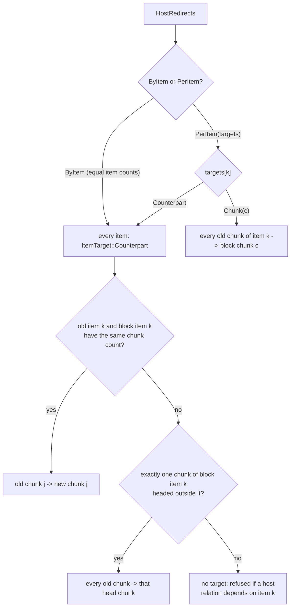

# Alignment

**Status:** Current
**Last modified:** {{git-dates:page}}

Alignment in the toolchain includes structural tier relationships, timing
binding and a separate overlap-marker pass. Tier alignment is structural (counting and
pairing AST nodes); word extraction is positional (domain-ordered token
indices).

| Layer | Where | Purpose |
|---|---|---|
| **Tier alignment** | `talkbank-model::alignment` | Main-to-dependent and dependent-to-dependent structural mappings; `%gra` uses `%mor` chunks |
| **Word timing binding** | `talkbank-model::alignment` | Count matching, lexical corroboration and sequence assessment for `%wor` observations |
| **Word extraction** | `talkbank-transform::extract` | Pull NLP-ready words from the AST in domain order |

## Tier Alignment

Computes structural correspondence and reports mismatches between the
relevant tier domains. Most pairs relate a dependent tier to the main tier;
GRA instead relates to MOR chunks, and Phon includes tier-to-tier checks.
Lives in
`crates/talkbank-model/src/alignment/`.

### GRA structural evidence

GRA validation analyzes authored dependency edges separately from MOR alignment.
A graph builder interns positive word indices into private node identities and
retains every parent edge, including competing edges for repeated indices.
Selecting the first relation would hide cycles according to source order and
break the monotone property used by recovery validation: deleting an edge cannot
create a cycle. E721 separately checks sequential word indices.

The finished graph has resolved endpoints. Iterative DFS consumes it into cycle
evidence without recursive calls or repeated relation-list searches. A borrowed
`GraStructure` retains that result and the root count for one unchanged tier.
After reporting E723/E724, whole-tier admission consumes the same analysis into
`WholeGra` when alignment evidence permits E721/E722. A detected cycle suppresses
the consequent missing-root finding. None of these intermediate types certifies
a valid dependency tree; raw model mutation requires a fresh analysis.

Coordinated replacement blocks have a stricter boundary: `BoundedBlockGraph`
checks dense ordering and in-range heads, then is consumed into
`RootedBlockGraph` only when every chain reaches its unique root. The immutable
result belongs to `SplicedBlock`. Iterative reachability caches completed paths,
so each head is traversed once even for long chains. This complete-tree admission
is distinct from the observed-edge evidence used for ordinary GRA diagnostics.

### TierDomain and PositionalDomain

```rust
enum TierDomain { Mor, Pho, Sin, Wor }        // walks, descent, word membership
enum PositionalDomain { Mor, Pho, Sin }       // counts and extraction
```

`TierDomain` is the vocabulary of the walkers and the membership rule
(`counts_for_tier`), and it has `Wor`. `PositionalDomain` is what a count or
an extraction takes (`count_tier_positions`, `collect_tier_items`,
`TierCountable`, `AlignableTier::DOMAIN`, `extract_words`), and it has no
`Wor` on purpose: the `%wor` count and pairing are
`WorMainTierProjection`'s (`MainTier::wor_projection`, then `bind_timing`
for the count and `corroborate_wor_timing` for the words), so the count and
extraction functions carry no second implementation of that count. The
overlap-marker position walk in `alignment/helpers/overlap.rs` uses
the shared `%wor` walker and advances its counter only for eligible words.
`PositionalDomain` converts into `TierDomain` infallibly; the reverse is a
`TryFrom` that refuses `Wor`.

Internally, the shared positional traversal carries a static domain through
both top-level and bracketed content. Its emitted payload is domain-indexed:
`%pho` positions can contain a word, a phonological group, or a pause, never a
sign group or action. `%mor` has no atomic-group payload; `%sin` can carry sign
groups and top-level actions. These are producer guarantees, not filters in a
phonology-specific second walk. Runtime-domain public APIs dispatch to this
same traversal; their signatures and alignment policies are unchanged.
Leaf admission emits the domain-typed position directly to the sink. The shared
walk does not receive an optional payload and re-test admission at each leaf;
only the policy owner decides whether a separator, pause or action contributes.

The measuring-group policy selects its atomic payload before constructing a
position. Mutable word traversal asks that same policy for the decision without
an AST payload, while immutable word traversal projects its answer to entered
content. Neither owns a second domain table. Existing spec/reference contracts
cover the container/domain matrix, grouped diagnostic presentation and shared
phonology indices; type-level exclusions do not replace those policy tests.

The same utterance produces different counts per membership domain:

| Rule | Mor | Pho | Sin | Wor |
|---|---|---|---|---|
| Skip retrace groups | Yes | No | No | No |
| Count pauses | No | Yes | No | No |
| PhoGroup | Recurse | Atomic (1) | Skip (0) | Recurse |
| SinGroup | Recurse | Skip (0) | Atomic (1) | Recurse |
| Include fragments (`&+`) | No | Yes | Yes | No |
| Include nonwords (`&~`) | No | Yes | Yes | No |
| Include fillers (`&-`) | No | Yes | Yes | Yes |
| Include untranscribed | No | Yes | Yes | No |
| Include tag-marker separators | Yes | No | No | No |
| `ReplacedWord` aligns to | Replacement | Original | Original | Original |

For the word filter (`counts_for_tier`), shared descent policy and content
walkers, see [CHAT Data Model](chat-model/chat-model.md). Leaf walking,
positional counting and NLP extraction consume that policy differently:
an atomic group contributes one alignment position but no extracted word.
Use the positional owner for structural counts, not the number of callbacks
from a leaf walker or the length of an extracted word list.

### Retrace handling, alignment-critical

Retraces are the most alignment-critical content type. A `Retrace` node
wraps content the speaker said then corrected.

- **Mor:** skip entirely (count `0`). The retrace was a false start;
  only the correction carries morphological analysis.
- **Pho, Sin:** recurse, words were physically produced and have
  phonological / gestural data.
- **Wor:** recurse, retrace ancestry does not change `%wor` membership.

**Critical invariant:** parsing must preserve retrace structure, including
its annotated wrapper and its position at either content layer. This includes
single-word retraces with
replacements (`word [: repl] [* err] [//]`). If a retrace is
accidentally emitted as a bare `ReplacedWord`, it counts for `%mor`
alignment, causing false E705 errors. The canonical retrace and replacement
references exercise their distinct extraction policies. Full data model + parsing
pipeline + CHAT examples in
[Retraces and Repetitions](../chat-format/retraces.md).

### AlignmentPair

```rust
struct AlignmentPair<S = usize, T = usize> {
    source_index: Option<S>,
    target_index: Option<T>,
}
```

Generic index-pair primitive. `Some`/`Some` means both indices are present;
one `None` represents a mismatch placeholder. Structural aliases retain their
index spaces: `MorAlignmentPair` uses `MainWordIndex`/`MorItemIndex`,
`PhoAlignmentPair` uses `MainWordIndex`/`PhoItemIndex`, and `SinAlignmentPair`
uses `MainWordIndex`/`SinItemIndex`. Main-tier positions remain domain-relative;
sharing `MainWordIndex` does not make Mor and Pho positions interchangeable.

Index construction is also distinct from sequence admission. Zero-based index
newtypes accept any `usize`; they identify a domain without certifying bounds
or a particular transcript. `SemanticWordIndex1` additionally excludes zero,
including on JSON import. Its `to_chunk_index()` safely subtracts one, but the
result may still exceed the MOR tier's chunk count. `MorTier::chunk_at()` takes
the raw zero-based index and returns `None` when no chunk exists. `GraHeadRef`
classifies wire zero as `Root` and positive values as word references; this
classification does not validate a dependency graph.

`is_complete()` checks only that both indices are present;
`is_placeholder()` checks for absence. Neither proves bounds, source identity
or that a producer computed the row. Likewise,
`TierAlignmentResult::is_error_free()` inspects diagnostics only, not provenance
or completeness of a publicly accumulated result.

### Per-domain results

| Type | Function | Source → Target |
|---|---|---|
| `MorAlignment` | `align_main_to_mor()` | Main → `%mor` items |
| `PhoAlignment` | `align_main_to_pho()` | Main → `%pho` tokens |
| `PhoAlignment` | `align_main_to_pho()` | Main → `%mod` tokens (the same phonology domain) |
| `SinAlignment` | `align_main_to_sin()` | Main → `%sin` tokens |
| `GraAlignment` | `align_mor_to_gra()` | `%mor` chunks → `%gra` relations |

`%gra` aligns to `%mor` *chunks*, not items. Clitics create additional
chunks (`pro|it~v|be&PRES` = 2 chunks: main + post-clitic).

### Trait abstractions

| Trait | Purpose | Implementors |
|---|---|---|
| `IndexPair` | `source()`/`target()` on any pair type | `AlignmentPair`, `GraAlignmentPair` |
| `TierAlignmentResult` | `pairs()`/`errors()`/`push_*()` accumulator | Structural alignment result types |
| `AlignableTier` | What a structural tier provides for generic alignment | `PhoTier`, `SinTier` |
| `TierCountable` | `count_tier_positions()` / `collect_tier_items()` methods, over a `PositionalDomain` | `[UtteranceContent]` |

The generic `positional_align()` function uses `AlignableTier` to
eliminate duplication: `align_main_to_pho()` and `align_main_to_sin()` are
thin wrappers around it. `%mor` does not use it because it has additional
terminator validation logic. `%gra` does not use it because its source is
`MorTier`, not `MainTier`.

### `%wor` drift is not a structural alignment error

`%wor` is a timing-annotation sidecar, not a structural dependent tier.
`validate_alignments()` does **not** reject a `%wor` word-count mismatch.
This does not exempt `%wor` syntax, word bullets or media-linkage evidence
from their own validation rules.

Consumers that need timings call `bind_wor_timing()`. Its typestate result is
one of `Missing`, `Drifted`, or `CountMatched`. A
`CountMatchedWorTimings` value exposes the common count and borrowed word pairs
after equal counts have been observed under the named `FilteredLexicalV1`
membership policy. The borrowed words retain their original model fields;
count matching does not admit those fields as corroborated timing. Position
permits the next comparison. Callers that need timing slots must pass
that state to `corroborate_wor_timing()`, which compares the parsed `%wor`
display tokens with the canonical display sequence derived from the main tier.
Only `CorroboratedWorTimings` exposes positional slots. Each such slot takes
lexical identity from the main tier and timing from the corresponding `%wor`
word bullet. `%wor` text may refuse unsafe reuse but cannot supply lexical
identity. A present but untimed slot is `WorSlotTiming::Unaligned`; it is not
conflated with a missing tier or count drift.

When the sidecar is already present, use
`main.wor_projection().bind_present_timing(wor)`: it returns either count-matched
evidence or count drift, never a missing-tier state. The optional binding route
delegates to this same comparison after handling absence.

`MainTier::wor_projection()` is the single owner of current Wor-domain
selection. Both `%wor` generation and timing binding travel through that typed
projection and share its membership policy. This does not establish that timing
is acoustically correct or that separately edited model fields remain aligned. See
[`%wor` Timing Semantics](wor-timing.md) for the complete contract and research
boundary.

### Phon tier-to-tier alignment

A second class of alignment that operates **between dependent tiers**:

| Source | Target | Code |
|---|---|---|
| `%modsyl` | `%mod` | E725 |
| `%phosyl` | `%pho` | E726 |
| `%phoaln` | `%mod` | E727 |
| `%phoaln` | `%pho` | E728 |

Derived-view alignments: `%modsyl` is a syllabified reannotation of
`%mod`, `%phosyl` of `%pho`; those counts match directly. `%phoaln`
advances the two source tiers independently: a one-sided pause consumes a
slot only on the tier bearing it. Utterance-owned `PhoalnWordBinding` values
carry the alignment word and its bound source items. Both effective counts
and reconstruction checks consume those bindings; neither consumer indexes
the source tiers by raw alignment-word position. Missing source items remain
distinct from slots intentionally absent for an opposite-side pause.
`compute_alignments()` performs these checks after its main-tier alignment
steps and may report E727 and E728 simultaneously. Ordinary non-pause insertions/deletions still consume
both word slots.

These diagnostics describe the supplied CHAT tiers, not the provenance or
cause of a mismatch. See
[Interpreting mismatches](../chat-format/phon-tiers.md#interpreting-mismatches)
for the boundary between structural validation and transcription repair.

### Parse-health gating

Alignment diagnostics honor `ParseHealth` metadata. If a dependent
tier's domain is parse-tainted, mismatch errors for that domain pair
are suppressed. Main-tier taint blocks all main→dependent alignments.
Dependent-tier taint blocks relationships that depend on that tier: for example,
MOR taint blocks both main↔MOR and MOR↔GRA. Phon tier-to-tier checks
have their own gates (`can_align_modsyl_to_mod`,
`can_align_phosyl_to_pho`, `can_align_phoaln`).

`ParseHealthState::Unknown`, including after JSON import, cannot authorize any
alignment. Adding one tier's taint or all dependent-tier taint preserves
`Unknown`: evidence of damage cannot establish that the remaining tiers were
parsed cleanly. Tainting an already parser-backed state only withdraws trust;
it never enables an alignment that was previously unavailable.

File-level checks and derived metadata share the unknown-provenance warning
owner and direct callers to parser-backed validation. Do not stamp reconstructed
or JSON-loaded content as parser-clean merely to suppress that warning. A parser
adapter's `ParseHealth::finish_utterance` must carry the recovery evidence it
accumulated for the entire utterance; it is not a shortcut for model assembly.

Explicit [checked construction](chat-model/chat-model.md#constructing-rather-than-parsing)
is a separate admission path for assembled typed documents. Its `Constructed`
state permits alignment checking but does not claim parser provenance or source
span authority. Adding recovery taint withdraws construction admission entirely;
it must never turn construction into partially clean parser evidence.

The canonical provenance workflow checks single-tier, dependent-only and
whole-utterance trust withdrawal against parsed spec/reference models. Broad
recovery must discard cached pairs and WOR timings, retain the semantic content
and tier presence, and produce stable diagnostics on repeated recomputation.
Dependent-only recovery leaves main-tier provenance clean; whole-utterance
recovery warns about both damaged alignment sides. These are public API recovery
transitions, not claims that the clean seed files contain those parse errors.

`compute_alignments()` clears the previous alignment diagnostics and builds a
new `AlignmentSet` before replacing the utterance's stored metadata. A blocked
structural relationship retains a warning result rather than a fabricated
match; blocked WOR timing leaves no sidecar. Callers must inspect provenance
and diagnostics, not interpret a present metadata object as successful alignment.

## Word Extraction

`extract_words()` (in `crates/talkbank-transform/src/extract.rs`) uses
the content walker to pull words from the AST in domain-specific order,
over a `PositionalDomain` (`%wor` words are the projection's).
Returns `Vec<ExtractedUtterance>`; each entry carries its speaker, utterance
index, and ordered `words`. Each `ExtractedWord` carries cleaned `text`,
`raw_text`, `utterance_word_index`, and `form_type`. Its governing language
mark is private: use `language_kind()` or `resolve_language()` so resolution
retains the position captured from the source during traversal. Tag-marker
separators (`,` `„` `‡`) are included as words in Mor because they have
`%mor` items (`cm|cm`, `end|end`, `beg|beg`).

Canonical replacement/retrace references verify the extracted sequences in
all three domains. Mor uses replacement words and omits retraced material;
Pho/Sin use the eligible spoken originals, including retraced words. Ordinary
explanatory annotations do not create extra extracted words. Extraction is
read-only and must preserve the original CHAT serialization.

`count_utterance_content` counts exactly the items this extraction emits,
using the same `visit_extractable` owner with a counting sink. It is not an
alias for `count_tier_positions`: extraction emits eligible words and Mor
tag separators, not atomic groups, pauses or actions. Sharing the
`PositionalDomain` selector does not make these output index spaces identical.

## Overlap Marker Iteration

CA overlap markers (⌈⌉⌊⌋) appear at three content levels,
`UtteranceContent` (top-level), `BracketedItem` (inside groups), and
`WordContent` (intra-word, `butt⌈er⌉`). One API in
`talkbank-model/src/alignment/helpers/overlap.rs`, on the shared
`walk_content` at the `%wor` domain, with `counts_for_tier` controlling word
counter increments. That additional membership check keeps positions on the
`%wor` projection's scale; the walker alone does not count eligible words.

### `extract_overlap_info`, region-based

The marker stream owns pairing state: opening boundaries, available closing
boundaries, and consumed closing boundaries are distinct variants. Pairing
consumes only a later closing boundary of the same kind and index; there is no
parallel bitmap whose state can drift from the markers. Unmatched openings and
closings remain explicit in the result. Opening regions retain source order,
followed by orphaned closing regions in source order. This is positional
analysis, not a validity claim or an observed acoustic onset time.

Pairs markers by (kind, index) into `OverlapRegion` structs. Each
region represents a matched ⌈...⌉ or ⌊...⌋ pair. Index-aware:
`⌈2...⌉2` forms a separate region from `⌈...⌉`. Mismatched indices
leave markers unpaired. Onset-only ⌈ (without ⌉) is a legitimate CA
convention, region has `end_at_word = None`,
`is_well_paired() = false`, but `top_onset_fraction()` still works.

### Cross-utterance, `analyze_file_overlaps`

For whole-file analysis, in `overlap_groups.rs`. 1:N matching: one
top region from speaker A can match multiple bottom regions from
speakers B, C, etc. Used by E347 and `chatter inspect overlaps`.

When a turn contains multiple top regions with the same index, bottoms from
the same responding speaker distribute among vacant sibling tops before
reusing a filled sibling. Other speakers may still join a group (1:N), and
a later top with that index takes precedence for subsequent responses.
`corpus/reference/ca/overlap-siblings.cha` covers this combination with mixed
timed/untimed respondents and an interleaved comment. Its checked-admission
contract asserts the grouping independently before snapshotting region order
and timing; timing is not inferred for an untimed respondent.
Analysis consumes each bottom anchor into either a matched group or the
orphan collection. No parallel match bitmap or cloned classification input
can drift from that partition. Public analysis types and matching policy are
unchanged.

### Overlap validation

| Code | Level | Check |
|---|---|---|
| E347 | Cross-utterance | Indexed orphaned tops/bottoms after 1:N matching (error); unindexed orphans are not reported by this rule |
| E348 | Utterance | Reserved and deliberately suppressed; not an active missing-end warning |
| E373 | Utterance | Invalid overlap index values (must be 2-9) |
| E704 | Cross-utterance | Same speaker in consecutive utterances with a well-paired top region followed by a well-paired bottom region (error) |

Onset-only marking is not by itself an E348 violation. Registry status and
the retained legal control govern this boundary; do not enable a missing-end
check just because a marker has no local closing partner.

`chatter inspect overlaps <path>` is exploratory. It prints TSV rows only
for files whose recovered models contain overlaps. It currently parses with
a null diagnostic sink and does not perform checked CHAT admission, so the
report cannot certify input validity or a complete source inventory.
Its temporal heuristic compares bullet starts against the top interval with
a two-second tolerance; that is not acoustic validation.

The legacy `--database <path.jsonl>` option writes a JSON-lines report, not a
transactional database or resumable ledger. Input discovery and parser setup
precede output creation. The destination must be new: existing paths, including
input aliases and symlinks, are refused atomically rather than overwritten.
Read, record-write and final-flush failures exit unsuccessfully without the
“written” completion message. A newly created partial report is retained for
inspection, not deleted or treated as complete. Successful flushing confirms
I/O completion, not crash durability, CHAT validity or acoustic accuracy.

## Coordinated `%mor` / `%gra` replacement

`MorTier::splice_range_coordinated` (and the single-item
`splice_coordinated`) replace a contiguous range of `%mor` items and the
matching `%gra` relations in one atomic edit. A downstream code-switching
workflow can use it per language span: reparsed items replace the primary
analysis, and replacement can change chunk counts (`it's` becomes `it~'s`).
This API does not itself choose the language span or run a tagger.

The replacement is a `SplicedBlock`, built by `SplicedBlock::new(mors,
relations)` from the items and one relation per chunk in block-relative form.
Building it is the only route to a block, and it parses the relations once:
head `0` becomes the span root and every other head a `BlockChunk` (the
block's own 1-based numbering, a different space from the host's
`SemanticWordIndex1`). A block is a tree with exactly one root; a count
mismatch, a relation out of chunk order, a head outside the block, no root or
two, or a cycle is a `SplicedBlockError`, so the splice never sees one.
`SplicedBlock::root_chunk()` returns that admitted root as a `BlockChunk`.
Callers can use it for an explicit host redirect without inspecting or
validating the block's relations again. The root and relations are immutable
after admission.

The host is admitted first: each of its relations must carry its own chunk as
its index (relation `k` of the tier, from 1, has index `k`), because every
head is read as a chunk number; a host numbered otherwise is refused
(`HostIndexOutOfOrder`). Inside the splice, the numberings it moves between
are separate private types (`host_chunks.rs` beside the splice): a host chunk
before the splice (`PreChunk`), after it (`PostChunk`), a block chunk
(`BlockChunk`), and a chunk or item of the replaced range. `Geometry::locate`
sorts a pre-splice chunk into kept or replaced, and `Geometry::translate`,
which takes only a kept chunk, is the one route from the pre-splice numbering
to the post-splice one; `Geometry::place` is the one route from a block chunk.
The plan's result-numbering routes preserve these distinctions; raw wire
indices are produced only when writing result relations. A `SplicePlan` owns
exclusive borrows of both target tiers, prepares the complete replacement and
can write only those same tiers after all checks succeed. Every refusal occurs
before either tier is changed.

Four kinds of `%gra` head are rewritten, each by its own rule:

- A head inside the block becomes the block chunk placed after the host
  chunks before the range.
- The span root attaches where the caller's `SpanRoot` says:
  `UtteranceRoot` (head `0`, relation `ROOT`), or `HostChunk { chunk,
  relation }`, a host chunk named by its index BEFORE the splice, which the
  splice translates like any host head (shifted when it lies after the
  range), with the relation the span root takes under it. That relation is
  an `AttachmentRelation`, which refuses a root label, so `ROOT` under a host
  head cannot be written. `SpanRoot::from_gra_head(head, relation)` reads the
  anchor off a host relation's `GraHeadRef`.
- A host head past the replaced range shifts by `new_chunks - old_chunks`.
- A host head INTO the replaced range depended on a word, so it must land on
  the chunk of the block that stands for that word. Only the caller knows how
  old items correspond to new ones, so it states that as a `HostRedirects`
  value, and the splice validates the statement against the admitted host
  range and the block before it changes anything.



`HostRedirects::ByItem` refuses unequal item counts
(`RedirectItemCountsDiffer`). `PerItem` with the wrong number of targets, a
`Chunk` target outside the block, or a `Counterpart` for an item the block
does not have is refused (`RedirectCountMismatch`, `RedirectOutOfBlock`,
`NoCounterpart`). A dependent of an item with no unique head chunk is refused
(`NoUniqueHeadChunk`), but only when such a dependent exists. The validated
form, one target per replaced old chunk, is private to the splice and built
from the admitted host, so it cannot be validated against one range and
applied to another.

### What the splice guarantees

Host admission checks relation numbering, not complete host validity. Existing
out-of-range heads or cycles outside the affected dependency chain are not
repaired by the splice. Retain the valid-host precondition below and validate
the transformed document before publication; successful splicing alone is not
whole-document acceptance.

The splice adds no cycle and no second root: if the host `%gra` was a tree,
the result is a tree. The block is a one-rooted tree by construction; the
span root attaches to the utterance's root only when no host relation outside
the replaced range is already a root (`UtteranceRootTaken`), and to a host
chunk only when that chunk lies outside the range (`SpanRootInReplacedRange`),
within the host (`SpanRootOutOfHost`), and its own chain of heads does not
reach the range (`SpanRootDependsOnSpan`: with `x@s y@s z .` and `z -> x`,
the span `x y` cannot hang under `z`). Every refusal leaves both tiers
unchanged. The method's rustdoc carries a worked L2 example: in `dont@s:eng
mal geh .`, the span `dont` becomes `do~n't`, `mal` (a dependent of `dont`)
moves to the span root `do`, and the span root keeps depending on `geh`,
chunk 3 before the splice and 4 after it.

## Design Principles

1. **No string hacking.** All alignment operates on typed AST
   structures (`Word`, `MorTier`, `AlignmentPair`), never on serialized
   CHAT text.
2. **Domain-aware from the start.** `TierDomain` gates traversal at the
   walker level. Downstream code never re-implements retrace / group
   skipping logic.
3. **Deterministic over approximate.** Tier alignment and word
   extraction use deterministic, positional algorithms over the typed
   AST.
4. **Typed index spaces.** Structural pair aliases carry source and target
   index types rather than cloned payloads. Preserve those types through
   consumers; raw integer compatibility does not establish correspondence.
5. **Exhaustive policy review.** Prefer exhaustive matches when every content
   variant needs a policy. A wildcard compiles when a variant is added, so
   compiler success alone cannot prove all consumers were reviewed.
6. **Shared traversal.** Reuse the owning walker and membership policy rather
   than maintaining a second traversal whose domain rules can drift.

## Downstream Consumers

| Consumer | Crate | Usage |
|---|---|---|
| Validation | `talkbank-model` | Cross-tier checks (including E714/E715 and E725-E728), active overlap rules E347/E373/E704; E348 remains suppressed |
| LSP hover | `talkbank-lsp` | Show aligned tier items for word under cursor |
| Word extraction | `talkbank-transform` | NLP-ready words from utterances |
| Overlap audit | `chatter` | `chatter inspect overlaps` |
| `%wor` generation | `talkbank-model` | Build `%wor` tier from main tier |
