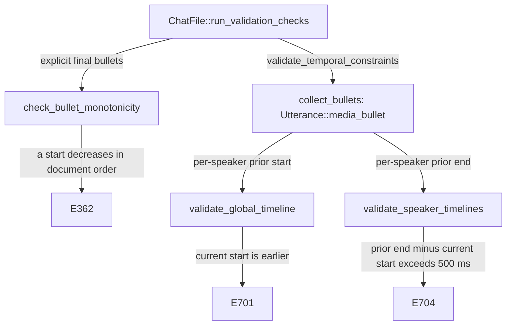

# Bullet Validation

**Status:** Current
**Last updated:** {{git-dates:page}}

Media bullets link transcript positions to unsigned millisecond offsets.
The visible `•start_end•` notation in this chapter stands for actual U+0015
delimiters. Parsing, interval validation, document ordering and acoustic
accuracy are separate questions. This chapter describes Chatter's current
checks, not a claim that its timing matches the recording.

## Current policy by timing surface

Bullets encode unsigned millisecond offsets between U+0015 delimiters; `•` is
the visible notation used in this chapter. Parsing a bullet is not proof that
its interval is valid, nor that it matches the recording.

| Surface or relationship | Current validation contract |
| --- | --- |
| Individual main-tier bullet | Positive duration: `start < end`; otherwise E362 |
| Individual `%wor` word bullet | Positive duration: `start < end`; zero or reversed duration is E362 |
| Consecutive utterance-final main bullets, in document order | Starts must be nondecreasing, regardless of speaker; otherwise E362 |
| Successive selected utterance bullets for one speaker | Starts must be nondecreasing (E701); self-overlap greater than 500 ms is E704 |
| Cross-speaker utterance end overlap | Not itself an error; E729 is not implemented |
| Adjacent words within `%wor` | Positive intervals may overlap or start out of order; no word-sequence rejection rule |
| Word timing versus the main-tier envelope | No general requirement that each word interval lie inside the main bullet |
| Missing word bullet | Legal partial timing, not a zero-duration substitute |

Equal starts pass the start-order check; touching intervals and gaps are not
errors. Exactly 500 ms of same-speaker utterance overlap passes E704. The
word-level policy does not inherit that utterance-level tolerance: it has no
adjacent-word overlap test at all. For example, `%wor` intervals `100_300`
and `200_400` are both positive and allowed, as are `300_400` followed by
`100_200`. These are structural permissions, not acoustic endorsements.

**Important scope distinction:** the global E362 check in
`ChatFile::run_validation_checks` still runs alongside the per-speaker E701
check. Thus a cross-speaker backward start can pass E701 but fail complete
validation with E362. Statements below about E701's per-speaker scope must
not be read as permission for global backward starts. Start ordering and end overlap are different relationships; permitting
conversational overlap does not disable the start-order requirement.

`%wor` has no trailing tier-level bullet. Its timing belongs to individual
words; its main tier owns the utterance span. See
[`%wor` Timing Semantics](wor-timing.md) for membership, lexical corroboration,
complete timing admission, and source-bound replacement. Zero-duration word
bullets are now invalid even in older data; this rule does not rewrite it.
The special `0_0` spelling can already fail parsing as E360, before interval
validation; it is not an accepted exception to positive duration.

### Media linkage and evidence

An utterance-final bullet, an internal main-tier bullet (including nested
content), or an actual `%wor` word bullet supplies timing evidence. A `%wor`
tier containing only untimed words does not. Timing presence does not depend
on lexical alignment or matching word counts.

- E752: timing exists but no `@Media` header declares the indexed media.
- E552: `@Media` says `unlinked` but timing exists, including `%wor`-only timing.
- E544: an expected recording is declared without a status qualifier, but
  no timing exists. A declaration of missing media is not a linkage promise.

Replacement admission may carry an E544 regeneration obligation while a
designated timing tier is removed. It must be discharged before complete
output admission; removing bad timing is not proof of successful regeneration.
None of these checks opens audio to certify recording length or acoustic
placement. Validation reports faults; it does not manufacture durations or
normalize overlapping words.

## Which bullet does each check use?

The global E362 sequence consists only of explicit utterance-final bullets,
in document order. Untimed utterances are skipped; the comparison is between
successive entries in that selected sequence, even if another utterance lies
between them.

The temporal E701/E704 sequence instead uses `Utterance::media_bullet()`.
For each utterance it prefers the explicit final bullet; if none exists, it
uses the first top-level `InternalBullet`. This fallback does not recursively
collect nested bullets and does not use `%wor`. Each speaker's successive
entries are compared independently, including across intervening speakers.

Media-linkage checks use a broader timing-evidence view, including nested
main-tier and word-tier timing. Do not substitute any one of these collections
for another merely because each contains bullets.

The following flow separates the document-order and speaker-order checks.
The owners are `model/file/chat_file/validate.rs`,
`model/file/utterance/accessors.rs`, `validation/bullet.rs` and
`validation/temporal.rs` in `talkbank-model`.

Despite its historical name, `validate_global_timeline` implements the
**per-speaker E701** check, not global E362. Each temporal pass updates its
speaker state after every selected bullet, including when it reports an
error. Neither temporal pass short-circuits the other. E362, E701 and E704
can therefore coexist on one input.

Every selected interval participates, including utterances containing only
`www`, `xxx` or `yyy`. `@Options: CA` does not bypass these checks.
The separate lexical-content predicate is not a timing exemption.

## E704 has two independent producers

Timed self-overlap compares the current selected bullet's start against the
same speaker's previous selected bullet's end. More than 500 ms reports E704;
exactly 500 ms does not. This is a comparison with the most recent selected
interval, not every earlier interval or a maximum-end envelope.

A separate cross-utterance marker check also reports E704: adjacent utterances
have the same speaker, the first has a paired top overlap region and the
second has a paired bottom region. An ordinary same-speaker continuation
without that bottom region is not enough. This path needs no bullet and has
no millisecond tolerance. See the E704 spec's paired marker controls.

The diagnostic code alone therefore does not identify which relationship
failed. Read its message and source location before proposing a correction.

## CHECK comparison: use the retained contract

The [generated CHECK assessment](errors-and-validation/check-parity-audit.md)
comes from the checked parity manifest and its retained fixtures. Its finite
claims are the comparison authority:

| CHECK case | Retained Chatter disposition |
| --- | --- |
| 82: end not after begin | E362 interval check |
| 83: begin before the previous tier's begin | E362 global start-order check |
| 133: same-speaker timed self-overlap | E704 temporal check |
| 84/85/110 with `+c0` | Recorded deliberate divergences; no strict continuity mode in Chatter |

E701 is an additional per-speaker start-order diagnostic; a numeric mapping
to CHECK 83 does not make their scopes identical. The manifest also records
fixture-specific CHECK behavior, including the three-tier witness needed for
83. Do not infer general diagnostic counts or intent from those observations.

E729 (cross-speaker overlap), E730 and E732 remain reserved and unimplemented,
not implemented checks waiting for an option. E731 does not add a second
zero-tolerance self-overlap rule; the E704 timing check owns that relationship.
The E729 and E731 specs retain default-mode overlap and exact-500-ms controls.

This chapter does not claim a current CLAN source audit, identical recovery,
identical diagnostic counts, or an implementation fault in another validator.

## Reviewing a timing finding

1. Identify the surface: final main-tier interval, fallback internal interval,
   word interval, or overlap-marker relationship.
2. Read the diagnostic message. E362 covers both individual intervals and
   global start order; E704 covers timing and marker relationships.
3. Compare against the appropriate predecessor and source span, not merely
   the preceding printed line.
4. Review the recording and transcription intent before editing. Do not sort
   turns, clamp times or remove bullets simply to silence a diagnostic.
5. Validate the reviewed result. Passing checks establish the stated structural
   rules, not acoustic correctness, complete word timing or media provenance.

For consumers needing complete positive word intervals and a timing hull, use
the checked transitions in [`%wor` Timing Semantics](wor-timing.md).
Ordinary validation permits partially timed word tiers and does not grant that
stronger capability.
