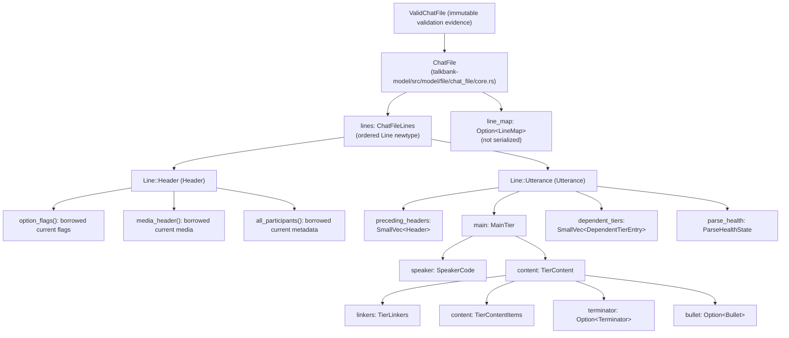
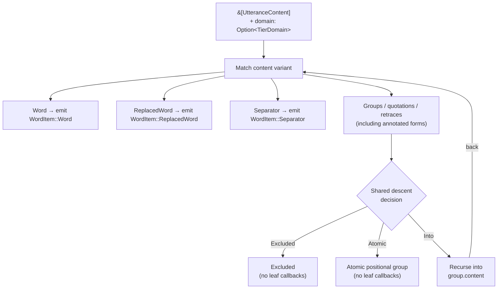
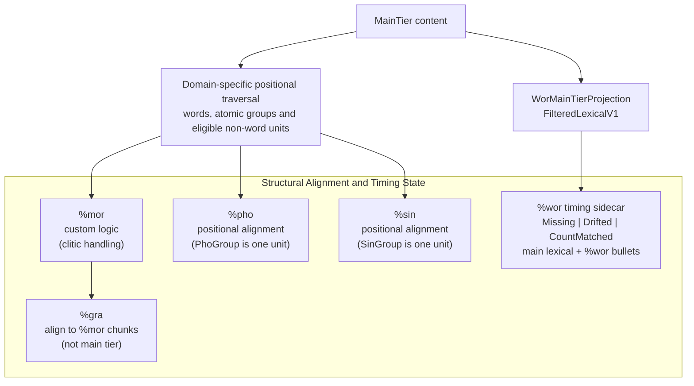

# CHAT Data Model

**Status:** Current
**Last updated:** {{git-dates:page}}

The `talkbank-model` crate defines the shared typed AST, validation and
alignment primitives used by Chatter's parsers and consumers. This page
explains model admission, the three content layers and shared traversal
owners. Downstream task orchestration is separate from these core contracts.

## Parser-neutral ownership

The shared model serves Tree-sitter and re2c on equal footing. Tree-sitter was
prototyped first; its current lowering needs do not define the model's limits.
Either parser can require changes to shared syntax, malformed-state or recovery
representations. The model is deliberately evolvable, not a fixed target for
the other backend to imitate.

Use shared types when they represent the required meaning. Keep backend-specific
carriers for parsing mechanics or syntax evidence that warrants them, and
review whether extending the shared model would remove a duplicate semantic
AST. See [backend ownership](../parser-backends.md#equal-backends-one-shared-model).

## No silent defaults or sentinels

Missing, malformed, unavailable and rejected data must remain explicit in the
types and transitions. Never substitute an ordinary model value for a fact the
producer does not know. Silent defaults and sentinels cause downstream checks
to diagnose invented data, creating spurious cascades; serializers and
transforms can then preserve the invention as if it came from the source,
causing silent corruption.

For example, a missing terminator must not become a period, failed text parsing
must not become a successful empty body, and rejected timing must not become
zero timestamps. Unknown source location is an explicit `Unlocated` state;
`0..0` is a real insertion point, not an absence marker.

Use a closed malformed/recovery variant with the evidence it needs, or an
explicit failed outcome such as `ParseOutcome::Rejected` or `Result::Err`.
Genuine source absence and genuinely empty content have their own meaning and
must not also encode parser failure. `Default`, `.unwrap_or_default()` and
fallback constructors must never manufacture semantic facts. Validation and
dependent checks may use only the facts established by the producing state.

This rule applies equally to both parsers and to shared-model changes. Adding
recovery support means representing what was observed, not weakening a checked
constructor or filling required fields with plausible placeholders. Successful
admission into `ValidChatFile` remains separate from a mutable recovery model.

Freecode and postcode payloads distinguish classified text from retained
unparsed source. Their private `TextPayload` can contain a code or missing
content; it cannot contain an unparsed lexeme. The lexer-facing constructor
consumes that classification: accepted text becomes a text payload, while
missing content retains the supplied whole lexeme as recovery. Wire-imported
text passes through the same text classifier. Validation still rejects missing
and unparsed content, and serialization preserves their respective spelling.

### Literal admission and remaining recovery boundaries

`non_empty_literal!` constructs `NonEmptyLiteral` evidence at compile time.
The public literal conversion accepts that evidence, never a raw string, so
direct callers cannot bypass the macro's check. The conversion needs no runtime
assertion. This proves non-emptiness, not CHAT lexical validity.

`NonEmptyString` has private storage and checked construction, including serde.
`RecoveryText` represents the mutable model's two observed states explicitly:
`NonEmpty(NonEmptyString)` and `Empty`. JSON still carries a string; an empty
string imports as `Empty`, survives rendering unchanged and receives the usual
contextual validation diagnostic. It cannot masquerade as admitted nonempty text.
Consuming `TryFrom<RecoveryText>` admits only the `NonEmpty` variant without
rechecking its bytes. Borrowing or rendering recovery text does not certify it.

Both parsers use this shared representation. This distinction proves lexical
non-emptiness only: whitespace can be nonempty but semantically invalid, and
whole-document acceptance still requires `validate_into`. Other model wrappers
with lenient serde retain their own validation obligations; this change does not
claim to seal every model boundary.

Language-code recovery remains permissive, including JSON readback. Rewrites
that promote a code into a declaration or utterance precode require
`RegisteredLanguageCode`, admitted by the same shape, placeholder and registry
rules used by validation. This evidence cannot be deserialized. An invalid
word or span code remains at its original site for E519; `fix-s` does not add it
to `@Languages`, and E255 does not recommend a precode for it.

Mixed and ambiguous `WordLanguageMarker` values retain their recovery-capable
lists. A resolved mixed/ambiguous result instead carries `MultipleLanguageCodes`,
whose constructor and JSON import require at least two members. Derived
`WordLanguages` metadata retains the same admitted list. Short recovery
lists report E212 and resolve to `Unresolved`, preserving the original marker.
This cardinality evidence does not establish registry membership or whole-file
validity; individual codes retain their normal validation.

### Unavailable analysis and provider transport

The shared model has no fallback constructor for `L2|xxx` morphology or `xbxxx`
cleaned text. Unavailable analysis must remain an explicit downstream outcome;
it cannot silently become a successful `MorWord`. Provider-specific substitutions
belong in a separate request type retaining the source-word association. Only
an admitted analysis may enter the shared morphology model. Do not migrate old
callers by moving the same fallback constructor into their local code.

These removals do not ban literal text in authored CHAT. The text projection
wrappers also support wire deserialization, so neither their types nor their
successful deserialization certify source provenance or CHAT validity.

### One word suffix

`Word::suffix: Option<WordSuffix>` owns the word's single `@` slot. Its variants
are `Form(FormType)` and `Language(WordLanguageMarker)`. The former independent
form and language fields could hold two individually legal markers together,
even though CHAT forbids that combination. Both parsers now admit external
field pairs with `WordSuffix::from_markers` and retain that same value through
lowering. Language rewrites mutate a borrowed language payload inside the slot.

JSON retains the `form_type` and `lang` property names. Admission refuses two
non-null values; explicit null and missing properties both express absence.
Undeclared or repeated source-marker text stays in `FormType::Undeclared`, and
shared validation reports E203 even after locations and parser diagnostics have
been lost on JSON readback. Rendering preserves recovery text and does not
certify validity.

### Custom form labels

`FormType::UserDefined(FormLabel)` represents a declared `@z:label` marker.
`FormLabel::new` admits the shared grammar's nonempty ASCII-letter, digit and
underscore alphabet without changing case or imposing a vocabulary. Both
parsers, JSON deserialization and the schema use that boundary. Construct a
custom form with `FormType::UserDefined(FormLabel::new("Code_9")?)`.
Valid JSON retains its `{"z":"Code_9"}` shape. Undeclared markers remain
`FormType::Undeclared` recovery values and still require validation; they are
never promoted to declared custom forms by replacing their text.

### Main-tier part-of-speech hints

`Word::part_of_speech` is `Option<WordPosTag>`. The present payload is nonempty
and contains only ASCII letters and colons, matching both parser grammars.
`WordPosTag::new` and JSON deserialization use the same admission boundary;
the JSON field remains a string, and its schema enforces that alphabet.
`with_part_of_speech` accepts the admitted type. Case, repeated colons and
custom labels retain their spelling; the type does not select a POS vocabulary
or infer Universal Dependencies morphology.

Native rich-word admission stores the shared tag directly, so lowering does
not reconstruct or recheck a string. Tree-sitter lowers the bound `$tag`
payload through the same constructor; a present but inadmissible payload
rejects word lowering instead of disappearing into `None`. The writer consumes
the admitted payload without repeating lexical checks. Optional absence and
parser recovery remain separate from an ordinary present hint.

### Participant role evidence

`ParticipantEntry` and joined `Participant` metadata carry `ParticipantDetails`.
`Complete { name, role }` holds an observed role and optional preceding name;
`MissingRole {}` preserves a declaration containing only a speaker code. CHAT's
positional syntax cannot identify a name without a final role token, so the
missing-role state cannot carry a name. Both parsers construct these same types.

The JSON `details` object requires a `state` tag (`complete` or `missing_role`).
Missing details and unknown fields are rejected, including a name or role attached
to `missing_role`. No deserialization default invents evidence. `name()` and
`role()` return only observed values. Rendering a role-less entry emits its code;
validation reports E513 even after JSON import. ID metadata cannot supply the
missing declaration role, and stale joined metadata cannot override declarations.
LSP speaker results expose absent roles as JSON null, and completion keeps the
known speaker with an explicit missing-role description.

Structurally damaged participant headers use `Header::UnparsedParticipants`,
which preserves their complete source, including rejected bytes. A recovered CST
may expose only a speaker prefix or promote the role token into the code position;
those leaves cannot establish identities. A rejected header remains present for
header ordering and duplicate checks, but its roster is indeterminate and its
metadata join yields no missing-ID or orphan-ID conclusions. Model validation
reports E316 after JSON import as well as on the original recovered model.

Rejected ID fields use `Header::UnparsedID`, retaining source rather than invented
metadata. They remain invalid after JSON import. When an ID's speaker is
unreadable, the join cannot prove that any unmatched declaration lacks an ID;
it withholds those missing-ID conclusions. Readable orphan IDs and birth
references remain independently checkable. Sanitization refuses the raw ID.

`participant_declaration()` admits exactly one parsed declaration. Absent,
rejected and repeated declarations have distinct errors; no first declaration
wins. The optional `participant_entries()` convenience and `declared_speakers()`
expose only admitted declarations. Merge refuses unavailable declarations before
combining speakers. The unchecked-model speaker mapping and rediarization APIs
also admit readable participant identity headers before rewriting: an unparsed
ID refuses even when the participant declaration is readable. They never report an unchanged
fallback as successful output. Sanitization refuses unparsed participant headers
because their name boundaries are unknown. Pseudonymization's validated-input
boundary excludes them. A plain role omission is narrower than structural recovery:
`CHI` still identifies CHI and uses `MissingRole {}`. A genuinely empty
source body is an empty declaration and retains E506; it is never used as
a substitute for rejected nonempty syntax.

### Unparsed dependent tiers

`DependentTier::UnparsedMor(UnparsedTier)` preserves a MOR line that a
backend could not parse, including its prefix and observed ending. Both parsers
retain this state at the original tier position. It is always invalid morphology;
JSON deserialization preserves that fact even though source locations and parser
provenance are not serialized. `mor_tier()` returns only parsed morphology.

The raw tier counts as present for duplicate and missing-tier checks, but cannot
participate in MOR alignment. Model validation reports its unparsed state instead
of checking fabricated words or a fabricated terminator. `WriteChat` preserves its
source content; the enclosing utterance owns the output line ending. This is
recovery serialization, not a validity or normalization guarantee.

Regeneration replaces this slot in place through `replace_or_add_tier`. The
lenient parsing helper may suppress owned MOR diagnostics for regeneration, but
retains the raw state and recovery provenance. Sanitization refuses unparsed MOR;
pseudonymization requires validated input. Utterance splitting applies its existing
MOR regeneration policy to both parsed and unparsed morphology.

Malformed phone alignment and interval syntax uses
`DependentTier::UnparsedPhoaln(UnparsedTier)` and
`DependentTier::UnparsedXphoint(UnparsedTier)`. Both backends retain the original
source and tier position rather than dropping the line or relabeling a supported
tier as unsupported. These variants reuse the same raw-source payload as MOR;
the enclosing enum states which tier failed. No parsed pairs or intervals exist.

The model rejects all three recovery variants after construction or JSON import.
Their presence withdraws the corresponding alignment trust. Regeneration can
replace the matching parsed or unparsed tier in its original slot. Sanitization
and utterance splitting drop raw phonological tiers under the same policy as
parsed phonological tiers. Genuinely empty parsed tiers remain separate from
malformed source and continue to receive the empty-content diagnostic.

## Custom dependent-tier labels

`UserDefinedDependentTierLabel::new(text)` admits the complete custom label,
including its leading `x` and excluding the percent sign. It requires an ASCII
letter after `x`, followed by ASCII alphanumerics, and excludes structured Phon
labels owned by `spec/symbols/phon_tier_labels.json`. The grammar's structured
prefixes and the model's exclusions are generated from that same registry.
Both parser backends construct this type before building a custom tier; JSON
deserialization and JSON Schema enforce the same boundary. The label has no
mutable string access or unchecked constructor.

The former standalone `UserDefinedTier` and suffix-only `UserDefinedTierLabel`
have been removed. Neither represented the payload used by the parsers or
`DependentTier`. Callers use `UserDefinedDependentTier` with a full checked
label; the label type's Rustdoc contains a compiled construction example.

`DependentTier::Unsupported` carries a separate `UnsupportedDependentTier`
recovery payload. Its raw label remains available for unsupported-tier
diagnostics. Empty custom-tier bodies remain representable and are judged by
the existing empty-content rule independently of label admission.

## Date admission

Construct `ChatDate` through `from_text` or `new`. `Valid(CheckedChatDate)`
contains private components admitted together with the original spelling;
read them with `day()`, `month()`, `year()` and `as_str()`; match `Valid(date)`
and use these accessors. There is no independent component constructor or mutable field access.

This checks ASCII `DD-MMM-YYYY` syntax, uppercase month abbreviations and days
01–31, **not calendar validity**: impossible month/day combinations and year
0000 retain their existing admission behavior. Unsupported text is preserved
for diagnostics. JSON remains a string and deserialization uses the same
admission boundary; no unchecked payload deserialization is exposed.

## ChatFile

The root type is `ChatFile`, representing a complete CHAT transcript:

```rust,ignore
pub struct ChatFile {
    pub lines: ChatFileLines,
    pub line_map: Option<LineMap>,
}
```

Header lines are the authority for file options and media. `option_flags()`
borrows the last `@Options` header's flags (empty when absent), and
`media_header()` borrows the first `@Media` header (absent when undeclared).
These accessors preserve recovery-model selection; neither proves unique headers
or valid media linkage. Line edits take effect immediately. JSON has no duplicate
root `options` or `media` fields that could disagree with the headers. Language
declaration likewise comes from `language_declaration()`, not a cached field.
Participant metadata likewise borrows current `@Participants`, `@ID` and
`@Birth` headers through the shared join. `get_participant()` and
`all_participants()` return `ParticipantView` values; `declared_speakers()`
retains declarations even when their ID metadata is absent. The borrowed views
cannot survive header mutation. The join still reports E522/E523/E524 at parse,
transform and validation boundaries; a readable view is not validation evidence.
JSON contains no root `participants` cache. Legacy root caches are ignored on
import. For an explicitly detached snapshot, call `to_owned_participant()`.

`validate_into` consumes the mutable model using default rules and structural
alignment checks. It returns either an immutable `ValidChatFile` with
policy/name/diagnostics or a `ValidationFailure` retaining the rejected model.
Use `validate_with_policy` to select a different validation policy. The owned
diagnostic collector determines admission even if the caller's sink discards
errors; unknown or recovered parse provenance also refuses complete admission.
`into_unchecked` consumes a proof before editing.

### Constructing rather than parsing

`Utterance::new` starts with unknown provenance. Appending a dependent tier
withdraws previous provenance and derived alignment results. Read provenance
through `parse_health()`; callers cannot assign the field. Parser adapters
finish a complete utterance through their accumulated
`ParseHealth::finish_utterance`, after recording recovery across all its tiers.
That adapter is a trusted producer boundary, not a general-purpose validator.

ASR and resegmentation callers assemble typed structure, then consume the file
through `validate_construction_with_policy(policy, errors, name)`. This uses
the existing model rules, including alignment when selected, without serializing
and reparsing CHAT. Success returns `ValidChatFile`; newly admitted utterances
carry `ParseHealthState::Constructed`, **not** parser-backed `Clean`. Recorded
parser recovery still rejects. Failure withdraws new construction admission.
This proves the supplied structure under the selected policy, not completeness
relative to any original source or fidelity to audio.

Construction admission never authorizes source-byte splicing, even when copied
components retain spans. JSON omits runtime provenance and restores `Unknown`
on import; the existing JSON representation is unchanged. Consuming a proof
with `into_unchecked` withdraws its construction admission before mutation.
Parser-backed mutable models still expose content fields: callers editing those
fields must withdraw stale provenance with `forget_parse_provenance()`.
The private health field is not a claim that all mutable-model edits are sealed.

Each `Line` is either a `Header` or an `Utterance`. The main ownership relationships (not an exhaustive field inventory):



Dependent tiers are ordered `DependentTierEntry` values: each combines its
typed tier with source-separator metadata. Use tier accessors or match
`entry.tier`; do not assume a unique fixed slot for each kind. See
[Dependent Tiers](../../chat-format/dependent-tiers.md) for their representations.

## Three-Level Content Hierarchy

CHAT main-tier content has three type layers. Groups can nest recursively;
three layers does not impose a maximum tree depth. The following is a
conceptual layout, not a copy-pasteable Rust declaration.

```text
ChatFile
└── Line::Utterance
    └── MainTier
        └── TierContent
            ├── content: TierContentItems         ← Level 1
            │   ├── Word(Box<Word>)
            │   │   └── word.content()            ← Level 3
            │   ├── OverlapPoint(OverlapPoint)
            │   ├── Group(Group)
            │   │   └── BracketedContent
            │   │       └── BracketedItems        ← Level 2
            │   ├── PhoGroup, SinGroup, Quotation
            │   │   └── (same BracketedContent)
            │   ├── Retrace(Box<Retrace>)
            │   ├── Pause, Event, Separator, ...
            │   └── AnnotatedWord, AnnotatedGroup, ...
            ├── bullet: Option<Bullet>
            ├── linkers: TierLinkers
            └── terminator: Option<Terminator>
```

### Level 1, `UtteranceContent`

Read items through `utterance.main.content.content.as_slice()`. The main
categories are:

| Category | Variants |
|---|---|
| Words | `Word`, `AnnotatedWord`, `ReplacedWord` |
| Groups and quoted spans | `Group`, `AnnotatedGroup`, `PhoGroup`, `SinGroup`, `Quotation`, `AnnotatedQuotation` |
| Retraces | `Retrace`, `AnnotatedRetrace` |
| CA markers | `OverlapPoint`, `Separator` |
| Events | `Event`, `AnnotatedEvent`, `OtherSpokenEvent` |
| Actions | `Action`, `AnnotatedAction` |
| Timing | `InternalBullet` |
| Scope markers | `LongFeatureBegin/End`, `NonvocalBegin/End/Simple`, `UnderlineBegin/End` |
| Other | `Freecode`, `Pause` |

**Critical rule:** every `match` on `UtteranceContent` must explicitly
list every variant. No `_ =>` catch-alls. Project policy: silent data
loss when new variants are added is unacceptable.

### Level 2, `BracketedItem`

Content inside groups (`<...>`, `‹...›`, `〔...〕`, `"..."`) is held in
`BracketedContent`. Read `group.content.content.as_slice()` rather than
reaching into the collection wrapper's private storage.

`BracketedItem` mirrors `UtteranceContent` closely. Retrace content
(`<word word> [/]`, `word [//]`) is a dedicated `Retrace` variant at
both levels, not hidden inside `AnnotatedGroup`. Groups can nest
arbitrarily deep.

### Level 3, `WordContent`

Content inside a single word token, read through `word.content()`:

| Variant | Example |
|---|---|
| `Text` | plain text segment |
| `Phonetic` | `@u` phonetic transcription segment |
| `Shortening` | `(lo)` omitted sound |
| `OverlapPoint` | `butt⌈er⌉`, overlap inside a word |
| `CAElement` | `↑ ↓` prosody markers |
| `CADelimiter` | `° ∆` paired delimiters |
| `StressMarker` | `ˈ ˌ` |
| `Lengthening` | `:` |
| `SyllablePause` | `^` |
| `CompoundMarker` | `+` in `ice+cream` |
| `CliticBoundary` | `~` in a cliticized form |
| `UnderlineBegin/End` | scope delimiters |

**Key insight:** overlap markers can appear at all three levels, as
standalone `UtteranceContent::OverlapPoint` (space-separated:
`⌈ word ⌉`), as `BracketedItem::OverlapPoint` (inside groups), or as
`WordContent::OverlapPoint` (intra-word: `butt⌈er⌉`). Any traversal
looking for overlap markers must check all three levels.

## Annotated Wrappers and Replaced Words

### `Annotated<T>`

Adds scoped content annotations (such as `[* m]` and `[= explanation]`) to
an annotatable inner type. Retraces have their own structure:

```rust,ignore
pub struct Annotated<T> {
    pub inner: T,
    pub scoped_annotations: AnnotatedContentAnnotations, // NEVER empty
    pub span: Span,
}
```

**The annotations are never empty**, and that is enforced by the type rather
than checked afterwards: `AnnotatedContentAnnotations::new` returns `None` for
an empty list, so an annotated wrapper cannot be built without an annotation.
A construct carrying none is the BARE variant instead, and that `Option` IS the
bare-versus-annotated decision at every construction site.

At Level 1: `AnnotatedWord(Box<Annotated<Word>>)`,
`AnnotatedGroup(Annotated<Group>)`,
`AnnotatedEvent(Annotated<Event>)`,
`AnnotatedAction(Annotated<Action>)`. The same variants exist at Level 2, and
so does every bare counterpart: see
[Annotations](../../chat-format/annotations.md) for the full pairing.

### `ReplacedWord`

Represents `word [: replacement]`, a surface form with a replacement:

```rust,ignore
pub struct ReplacedWord {
    pub word: Word,
    pub replacement: Replacement,
}
pub struct Replacement {
    pub words: ReplacementWords, // nonempty checked collection
}
```

Convention when extracting words for NLP depends on the domain. Mor uses
replacement words when present because morphology follows the correction.
Wor uses the original surface word because timing follows what was spoken.

## Tier Domains

Different NLP tasks need different views of the same content. The
`TierDomain` enum controls which words count for each tier and how
groups are traversed:

| Domain | Used by | Traversal / membership distinction | Counts separators? |
|---|---|---|---|
| `Mor` | `%mor` / `%gra` alignment | Retraces and alignment-excluded annotations are omitted | Yes, `,` `„` `‡` carry mor items (`cm\|cm`, `end\|end`, `beg\|beg`) |
| `Wor` | `%wor` generation and timing binding | Excludes omissions, fragments, nonwords and untranscribed tokens; retains eligible retraced/surface words | No |
| `Pho` | `%pho` alignment | A `PhoGroup` is one positional unit; leaf walkers do not enter it | No |
| `Sin` | `%sin` alignment | A `SinGroup` is one positional unit; leaf walkers do not enter it | No |

The content walker takes `Option<TierDomain>`: `Some(domain)` for
domain-aware descent and annotation gating, `None` to traverse without that
domain filter. A walker is not itself the complete count or timing-admission
policy. Use the alignment owner for positional units and
[`WorMainTierProjection`](../wor-timing.md#current-membership-policy) for word
timing membership and binding.

In particular, an atomic group is not excluded from alignment merely because
`walk_words` emits no words for it. Positional collectors consume the shared
descent decision's atomic payload; leaf walkers consume only its entered
content. Word eligibility and non-word positional units belong to those
domain-specific consumers, not to the number of walker callbacks.

## Content Walkers

`talkbank-model` exports closure-based walkers. Two layers:

- `walk_content`: visits supported content leaves through recursive
  containers; it does not emit container wrappers or each intra-word item.
- `walk_words` / `walk_words_mut`, filtered to words / replaced words
  / separators, with domain-aware gating. They do not replace alignment counts.

Choose the owner for the question:

| Task | API |
|---|---|
| Inspect content-level leaves | `walk_content` |
| Inspect or edit word-bearing leaves | `walk_words` / `walk_words_mut` |
| Inspect words with their governing code-switch scope | `walk_words_scoped` |
| Collect or count structural alignment positions | `collect_tier_items` / `count_tier_positions`, with `PositionalDomain` |
| Determine `%wor` membership and timing bindings | `WorMainTierProjection` |

```rust,ignore
use talkbank_model::alignment::helpers::{
    walk_words, walk_words_mut,
    WordItem, WordItemMut,
    TierDomain,
};

walk_words(content, Some(TierDomain::Mor), &mut |leaf| {
    match leaf {
        WordItem::Word(word) => { /* ... */ }
        WordItem::ReplacedWord(replaced) => { /* ... */ }
        WordItem::Separator(sep) => { /* ... */ }
    }
});
```



### What `walk_words` does NOT visit

Only words and separators. Not `OverlapPoint` (any level), not
`CAElement` within words, not events / pauses / actions, not internal
bullets. Use `walk_content` for content-level leaves and inspect `Word::content()`
when the operation needs intra-word markers. It does not automatically emit
each `WordContent` item; `extract_overlap_info` below is the worked example.

### `extract_overlap_info`, overlap regions

Walks content with `walk_content` at the `%wor` domain and applies
`counts_for_tier(..., TierDomain::Wor)` when advancing word positions. That
eligibility check, not the walker alone, keeps positions on the `%wor`
projection's scale. It inspects content-level markers and markers inside
surface words, not editorial replacement words, and pairs boundaries by kind
and index (⌈ with ⌉, ⌊ with ⌋) into `OverlapRegion` structs.
Used by the alignment pipeline (onset estimation)
and the validator (pairing checks). For whole-file analysis,
`analyze_file_overlaps()` matches top regions (⌈) with bottom regions
(⌊) across utterances with 1:N support (used by E347 and
`chatter inspect overlaps`).

## Validation

Beyond what the grammar enforces, `validate_with_alignment()` checks
semantic constraints:

- `%mor` alignment: number of MOR items matches alignable main-tier words.
- `%gra` structure: sequential indices, ROOT checks, circular dependency.
- Header consistency: `@ID` codes match `@Participants`.
- Speaker references: all `*SPEAKER:` codes declared.

Structural alignment and `%wor` timing state are computed from the same typed
main-tier model:



For the alignment algorithms themselves, see
[Alignment](../alignment.md).

## Common Pitfalls

1. **Choose the required notion of adjacency.** Consecutive lexical words,
   structural alignment positions, neighboring syntax items and adjacent source
   bytes are different relationships. Recursive word traversal accounts for
   nested content, but can skip intervening non-word leaves or excluded groups;
   its consecutive callbacks do not prove source adjacency. Use the relevant
   domain projection for alignment and source-bound syntax/spacing evidence
   for lexical adjacency. Flat array indices alone do not establish either.
2. **Missing intra-word content.** Overlap markers, CA elements, and
   other markers can appear inside `Word` content. Checking only
   `UtteranceContent::OverlapPoint` misses `WordContent::OverlapPoint`
   (e.g., `butt⌈er⌉`, `a⌈nd`).
3. **Missing annotated variants.**
   `UtteranceContent::AnnotatedWord` and `AnnotatedGroup` wrap inner
   types in `Annotated<T>` and are easy to forget.
4. **`BracketedContent` access.** `Group.content` →
   `BracketedContent` → `BracketedItems`; use slice/iterator APIs rather
   than private tuple storage.
5. **Separator counter sync (Mor domain).** Tag-marker separators
   (`,` `„` `‡`) count as NLP words because they have %mor items. Any
   code counting words in the Mor domain must count these separators
   too.

## Serialization

- **CHAT**: `WriteChat` serializes supported model values. Writing is not
  validation and need not reproduce original source bytes. Renderers use
  `ChatWriter`, whose associated error belongs to the destination. Existing
  `std::fmt::Write` sinks propagate `fmt::Error`; owned-string helpers use
  `ChatString` with `Infallible`, so they cannot suppress a rendering error and
  return a partial string as success. The rendering interface accepts text,
  characters and decimal integers, not arbitrary fallible `Display` callbacks.
  Streaming failure may leave a prefix in the caller's sink; callers must handle
  the returned error. Changing an implementation requires migrating its bound
  to `W: ChatWriter` and its result to `Result<(), W::Error>`.
- **JSON**: the transcript model has a serde representation; runtime trust,
  source indexes and accepted-document evidence are not reconstructed by
  deserialization. `ValidChatFile` has no deserialization path. See the
  [JSON Schema](../../chatter/integrating/json-schema.md) for wire shape,
  which is distinct from CHAT semantic validity.
- **JSON Schema**: derived via `JsonSchema`. Run
  `just schema-gen` to regenerate
  `schema/chat-file.schema.json`.

## Memory and Interning

Storage details belong to the owning Rust types. For example, utterances use
`SmallVec` for preceding headers and dependent-tier entries, while shared
string representations avoid duplication in selected types. These choices
are not a memory bound or a performance guarantee for every transcript;
measure the operation and input population before changing them.
