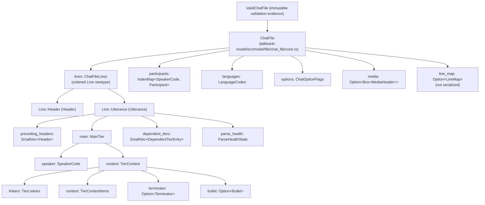
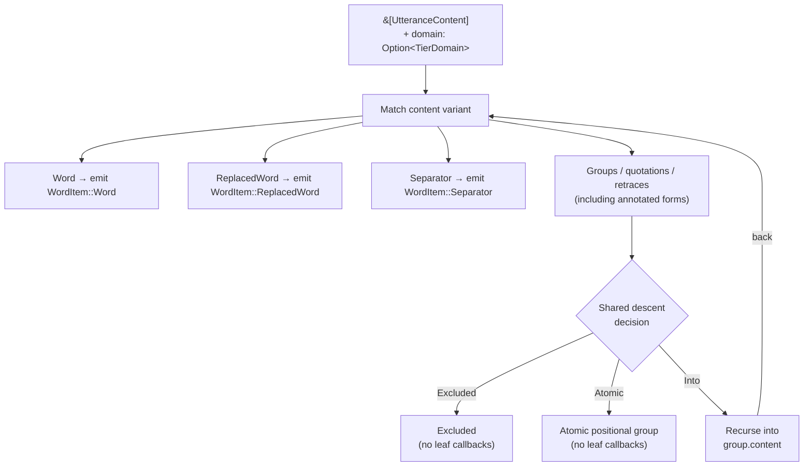
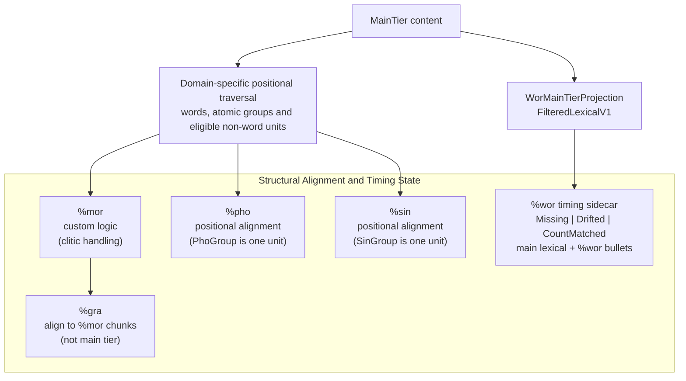

# CHAT Data Model

**Status:** Current
**Last updated:** {{git-dates:page}}

The `talkbank-model` crate defines the shared typed AST, validation and
alignment primitives used by Chatter's parsers and consumers. This page
explains model admission, the three content layers and shared traversal
owners. Downstream task orchestration is separate from these core contracts.

## Date admission

Construct `ChatDate` through `from_text` or `new`. `Valid(CheckedChatDate)`
contains private components admitted together with the original spelling;
read them with `day()`, `month()`, `year()` and `as_str()`; match `Valid(date)`
and use these accessors. There is no independent component constructor or mutable field access.

This checks ASCII `DD-MMM-YYYY` syntax, uppercase month abbreviations and days
01–31, **not calendar validity**: impossible month/day combinations and year
0000 retain their existing admission behavior. Unsupported text is preserved
for diagnostics. JSON remains a string and deserialization uses the same
admission boundary; no unchecked payload deserialization is exposed.

## ChatFile

The root type is `ChatFile`, representing a complete CHAT transcript:

```rust,ignore
pub struct ChatFile {
    pub lines: ChatFileLines,
    pub participants: IndexMap<SpeakerCode, Participant>,
    pub languages: LanguageCodes,
    pub options: ChatOptionFlags,
    pub media: Option<Box<MediaHeader>>,
    pub line_map: Option<LineMap>,
}
```

`validate_into` consumes the mutable model using default rules and structural
alignment checks. It returns either an immutable `ValidChatFile` with
policy/name/diagnostics or a `ValidationFailure` retaining the rejected model.
Use `validate_with_policy` to select a different validation policy. The owned
diagnostic collector determines admission even if the caller's sink discards
errors; unknown or recovered parse provenance also refuses complete admission.
`into_unchecked` consumes a proof before editing.

### Constructing rather than parsing

`Utterance::new` starts with unknown provenance. Appending a dependent tier
withdraws previous provenance and derived alignment results. Read provenance
through `parse_health()`; callers cannot assign the field. Parser adapters
finish a complete utterance through their accumulated
`ParseHealth::finish_utterance`, after recording recovery across all its tiers.
That adapter is a trusted producer boundary, not a general-purpose validator.

ASR and resegmentation callers assemble typed structure, then consume the file
through `validate_construction_with_policy(policy, errors, name)`. This uses
the existing model rules, including alignment when selected, without serializing
and reparsing CHAT. Success returns `ValidChatFile`; newly admitted utterances
carry `ParseHealthState::Constructed`, **not** parser-backed `Clean`. Recorded
parser recovery still rejects. Failure withdraws new construction admission.
This proves the supplied structure under the selected policy, not completeness
relative to any original source or fidelity to audio.

Construction admission never authorizes source-byte splicing, even when copied
components retain spans. JSON omits runtime provenance and restores `Unknown`
on import; the existing JSON representation is unchanged. Consuming a proof
with `into_unchecked` withdraws its construction admission before mutation.
Parser-backed mutable models still expose content fields: callers editing those
fields must withdraw stale provenance with `forget_parse_provenance()`.
The private health field is not a claim that all mutable-model edits are sealed.

Each `Line` is either a `Header` or an `Utterance`. The main ownership relationships (not an exhaustive field inventory):



Dependent tiers are ordered `DependentTierEntry` values: each combines its
typed tier with source-separator metadata. Use tier accessors or match
`entry.tier`; do not assume a unique fixed slot for each kind. See
[Dependent Tiers](../../chat-format/dependent-tiers.md) for their representations.

## Three-Level Content Hierarchy

CHAT main-tier content has three type layers. Groups can nest recursively;
three layers does not impose a maximum tree depth. The following is a
conceptual layout, not a copy-pasteable Rust declaration.

```text
ChatFile
└── Line::Utterance
    └── MainTier
        └── TierContent
            ├── content: TierContentItems         ← Level 1
            │   ├── Word(Box<Word>)
            │   │   └── word.content()            ← Level 3
            │   ├── OverlapPoint(OverlapPoint)
            │   ├── Group(Group)
            │   │   └── BracketedContent
            │   │       └── BracketedItems        ← Level 2
            │   ├── PhoGroup, SinGroup, Quotation
            │   │   └── (same BracketedContent)
            │   ├── Retrace(Box<Retrace>)
            │   ├── Pause, Event, Separator, ...
            │   └── AnnotatedWord, AnnotatedGroup, ...
            ├── bullet: Option<Bullet>
            ├── linkers: TierLinkers
            └── terminator: Option<Terminator>
```

### Level 1, `UtteranceContent`

Read items through `utterance.main.content.content.as_slice()`. The main
categories are:

| Category | Variants |
|---|---|
| Words | `Word`, `AnnotatedWord`, `ReplacedWord` |
| Groups and quoted spans | `Group`, `AnnotatedGroup`, `PhoGroup`, `SinGroup`, `Quotation`, `AnnotatedQuotation` |
| Retraces | `Retrace`, `AnnotatedRetrace` |
| CA markers | `OverlapPoint`, `Separator` |
| Events | `Event`, `AnnotatedEvent`, `OtherSpokenEvent` |
| Actions | `Action`, `AnnotatedAction` |
| Timing | `InternalBullet` |
| Scope markers | `LongFeatureBegin/End`, `NonvocalBegin/End/Simple`, `UnderlineBegin/End` |
| Other | `Freecode`, `Pause` |

**Critical rule:** every `match` on `UtteranceContent` must explicitly
list every variant. No `_ =>` catch-alls. Project policy: silent data
loss when new variants are added is unacceptable.

### Level 2, `BracketedItem`

Content inside groups (`<...>`, `‹...›`, `〔...〕`, `"..."`) is held in
`BracketedContent`. Read `group.content.content.as_slice()` rather than
reaching into the collection wrapper's private storage.

`BracketedItem` mirrors `UtteranceContent` closely. Retrace content
(`<word word> [/]`, `word [//]`) is a dedicated `Retrace` variant at
both levels, not hidden inside `AnnotatedGroup`. Groups can nest
arbitrarily deep.

### Level 3, `WordContent`

Content inside a single word token, read through `word.content()`:

| Variant | Example |
|---|---|
| `Text` | plain text segment |
| `Phonetic` | `@u` phonetic transcription segment |
| `Shortening` | `(lo)` omitted sound |
| `OverlapPoint` | `butt⌈er⌉`, overlap inside a word |
| `CAElement` | `↑ ↓` prosody markers |
| `CADelimiter` | `° ∆` paired delimiters |
| `StressMarker` | `ˈ ˌ` |
| `Lengthening` | `:` |
| `SyllablePause` | `^` |
| `CompoundMarker` | `+` in `ice+cream` |
| `CliticBoundary` | `~` in a cliticized form |
| `UnderlineBegin/End` | scope delimiters |

**Key insight:** overlap markers can appear at all three levels, as
standalone `UtteranceContent::OverlapPoint` (space-separated:
`⌈ word ⌉`), as `BracketedItem::OverlapPoint` (inside groups), or as
`WordContent::OverlapPoint` (intra-word: `butt⌈er⌉`). Any traversal
looking for overlap markers must check all three levels.

## Annotated Wrappers and Replaced Words

### `Annotated<T>`

Adds scoped content annotations (such as `[* m]` and `[= explanation]`) to
an annotatable inner type. Retraces have their own structure:

```rust,ignore
pub struct Annotated<T> {
    pub inner: T,
    pub scoped_annotations: AnnotatedContentAnnotations, // NEVER empty
    pub span: Span,
}
```

**The annotations are never empty**, and that is enforced by the type rather
than checked afterwards: `AnnotatedContentAnnotations::new` returns `None` for
an empty list, so an annotated wrapper cannot be built without an annotation.
A construct carrying none is the BARE variant instead, and that `Option` IS the
bare-versus-annotated decision at every construction site.

At Level 1: `AnnotatedWord(Box<Annotated<Word>>)`,
`AnnotatedGroup(Annotated<Group>)`,
`AnnotatedEvent(Annotated<Event>)`,
`AnnotatedAction(Annotated<Action>)`. The same variants exist at Level 2, and
so does every bare counterpart: see
[Annotations](../../chat-format/annotations.md) for the full pairing.

### `ReplacedWord`

Represents `word [: replacement]`, a surface form with a replacement:

```rust,ignore
pub struct ReplacedWord {
    pub word: Word,
    pub replacement: Replacement,
}
pub struct Replacement {
    pub words: ReplacementWords, // nonempty checked collection
}
```

Convention when extracting words for NLP depends on the domain. Mor uses
replacement words when present because morphology follows the correction.
Wor uses the original surface word because timing follows what was spoken.

## Tier Domains

Different NLP tasks need different views of the same content. The
`TierDomain` enum controls which words count for each tier and how
groups are traversed:

| Domain | Used by | Traversal / membership distinction | Counts separators? |
|---|---|---|---|
| `Mor` | `%mor` / `%gra` alignment | Retraces and alignment-excluded annotations are omitted | Yes, `,` `„` `‡` carry mor items (`cm\|cm`, `end\|end`, `beg\|beg`) |
| `Wor` | `%wor` generation and timing binding | Excludes omissions, fragments, nonwords and untranscribed tokens; retains eligible retraced/surface words | No |
| `Pho` | `%pho` alignment | A `PhoGroup` is one positional unit; leaf walkers do not enter it | No |
| `Sin` | `%sin` alignment | A `SinGroup` is one positional unit; leaf walkers do not enter it | No |

The content walker takes `Option<TierDomain>`: `Some(domain)` for
domain-aware descent and annotation gating, `None` to traverse without that
domain filter. A walker is not itself the complete count or timing-admission
policy. Use the alignment owner for positional units and
[`WorMainTierProjection`](../wor-timing.md#current-membership-policy) for word
timing membership and binding.

In particular, an atomic group is not excluded from alignment merely because
`walk_words` emits no words for it. Positional collectors consume the shared
descent decision's atomic payload; leaf walkers consume only its entered
content. Word eligibility and non-word positional units belong to those
domain-specific consumers, not to the number of walker callbacks.

## Content Walkers

`talkbank-model` exports closure-based walkers. Two layers:

- `walk_content`: visits supported content leaves through recursive
  containers; it does not emit container wrappers or each intra-word item.
- `walk_words` / `walk_words_mut`, filtered to words / replaced words
  / separators, with domain-aware gating. They do not replace alignment counts.

Choose the owner for the question:

| Task | API |
|---|---|
| Inspect content-level leaves | `walk_content` |
| Inspect or edit word-bearing leaves | `walk_words` / `walk_words_mut` |
| Inspect words with their governing code-switch scope | `walk_words_scoped` |
| Collect or count structural alignment positions | `collect_tier_items` / `count_tier_positions`, with `PositionalDomain` |
| Determine `%wor` membership and timing bindings | `WorMainTierProjection` |

```rust,ignore
use talkbank_model::alignment::helpers::{
    walk_words, walk_words_mut,
    WordItem, WordItemMut,
    TierDomain,
};

walk_words(content, Some(TierDomain::Mor), &mut |leaf| {
    match leaf {
        WordItem::Word(word) => { /* ... */ }
        WordItem::ReplacedWord(replaced) => { /* ... */ }
        WordItem::Separator(sep) => { /* ... */ }
    }
});
```



### What `walk_words` does NOT visit

Only words and separators. Not `OverlapPoint` (any level), not
`CAElement` within words, not events / pauses / actions, not internal
bullets. Use `walk_content` for content-level leaves and inspect `Word::content()`
when the operation needs intra-word markers. It does not automatically emit
each `WordContent` item; `extract_overlap_info` below is the worked example.

### `extract_overlap_info`, overlap regions

Walks content with `walk_content` at the `%wor` domain and applies
`counts_for_tier(..., TierDomain::Wor)` when advancing word positions. That
eligibility check, not the walker alone, keeps positions on the `%wor`
projection's scale. It inspects content-level markers and markers inside
surface words, not editorial replacement words, and pairs boundaries by kind
and index (⌈ with ⌉, ⌊ with ⌋) into `OverlapRegion` structs.
Used by the alignment pipeline (onset estimation)
and the validator (pairing checks). For whole-file analysis,
`analyze_file_overlaps()` matches top regions (⌈) with bottom regions
(⌊) across utterances with 1:N support (used by E347 and
`chatter debug overlap-audit`).

## Validation

Beyond what the grammar enforces, `validate_with_alignment()` checks
semantic constraints:

- `%mor` alignment: number of MOR items matches alignable main-tier words.
- `%gra` structure: sequential indices, ROOT checks, circular dependency.
- Header consistency: `@ID` codes match `@Participants`.
- Speaker references: all `*SPEAKER:` codes declared.

Structural alignment and `%wor` timing state are computed from the same typed
main-tier model:



For the alignment algorithms themselves, see
[Alignment](../alignment.md).

## Common Pitfalls

1. **Choose the required notion of adjacency.** Consecutive lexical words,
   structural alignment positions, neighboring syntax items and adjacent source
   bytes are different relationships. Recursive word traversal accounts for
   nested content, but can skip intervening non-word leaves or excluded groups;
   its consecutive callbacks do not prove source adjacency. Use the relevant
   domain projection for alignment and source-bound syntax/spacing evidence
   for lexical adjacency. Flat array indices alone do not establish either.
2. **Missing intra-word content.** Overlap markers, CA elements, and
   other markers can appear inside `Word` content. Checking only
   `UtteranceContent::OverlapPoint` misses `WordContent::OverlapPoint`
   (e.g., `butt⌈er⌉`, `a⌈nd`).
3. **Missing annotated variants.**
   `UtteranceContent::AnnotatedWord` and `AnnotatedGroup` wrap inner
   types in `Annotated<T>` and are easy to forget.
4. **`BracketedContent` access.** `Group.content` →
   `BracketedContent` → `BracketedItems`; use slice/iterator APIs rather
   than private tuple storage.
5. **Separator counter sync (Mor domain).** Tag-marker separators
   (`,` `„` `‡`) count as NLP words because they have %mor items. Any
   code counting words in the Mor domain must count these separators
   too.

## Serialization

- **CHAT**: `WriteChat` serializes supported model values. Writing is not
  validation and need not reproduce original source bytes.
- **JSON**: the transcript model has a serde representation; runtime trust,
  source indexes and accepted-document evidence are not reconstructed by
  deserialization. `ValidChatFile` has no deserialization path. See the
  [JSON Schema](../../chatter/integrating/json-schema.md) for wire shape,
  which is distinct from CHAT semantic validity.
- **JSON Schema**: derived via `JsonSchema`. Run
  `just schema-gen` to regenerate
  `schema/chat-file.schema.json`.

## Memory and Interning

Storage details belong to the owning Rust types. For example, utterances use
`SmallVec` for preceding headers and dependent-tier entries, while shared
string representations avoid duplication in selected types. These choices
are not a memory bound or a performance guarantee for every transcript;
measure the operation and input population before changing them.
