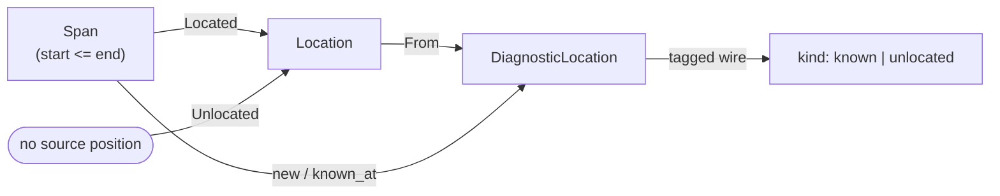
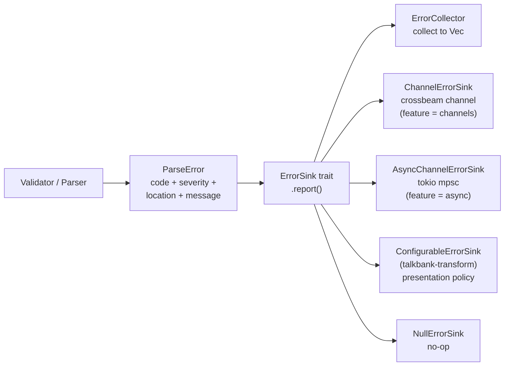

# Errors, CHAT core

**Status:** Current
**Last modified:** {{git-dates:page}}

The error infrastructure used across all CHAT-core crates
(`talkbank-model`, `talkbank-parser`, `talkbank-transform`,
`chatter`, `talkbank-lsp`). Defined in the
`errors` module of `talkbank-model`.

External runtime/application errors that live outside this repo's CHAT core are
documented separately in their owning projects. For the diagnostic UX standard
that applies within this workspace, see
[error-diagnostics-ux](error-diagnostics-ux.md).

## Core Types

### `ParseError`

CHAT parser/model findings use `ParseError`; initialization, I/O and other
application failures may use separate error types. Its main public fields are:

```rust,ignore
pub struct ParseError {
    pub code: ErrorCode,
    pub severity: Severity,
    pub location: DiagnosticLocation,
    pub context: Option<ErrorContext>,
    pub labels: Vec<ErrorLabel>,
    pub message: String,
    pub suggestion: Option<String>,
    pub help_url: Option<String>,
}
```

`ParseError::build(code)` returns a required-field typestate builder. Supply a
message and a location in either order, then call `finish()` to obtain the
diagnostic directly. Optional severity, context, suggestion and labels survive
these transitions. Typestate guarantees field presence, not source validity;
use the source-aware `DiagnosticLocation` constructors when admitting byte ranges.

```rust
use talkbank_model::{ErrorCode, ParseError};
let diagnostic = ParseError::build(ErrorCode::ParseFailed)
    .message("Input cannot be parsed")
    .at(0, 1)
    .finish();
```

`finish()` returns the diagnostic directly: there is no `try_finish()` and no
`ParseErrorBuilderError`, because an incomplete builder cannot finish. Streaming pipeline source admission
reports the producer's original diagnostic once and returns a parse failure;
it neither invents a source location nor fabricates an empty recovered document.

### `ErrorCode`

Error codes follow a structured numbering scheme:

| Range | Category |
|---|---|
| E1xx | Encoding |
| E2xx | Words and content |
| E3xx | Main tier (speakers, terminators, content, retraces) |
| E4xx | Dependent tier structure |
| E5xx | Headers |
| E6xx | Dependent tier validation |
| E7xx | Alignment and dependent-tier constraints, including Phon |
| W1xx-Wxxx | Warnings (same categories) |

The numbering is a navigational aid, not a parser/validator stage classifier.
`spec/codes/error-codes.toml` owns code identifiers, descriptions, diagnostic
kinds, implementation status and retired numbers. `spec/errors/` owns examples
and claims. There is no spec `Layer` field: the observation runner records
which stage emitted each finding. See
[Spec System](../spec-system.md#the-code-registry).

The registered generators publish the error reference into `docs/errors/`
and the book's generated error pages. Edit registry/spec owners and follow
[Spec Workflow](../../contributing/spec-workflow.md); never hand-edit a
generated code enum or error page.

### `Severity`

The core enum has `Error` and `Warning`, not an `Info` variant. Error-severity
CHAT findings block complete admission under the selected policy; warnings
remain reportable findings. An internal failure is not evidence of invalid
input, and neither a warning nor a recovered model proves input validity.
Diagnostic meaning and emission policy come from the rule, not just its code
prefix or display style.

### `DiagnosticLocation`, `Location` and `Span`

`Span` stores zero-based byte offsets as `usize`, with inclusive start and
exclusive end, in private fields, so every `Span` has `start <= end`. Trusted
producers (parsers, lexers, slice ranges) use `Span::new`, which panics on an
inverted range in every build profile: such a range is a producer bug, and it
fails where it is made rather than slicing wrongly later (wrappers that pass
offsets through are `#[track_caller]`, so the panic names the producer). In the
tree-sitter parser the span of a single CST node, for a model value, a
`DiagnosticLocation` or an `ErrorContext`, comes from one adapter, `span_of(node)`.
Bounds taken from two different tokens whose order is not guaranteed are
admitted with `Span::try_new` by the type that needs them.
Untrusted offsets use `Span::try_new` or `Span::try_from(range)`, which refuse
an inverted range, and JSON decoding goes through that check. Code that
receives a `Span` therefore never re-checks its order. A span does not prove
it belongs to a particular source.

A `Span` is pure geometry and always a real location, including `0..0` at the
start of a file. Whether something *has* a location is a separate fact, carried
by two enums:

- `Location` is `Located(Span)` or `Unlocated`, for values in the model: a
  parsed node is located, a node built programmatically or read back from AST
  JSON is not. Every model value carries `location: Location`, given to its
  constructor as the first argument (the parsers pass the node's span, a
  builder writes `Location::Unlocated`); there is no setter, default or
  sentinel span, and AST JSON carries no locations at all. A gate holds the
  tree-sitter parser at zero `Location::Unlocated` in production code, and
  the re2c parser at its measured count (its lexer keeps no offsets for the
  items inside a tier).
- `DiagnosticLocation` is `Known { span, position }` or `Unlocated`, for
  diagnostics. `position` is an optional `LineColumn`, whose one-based `line`
  and byte `column` are both `NonZeroUsize` and always travel together, so a
  line without a column cannot be represented. `From<Location>` maps the one
  onto the other.

Neither enum has an accessor that turns `Unlocated` into a default span. A
consumer that needs geometry matches and states its policy in the unlocated
arm: the LSP places an unlocated diagnostic at the document start (LSP has no
unlocated diagnostic) and skips an unlocated model value (nothing to hover,
fold or symbolize), the repair catalog refuses it
(`CatalogIneligibility::Unlocated`), source presentation reports
`DiagnosticSourceError::Unlocated`, and CLAN resolution returns
`ClanLocationError::Unlocated`. Text renderings print `location unknown`.

Two rules keep validators honest about the split:

- **Presence decides, location points.** Whether a rule fires depends on the
  construct existing in the model, never on its having a span; the span only
  chooses where the diagnostic points. E752 (timing without `@Media`) and
  E767 (whitespace before the `@Media` comma) were once gated on
  `location.span()`, which silenced both under the re2c front end.
- **A value with no location of its own reports where its parent narrowed.**
  Header payloads (participant entries, language codes, option flags, dates)
  carry no location; `check_header` narrows the `ValidationContext` to the
  header's line and `ValidationContext::field_diagnostic_location` turns that
  into the diagnostic's location, or into `Unlocated` when nothing narrowed.
  No validator writes `at_offset(0)` for a value it cannot place.



The wire form is tagged: `{"kind":"known","start":S,"end":E}`, with `line` and
`column` added together when known, or `{"kind":"unlocated"}`. Decoding goes
through a private wire type and `TryFrom`, which refuses a reversed span, a
zero line or column, and a line without its column (or the reverse). Plain
serde `flatten` over an optional position would read those as "no position"
without an error, which is why the wire type exists.

A location that moves keeps its meaning honest: `rebased` (into another
coordinate space) and `SpanShift` (after an edit that moves the span) drop the
cached position, because it described the old coordinates; a span before an
edit keeps it.

`LineColumn` counts bytes, not UTF-16 code units. LSP positions use their own
conversion helpers; do not copy CLI/source columns directly into protocol
ranges.

### `ErrorContext`

Carries the source fragment around the error location:

```rust,ignore
pub struct ErrorContext {
    pub source_text: String,
    pub span: Span, // Relative to source_text, not the document location.
    pub expected: SmallVec<[String; 2]>,
    pub found: String,
    pub line_offset: Option<usize>,
}
```

## `ErrorSink` Trait

The central abstraction for error reporting:



```rust,ignore
pub trait ErrorSink: Send + Sync {
    fn report(&self, error: ParseError);
}
```

Many lower-level parsing and validation functions stream findings to
`&impl ErrorSink`. Other APIs also return parse products or checked outcomes;
streaming does not replace those admission results. Sinks support:

- **Collecting** all errors (for batch processing).
- **Printing** errors in real-time (for interactive use).
- **Filtering** by severity or code.
- **Counting** errors without storing them.

The `Send + Sync` bounds and `&self` reporting method permit shared sinks.
Implementations provide appropriate synchronization, such as an interior
`Mutex<Vec<ParseError>>`; `&self` alone is not a thread-safety guarantee.
Discarding or filtering a finding changes reporting, not the source's validity.

`ErrorCollector` is the in-memory collector in
`errors/collectors.rs`. The stored-diagnostics role is explicit in
both code and docs.

Module layout in `talkbank-model`:

- `errors/error_sink.rs`: trait and lightweight forwarding sinks.
- `errors/collectors.rs`: in-memory collectors and counters.
- `errors/async_channel_sink.rs`: Tokio-channel streaming.
- `errors/offset_adjusting_sink.rs`: remove synthetic wrapper offsets.
- `errors/rebased_sink.rs`: translate raw document locations and labels while
  retaining the diagnostic's self-contained source context. Use before display
  enhancement converts secondary labels into snippet-relative coordinates.
- `errors/tee_sink.rs`: forward diagnostics to both sinks.

`ConfigurableErrorSink` is the one adapter that does NOT live here: it
applies a `PresentationPolicy` (what a reader is shown), which belongs to
`talkbank-transform` so that `talkbank-cache` cannot reach it and fold a
display preference into the validation cache key. See the leniency-policy
chapter.

`ChannelErrorSink` is opt-in behind the `channels` feature so the
default `talkbank-model` dependency does not pull in `crossbeam` just
to own the core error trait and in-memory collectors.

## Parser and validation observations

Parser diagnostics concern the original source and recovery. A whole-file
`ParseProduct::Built` can retain a model alongside errors; it is not the same
as successful source admission. Trait/fragment APIs return `ParseOutcome` and
stream diagnostics. Do not write a parser-spec test that assumes every fault
must prevent a model from being returned.

Model validation checks the resulting structure under the selected rules and
alignment policy. A recovered model may still yield additional findings, but
validating it cannot retroactively certify discarded source. Specs retain
parser and validation observations separately, including cases detected by
both. Their claims are evaluated by the actual spec runner, not an invented
numeric-range or layer rule. See [Validation](validation.md).

## Adding a New Error Code

1. Add the code's typed metadata to `spec/codes/error-codes.toml`. Check
   existing and retired identifiers; do not edit `generated_error_code.rs`.
2. Add reviewed examples under `spec/errors/` using the canonical format,
   including legal controls and meaningful invalid/subsumption boundaries.
3. Implement the rule at its parser/model owner, using source-bound evidence
   and the shared diagnostic constructors rather than guessed locations.
4. Follow [Spec Workflow](../../contributing/spec-workflow.md) and the root
   guidance for complete regeneration of affected registered artifacts and
   focused behavioral tests. Currency alone is not rule correctness.
5. Review actual observations and consumer-facing diagnostic output; changing
   expected output solely to match an implementation is not adjudication.
