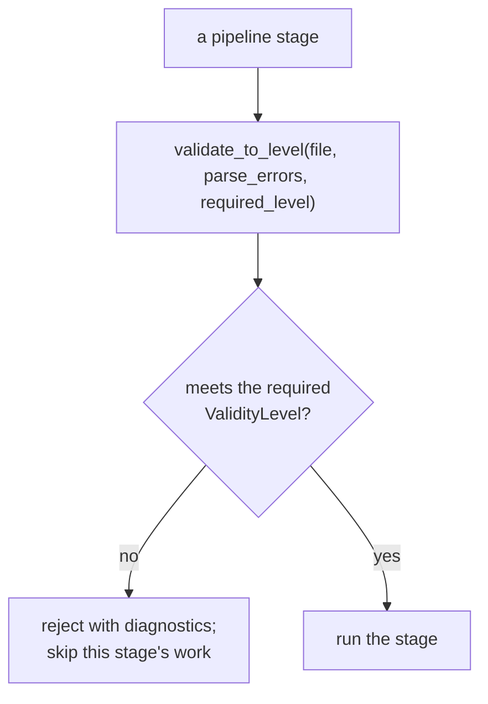

# Validation

**Status:** Current
**Last modified:** {{git-dates:page}}

Model checks, accepted-document evidence and the legacy partial checks a
pipeline may still encounter. For the
error-code infrastructure (codes, sinks, severities, layers) see
[chat-core-errors](chat-core-errors.md); for the diagnostic UX standard see
[error-diagnostics-ux](error-diagnostics-ux.md).

All validation logic is Rust. `talkbank-model::validation` owns CHAT-core
validation; `talkbank-transform` composes parsing and admission and retains the
legacy gate functions `validate_to_level` and `validate_output`.

## Choose the boundary by the evidence needed

Successful parsing, a diagnostic pass and an accepted document are different
results. A mutable `ChatFile` may contain recovered structure; a sink-based
check does not turn that model into an immutable validity certificate.

| Need | Entry point | Result and boundary |
|---|---|---|
| Inspect findings on an existing model | `ChatFile::validate`, `validate_with_rules` or `validate_at` | Streams diagnostics; does not consume the model or issue accepted-document evidence |
| Parse with optional checks | `talkbank_transform::parse_and_validate` | Mutable `ChatFile`; selected options may omit validation |
| Parse and retain model acceptance under a required policy | `talkbank_transform::parse_validated_with_parser` | `ValidChatFile`, or retained parse/validation failure evidence |
| Admit an existing parser-produced model | `ChatFile::validate_with_policy` | Consumes the model; source parsing diagnostics must already have been handled |
| Admit typed programmatic construction | `ChatFile::validate_construction_with_policy` | Checked construction, not parser-backed source provenance |
| Preserve admitted original bytes | `parse_source_with_parser(...).admit(...)` | `AdmittedSourceChat`, binding those bytes to their immutable model proof |

The required parse boundary forwards the producer diagnostics, rejects internal
failure independently of severity, rejects error-bearing or unbuildable parses,
then attempts model admission. Model admission owns its diagnostic collector:
a caller's `NullErrorSink` cannot turn rejection into success. Unknown or
recovered utterance provenance also refuses complete model admission. Ordinary
warnings are retained in successful `ValidChatFile` evidence.

The model-only convenience helper `validate_chat_file_with_options` is different:
it does not parse, uses an anonymous transcript name, and returns `Ok(())` when
validation is disabled. When it runs checks, **any** diagnostic, including a
warning, produces `Err(Vec<ParseError>)`. Do not use that return shape as though
it were `ValidChatFile` admission.

For named inputs, pass `TranscriptName::for_path` to a named entry point;
`TranscriptName::Anonymous` intentionally omits filename-dependent checks such
as E531. Model validity does not establish source completeness, transcript/audio
fidelity or byte-preserving output. Editing consumes accepted-model evidence;
revalidate after mutation. Original-byte preservation needs the separate
source-bound carrier, not just a model with spans.

See [Library Usage](../../chatter/integrating/library-usage.md#parsing-and-validating-a-chat-file)
for maintained examples and the separate replacement-admission workflow.

## Rule selection and alignment computation

`ValidationPolicy` combines `RuleSelection` with `AlignmentValidation`.
`Structure` runs model checks without precomputing tier alignments;
`IncludeTierAlignment` first computes per-utterance alignment and language
metadata, then runs the same validation pipeline with the selected rules.
`Structure` is not a command to suppress every alignment-related diagnostic:
utterance validation still reports any alignment diagnostics already stored in
the model and performs tier-local checks such as MOR content and WOR intervals.

`ChatFile::validate_into` selects default rules and `Structure`.
`ParseValidateOptions::with_alignment()` enables validation as well as alignment
computation. By contrast, `with_strict_linkers()` only selects rules: it does not
turn a parse-only option into validation. Required-policy APIs have no
parse-only state. Unchanged-source admission uses its fixed default-rule,
tier-alignment policy rather than accepting a caller-selected weaker policy.

## Timing presence is not admission

`ChatFile::timing_evidence()` observes main-tier bullets (including recursively
nested internal bullets) and actual `%wor` timing through the same owner as
E544. Its recorded witness borrows both the document and its actual bullet;
callers cannot construct a witness from unrelated values. The observation does
not validate intervals, recovery, headers or alignments, and grants no write
permission. Regeneration consumers can distinguish restored timing from an
outstanding linkage obligation while still requiring complete output admission.

## Legacy workflow validity levels

These levels are partial workflow checks, not complete CHAT-validity or output
certificates. Complete source admission and checked construction remain the
boundaries for retained input and writable output.

`ValidityLevel` (in `talkbank-model::pipeline`) is cumulative: each level
includes every check below it.

| Level | Name | Checks |
|---|---|---|
| L0 | `Parseable` | supplied parse-diagnostic slice is empty; the helper does not parse input |
| L1 | `StructurallyComplete` | nonempty declared speaker roster and language list, all utterance speakers declared, terminators present unless CA waives them |
| L2 | `MainTierValid` | L1 plus rejection of a main tier with no content, linkers or language precode |

The names are historical and broader than the checks implemented. In
particular, L2 does not validate individual words or timing intervals, and L1
does not require every declared speaker's `@ID` record. Use complete checked
admission when the consumer needs those guarantees.

```rust,ignore
use talkbank_transform::validate::validate_to_level;

// parse_errors come from the parser (typically parse_lenient).
validate_to_level(&file, &parse_errors, ValidityLevel::MainTierValid)?;
```

`validate_to_level` aggregates findings from these selected checks, not all
CHAT rules. The L0 gate surfaces the first parse error's code, source
excerpt and byte span in its message, so a user can locate the problem without
reading logs.



**A selected level cannot waive invalid retained input.** A command may tolerate
defective generated tiers only through an admitted replacement plan that
actually discards and regenerates them. Forced alignment does not acquire
complete admission merely because a file is parseable.

## Legacy output checks

`validate_output` checks selected invariants of the supplied model. It receives
neither the input document nor serialized output, so it cannot prove
preservation, absence of degradation or successful output parsing. It checks
terminator presence (with the CA exemption), then existing MOR counts for
`"morphotag"` or backwards utterance-bullet timing for `"align"`. It does not
require a missing MOR tier to appear or establish full timing validity.

**Known defect, recorded here rather than left for the next reader to
rediscover.** `validate_output` takes the command as a `&str` and dispatches
with `match command { "morphotag" => ..., "align" => ..., _ => {} }`. Two
things are wrong with that and neither is cosmetic:

- The catch-all silently skips every command-specific check. A caller passing
  a typo, or any command the match does not list, gets the terminator check
  and nothing else, with no error and no warning. It type-checks perfectly.
  `clippy::wildcard_enum_match_arm` cannot see this one, because the match is
  over an open set of strings rather than a closed enum.
- The strings name commands belonging to a downstream ML pipeline, which is
  workflow-specific knowledge embedded in a general-purpose CHAT library.

This legacy helper remains a partial check, not an output-admission API.
New integrations should use the shared checked source/construction boundaries
rather than extend the command-string dispatch. Any redesign must account for
actual consumers and the required typed policy; this chapter does not claim
that compatibility is the only remaining design issue.

## Severity posture

Complete admission distinguishes error-severity findings, warnings and internal
failures under the selected policy. A warning is not an error, but a recovered
model or a caller that discarded diagnostics cannot thereby claim valid source.
Inspect the rule definition and selected validation policy; there is no blanket
exemption making legacy `%gra` valid while checking only newly generated tiers.

Lower-level serializers can write mutable models without admission. Consumers
that require valid output must explicitly use and preserve the accepted-model
or source-admission boundary; an unvalidated write is not prevented merely by
calling a serializer.

## Verification

The commands are in [Developer Verification Checks](../../contributing/dev-checks.md)
and [Testing and Quality Gates](../../contributing/quality-gates.md); this page
does not duplicate them. Labels like `G0-G14` come from a predecessor workspace
and name nothing here.

The reference corpus is a synthesized regression signal, **not** a validity
authority; treating it as one leads someone to weaken a validator so a fixture
stays green. When a reference file fails, adjudicate tool versus data against
the rule and recorded decisions before changing either.

## Known limitations

- **`%wor` word counts are not validated against the main tier.** `%wor` is a
  timing-annotation sidecar, so legacy files may carry `xxx`, fragments or
  nonwords in `%wor` without producing alignment errors. Timing consumers can
  request a typed binding. `Drifted` fails closed without making the legacy
  file invalid. `CountMatched` permits a canonical display-token comparison
  but exposes no timing slots. Only the later `Corroborated` state exposes
  timing, so a detectable same-count lexical edit also fails closed.
- **Quotation checks depend on the selected strict-linker policy.**
  `build_validation_context` derives `enable_quotation_validation` from
  `ValidationRules::strict_linkers_enabled()`. The checks are wired through
  that policy; a custom context's default value does not describe every caller.
- **Some error specs have no validator yet.** `just spec-status` is the
  authority on which, and on how many; it derives the answer from the specs
  rather than from a count written in prose.

## Consumers outside this repository

chatter contains no ML-pipeline code. Downstream consumers embed these crates
and add their own gates, bug reporting and cache invalidation; how a given
pipeline reports a validation failure, and where it writes it, is documented by
that pipeline, not here.
