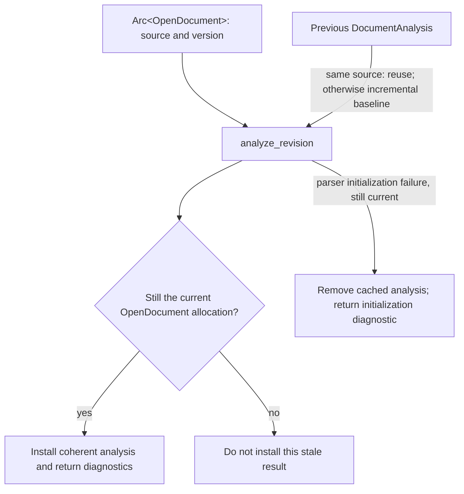

# Memory and Ownership

**Status:** Current
**Last updated:** {{git-dates:page}}

This chapter describes ownership boundaries in Chatter. Storage choices support
those boundaries; neither a shared pointer nor an owned string proves CHAT
validity, source provenance or safe reuse after an edit.

## Strings and domain values

| Representation | Role | Boundary to preserve |
| --- | --- | --- |
| `SmolStr` | Owned text with small-string storage | Use the domain wrapper's constructor; storage does not validate syntax |
| `Arc<str>` | Shared immutable text, including interned symbols and editor source snapshots | Sharing is not proof of common origin or validated content |
| `String` | Mutable owned text for assembly, messages and serialization | A newly serialized string has its own coordinates |
| `&str` | A borrowed view into an owner | Do not let the view outlive its owner or pair it with an unrelated source span |

The `string_newtype!` macro supplies a private `SmolStr` field and shared
read/serialization behavior. Its general constructor preserves input text; it
does not normalize or validate it. Types with stronger requirements use their
own checked construction. `interned_newtype!` supplies an `Arc<str>` wrapper
whose `new` and `From` paths call the selected interner. Its public tuple
field and derived deserialization are not a guarantee that every value came
through that interner.

Inspect the actual type rather than assuming all string wrappers share one
validation or allocation policy. The macro definitions live in
`crates/talkbank-model/src/model/macros.rs`.

## Process-local interning

`StringInterner` in `talkbank-model/src/model/intern.rs` owns a
`DashMap<Arc<str>, Arc<str>>`. Five `OnceLock` accessors initialize the
speaker, language, POS, stem and participant families, seed common symbols and
reuse their maps for the process lifetime.

The implementation first looks up a value and clones the stored `Arc` on a
hit. On a miss it allocates and inserts a string. These are separate operations:
concurrent first misses can return equal strings in distinct allocations.
Pointer identity is therefore not the domain's equality or provenance contract.

Initialization-once does not make map reads lock-free. The map still coordinates
concurrent access internally; avoid retaining its guards across unrelated work.
Entries have no eviction path in this implementation. Dropping a `ChatFile`
does not clear the process-global maps, so memory use depends on distinct
symbols encountered as well as concurrently live files.

Interning can avoid repeated string allocations, while cloning an existing
`Arc` shares its allocation. Neither fact supplies a corpus-wide memory-saving
percentage, contention bound or throughput guarantee. Measure the relevant
workload and dependency versions before making such claims.

## Parser and model ownership

The primary parser's `TreeSitterParser` stores a tree-sitter `Parser` in a
`RefCell`. Its methods can take a shared receiver while borrowing that parser
mutably during an operation. A shared receiver is not permission to parse
concurrently through the same instance. Reuse the established per-worker or
thread-local services instead of placing it behind an arbitrary shared
application lock.

A tree-sitter node borrows its tree; extracting text also needs the matching
source bytes. The owned `ChatFile` does not borrow the input string, but its
source spans still refer to the input revision. Ownership of model storage
does not make those spans meaningful against edited or regenerated text.

A model-only caller need not retain a CST. A source-bound `ParsedRevision`,
as used by editor analysis, retains the revision evidence needed for incremental
parsing. Do not assume every tree is dropped immediately after lowering.

Validation borrows the model and reports through an `ErrorSink`. The sink
may collect diagnostics or stream them; the interface does not promise
allocation-free validation. A recovered model and a completely validated model
remain different states. See [Parser/Model Contracts](parser-model-contracts.md)
and [Parsing](parsing.md) for admission and recovery.

## Editor snapshots

The LSP stores two related kinds of owned value:

- `OpenDocument`: immutable `Arc<str>` source plus the client version.
- `DocumentAnalysis`: a `ParsedRevision`, `Arc<ChatFile>`, diagnostics and
  parsed/recovered analysis status, constructed together from one source.

The backend shares these through separate URI-indexed maps. A new document edit
replaces the open-document snapshot. Analysis may use the prior revision's CST
as an incremental baseline, but lowers the resulting current source rather
than installing an independently supplied model.

The following flow shows the ownership check before an analysis is installed.
Owners are `backend/documents.rs`, `backend/diagnostics/analysis.rs` and
`backend/diagnostics/validation_orchestrator.rs` in `talkbank-lsp`.

The identity check here compares the owned document snapshot, not interned
word pointers. Diagnostic publication carries the client version. Identical
source can reuse analysis, but a previous model's spans cannot be silently
reinterpreted against changed source. Debouncing avoids unnecessary push
analysis; it is not proof that every intermediate edit was analyzed.

The implementation clones owned references before parser callbacks and does
not carry a map guard across the asynchronous diagnostic notification.
When extending a feature, preserve that separation between short map access,
parsing work and client I/O.

## Cache and batch lifetimes

The validation cache is a separate persisted result store, not the owner of
live document models or CST nodes. Its identity, validation and roundtrip
lookups have distinct admission rules. Use
[Validation Cache](parser-and-grammar/validation-cache.md) for configuration,
expiry, forcing and reuse; do not copy connection settings into another guide.

Batch file models can be released after their consumers finish, but parser
services, caches and global interners can outlive an individual file. Therefore
"one file at a time" is not a bound on the process's total retained memory.
Output buffers, queued results and concurrent workers also have their own
owners and lifetimes.

## Review checklist

- Identify the lifetime and source revision of each borrowed or shared value.
- Use validated domain constructors where an invariant is required. Do not
  substitute `Arc`, a private field or a storage macro for semantic admission.
- Use content equality for interned domain values; reserve pointer identity
  for an explicitly owned snapshot identity contract.
- Keep map/lock guards out of parser callbacks and asynchronous waits unless
  the owning API explicitly requires and supports that lifetime.
- Follow the subsystem's existing collection and synchronization owners.
  Collection names alone do not establish ordering, fairness or determinism.
- Review retention as well as allocation: global caches and interners do not
  disappear when the last per-file model is dropped.
- Verify each resource's actual cleanup behavior before promising flush,
  cancellation or process termination on drop.
- Retain measured inputs and tool versions for performance claims. This
  chapter makes no global allocation census or universal prohibition on
  particular Rust collection types.

For aggregate shape and typestate review, see
[Wide Struct Audit](chat-model/wide-structs.md). Broader span representation
changes require their own design; this guide describes current ownership.
