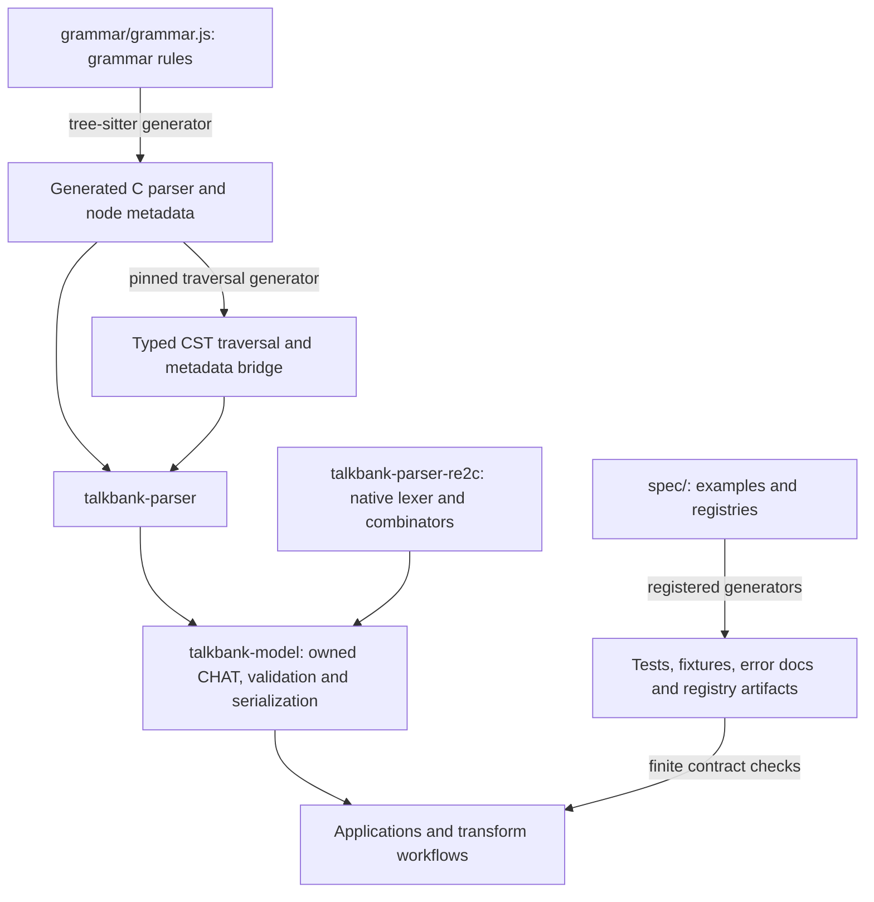
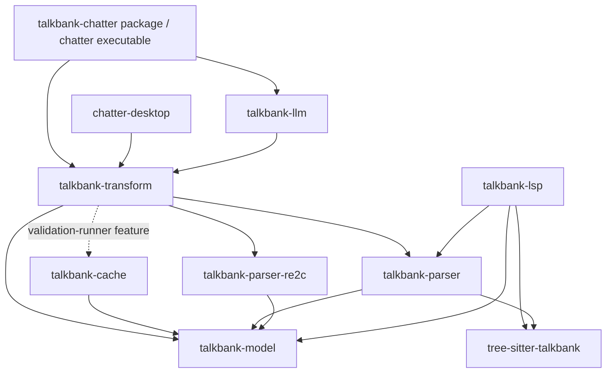

# Architecture Overview

**Status:** Current
**Last modified:** {{git-dates:page}}

Chatter brings the CHAT specification examples, grammar, shared Rust model,
parsers, validation and user applications together. The tree-sitter parser is
the default; the independent re2c backend is also part of the 1.0 compatibility
work. Neither implementation defines correctness merely by accepting an input.

## Source, generation and runtime

There is no single fully generated path from prose specification to application.
Authored specs, symbol/error registries, grammar rules and handwritten semantic
validation have different owners. Generated artifacts connect them and must stay
in sync; they do not prove that every rule or construct has been covered.

The following flow shows the principal artifact boundaries, not Cargo imports:

The [Spec System](spec-system.md) owns the generated-artifact inventory;
[Grammar Workflow](../contributing/grammar-workflow.md) owns regeneration.
Some grammar regions are generated from registries; handwritten grammar rules
remain an explicit source, not an output reconstructed from every spec example.

Ordinary source builds consume committed generated artifacts. Regenerating
typed traversal additionally needs the pinned standalone generator and the
access described in the grammar workflow. A successful ordinary build is not
proof of independent generator bootstrap, registry installation or release
qualification.

## Runtime boundaries

- `talkbank-model` owns the shared model, parser traits, validation, alignment,
  diagnostics and serialization contracts.
- `talkbank-parser` lowers tree-sitter syntax into that model.
  `talkbank-parser-re2c` uses its own native lexer/combinators and lowers into
  the same model type. Shared type does not imply identical recovery values.
- `talkbank-transform` owns higher-level parsing/validation/conversion,
  transformation and runner workflows. Its default `validation-runner`
  feature adds the shared cache and channel dependencies.
- The CLI and desktop consume transform workflows. The LSP directly uses
  the primary parser, model and grammar services; it does not depend on the
  transform runner or SQLite cache.
- `talkbank-llm` adapts the transform judgment-provider interface to HTTP for
  explicitly requested model-assisted work. Ordinary CHAT parsing/validation
  does not require a model service.

These selected **normal dependency** edges come from the package manifests;
arrows point from consumer to dependency. Build/dev dependencies and other
direct edges are deliberately omitted.

See [Crate Reference](crate-reference.md) for package names, locations and
support tooling. Dependency availability is not a promise that every package
or platform has completed publication acceptance.

## Choosing the next reference

- [Repository Architecture and Boundaries](repo-architecture.md): directory
  ownership, workspaces and which manifest to use.
- [Parser Backends](parser-backends.md): semantic agreement and one-way error
  detection, without demanding identical recovery.
- [Parser/Model Contracts](parser-model-contracts.md), [Parsing](parsing.md)
  and [Memory and Ownership](memory-and-ownership.md): admission, source
  revision and lifetime boundaries.
- [CHAT Model](chat-model/chat-model.md), [Alignment](alignment.md) and
  [Validation](errors-and-validation/validation.md): runtime semantics.
- [Documentation Architecture](../contributing/documentation-architecture.md):
  where handwritten and generated documentation belongs.
