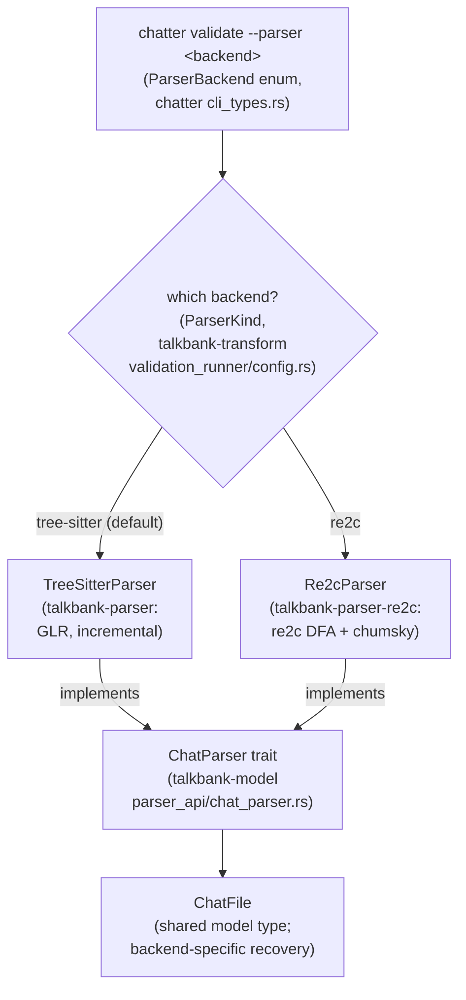
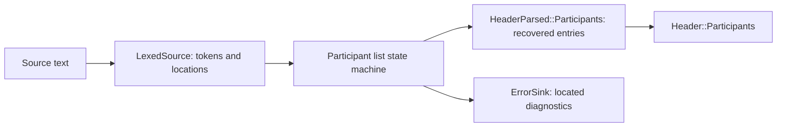

# Parser Backends

**Status:** Current
**Last updated:** {{git-dates:page}}

TalkBank has two CHAT parser implementations. Both implement the `ChatParser`
trait and produce the same `ChatFile` model type, not necessarily identical
values or recovery results.

The `--parser` flag selects the backend at the CLI boundary; everything
downstream consumes the shared model API. Backend differences remain observable
in supported input, diagnostics and recovery:



In the validation runner, `ParserDispatch::new(kind)` (in
`validation_runner/worker.rs`) constructs the selected backend. The private
enum does not itself implement `ChatParser`: its inherent streaming adapter
matches the variant for each file. It calls Tree-sitter's inherent streaming
method or re2c's trait file method at offset zero; a rejected re2c outcome
becomes an empty recovery model while diagnostics remain in the supplied sink.
The runner's diagnostic admission, not the presence of that model, decides
whether the attempt completed. Other consumers can use the trait directly.

## The shared `ChatParser` trait

### Backend compatibility mandate

This section is the authoritative policy for re2c/tree-sitter compatibility.
Backend measurements and regression baselines record evidence; they do not
override this contract.

Both implementations must pursue the same independently justified CHAT syntax,
meaning and validity rules **idiomatically within their own architectures**.
Neither parser is an oracle for the other. For supported valid input, the goal
is semantic agreement in the shared model, not identical internal representation.

The re2c backend is important for **1.0**. Every input that produces an error
with tree-sitter must produce some error with re2c through the corresponding
supported API and validation policy. A warning alone does not satisfy this
one-way requirement. An internal tool failure is failed measurement, not proof
that a CHAT fault was detected. Diagnose concrete tree-sitter defects against the
specification; a difference does not authorize ignoring its error.

For developers, these are mandatory constraints:

- Use re2c lexer states, rich tokens, parser-owned recovery and typed,
  source-bound evidence. Use typestate, ownership and validated constructors
  to preserve admission and recovery distinctions.
- Do not emulate tree-sitter's CST, MISSING nodes, recovery traversal or
  recovered model shape merely to satisfy an equality test. Do not add a
  parallel parser, reparse reconstructed text, or scan raw input after parsing
  to manufacture another backend's diagnostics.
- Report the fault the available evidence supports, at a truthful source
  location. Preserve useful content where sound, but never fabricate valid
  structure, discard faults silently, or treat a recovered result as valid.
  A broader honest diagnostic is preferable to invented specificity.
- Adjudicate differences as a genuine semantic defect, an acceptable
  architectural difference, or an explicitly unsupported experimental feature.
  Retain valid controls and invalid-input rejection tests. Do not weaken a
  CHAT rule or change a baseline solely to make a comparison pass.
- Exact diagnostic codes, wording, counts, ordering, rejection stage and
  recovery output are **not cross-backend requirements**. Fix an inaccurate
  diagnostic for its user impact, not because the other backend differs.

For users switching `--parser`:

| Aspect | What to expect |
|---|---|
| Supported valid CHAT | The intended meaning and shared-model semantics should agree. A disagreement needs investigation. |
| Invalid input | Diagnostic detail, number, order and highlighted recovery region may differ; identical error reports are not promised. |
| Recovered content | Partial models and retained fragments may differ. Recovery is not validity and is not a portable data-repair contract. |
| Current limitations | Known missed errors are defects blocking the 1.0 detection contract, not experimental exemptions. Finite passing comparisons do not establish specification completeness. |

Use the default tree-sitter backend for production validity decisions and the
LSP. Consumers must not depend on cross-backend diagnostic identity or
interchangeable recovered output. Report concrete validity or semantic
disagreements with a minimal input and parser version; a diagnostic difference
alone does not establish a bug.

One-way error detection is a 1.0 acceptance condition; full diagnostic or
recovered-model equivalence is not. Tree-sitter remains the default and the
incremental LSP backend. The re2c requirement does not waive truthful diagnostics
or authorize architecture-distorting workarounds. Retain valid controls and
isolated invalid variants so an unrelated error cannot conceal a missed fault.

For an unannotated angle group, re2c retains its native `Group` and emits a
missing-required-element error over the containing main tier's lexer region.
It does not invent a retrace marker. The same dispatcher serves the sink-bearing
file, utterance and main-tier APIs, including nested groups. A retained bare
group is recovery content, not proof that its original source was valid.

### API shape

Both backends implement `talkbank_model::ChatParser` directly (the
tree-sitter impl landed 2026-07-24 in
`talkbank-parser/src/api/chat_parser_impl.rs`; the re2c impl has carried it
from the start). The trait is the parser-agnostic API for every
granularity: whole files, headers, utterances, main tiers, `%mor`/`%gra`
and the other dependent tiers, down to single words and relations. Each
base parse method takes `(input, offset, errors)` and returns a `ParseOutcome`;
context-aware methods additionally take `FragmentSemanticContext`. Diagnostics
stream through the caller's `ErrorSink`; `Parsed` alone does not prove validity.
Do not confuse this trait file method with Tree-sitter's single-argument
inherent file method, which returns `ParseProduct`.

Downstream consumers should bind on the trait, not on a concrete backend:

```rust,ignore
fn analyze<P: ChatParser>(parser: &P, text: &str) { /* ... */ }
```

selects the backend with one generic bound, including cross-target setups
(tree-sitter natively, pure-Rust re2c on wasm, where compiling
tree-sitter's C runtime is undesirable). No facade or cfg-gated dispatch
module is required merely to express that generic bound. Target-specific
dependency selection still belongs to the consumer. The `wasm` job in
`ci.yml` is configured to run `just wasm-check` for `talkbank-model` and
`talkbank-parser-re2c` on pushes and pull requests targeting `main`.
That is a compilation check for `wasm32-unknown-unknown`, not execution in a
browser or a current successful CI receipt.

Two notes on the trait's shape:

- The trait has generic methods (`errors: &impl ErrorSink`), so it is not
  dyn-compatible; runtime backend selection uses a small enum such as
  `ParserDispatch` rather than `Box<dyn ChatParser>`.
- Tree-sitter's base parse methods delegate to inherent fragment methods.
  Context-aware overrides forward context for words, main tiers and utterances;
  other context-aware methods can inherit the trait's context-ignoring default.
  Do not infer that every fragment applies every context field. The trait
  conformance tests live in
  `crates/talkbank-parser/tests/integration/chat_parser_trait.rs`.

## Where values are placed

Both backends place every model value by one convention, and the cross-backend
deck (`equivalence_container_locations` in the re2c crate's equivalence tests)
holds them to it. The convention is the rule "a location is exactly the item":

- A **line** (header, main tier, dependent tier) includes its line ending when
  the source has one. **Main-tier content** starts after the separator's colon,
  so the tab is content; `MainTierLocations` documents this once.
- A **word** is its text as written. A word the re2c lexer could not read as
  one token is assembled from subtokens and takes the source slice from its
  first token through its last, so it is placed like any other word; that
  slice is the source as written, including a curly quote the file parser
  stripped and reported between two subtokens.
- A **group** is its brackets, `<` through `>`; a **quotation** its two marks;
  an **event**, **freecode**, **marker** or **bullet** its own lexeme.
- A **retrace** runs from its content (the brackets it took from a bare group,
  or the one item it wraps) through its marker. `Retrace::marker_location` is
  the marker alone.
- A **replaced word** runs from the word through its last annotation, the
  replacement's `]` included.
- An **`Annotated<T>` wrapper** runs from its construct through its own last
  annotation. In a chain such as `a [?] [/] [!]` the inner annotated word
  ends at `[?]`, the retrace at `[/]`, and the outer wrapper at `[!]`; the
  outermost wrapper therefore ends at the chain's final `]`, which the
  glued-code rule (E757) relies on.
- A **hull** that cannot place one of its parts is `Unlocated`, never a span
  that stops short of the construct; `Unlocated` is otherwise reached only for
  a slice that is not from the source being converted, which is a programming
  error.

Two policies follow from this and are rulings, not conventions:

- **Diagnostics are owned by the model's rules, never mirrored by a parser.**
  A parser-side token scan that exists to emit a specific diagnostic (the re2c
  backend carried one for E757 while its wrappers were unlocated) fires beside
  the rule once the typed path reaches the construct, and encodes the message
  rather than the fact. When a diagnostic seems missing on one backend, place
  the construct so the rule reaches it; do not add text-level scanning to
  produce the code.
- **One flagged error is enough.** A line already reported malformed at a byte
  (an orphan `[/]` opening an utterance, E759) does not also get the glued-code
  error there to match CLAN's count; CHECK parity for a second message on the
  same bytes is not a goal.

## TreeSitterParser (default)

### Structured metadata header boundaries

`@Languages` retains its ordered code list; list structure and ISO 639-3
membership are separate parsing and validation obligations. `@Types` carries
design, activity and group as alphanumeric atoms. Optional whitespace around
its commas is structure, not part of those values. Tree-sitter's generated field
kinds own the Types reader's diagnostic identity; re2c's lexer tags capture the
atoms without separator whitespace. `@Situation` remains free text, including
Unicode, rather than inheriting the restricted Types field grammar.

Header fragments and whole documents use the same lowering boundaries. Invalid
Types atoms must be detected without treating an internal failure as a CHAT
diagnostic. Parse diagnostics also remain distinct from model checks: validation
of a salvaged model does not certify the original source bytes. Keep the parse
product and its diagnostics when deciding whether the input was accepted; JSON
payload replay does not recreate parse-health evidence.

For isolated words, `parse_word_with_context` (or the inherent
`parse_word_fragment_with_context`) applies the enclosing document's effective
`@Options: CA` to the admitted typed word. A standalone parenthesized word then
has the same CA-omission interpretation as whole-document parsing; mixed lexical
shortenings remain shortenings. This transition preserves raw spelling and
source coordinates and does not retry rejected input. The context-free word API
does not infer file options: callers that know them should supply the context.

- **Crate:** `talkbank-parser`
- **Technology:** [tree-sitter](https://tree-sitter.github.io/) GLR parser
- **Grammar:** `grammar/grammar.js` → generated C parser
- **Strengths:** Incremental reparsing (LSP), robust error recovery (GLR),
  CST-level diagnostics
- **Concurrency:** Reuse one parser handle per worker; its mutable parser
  state is internally borrowed and is not shared concurrently.

Used by the LSP and the default CLI validation path.

## Re2cParser

- **Crate:** `talkbank-parser-re2c`
- **Technology:** [re2c](https://re2c.org/) DFA lexer + [chumsky](https://docs.rs/chumsky/1.0.0-alpha.8) parser combinators
- **Grammar:** Independently maintained re2c conditions and chumsky combinators,
  reviewed against the shared syntax contracts; not generated from `grammar.js`
- **Design:** Stateless parser handle, DFA lexing and independent native
  parsing/recovery. Measure performance for the intended workload.
- **Limits:** No incremental reparsing. Full specification and backend
  completeness remain unproven; finite passing comparisons do not establish
  1.0 readiness. Exact diagnostic identity is not a requirement.

Used for parser parity testing and performance benchmarking.

### Source ownership and participant recovery

The native intermediate AST borrows caller source. Conversion produces the
owned shared model; do not confuse an intermediate AST's lifetime with the
public `ChatFile` lifetime. Source borrowing and scoped token storage are
ownership choices, not a general proof of leak freedom or a memory bound.

File parsing receives a `LexedSource` that privately owns tokens and their
lexer locations alongside the borrowed source. Its only constructor lexes
that source, preventing callers from pairing unrelated token and location
arrays. Participant lists consume those located tokens through one parser
shared with the fragment entry point:



The list distinguishes its initial state, a nonempty entry, and a consumed
comma awaiting another entry. A trailing comma therefore reports E550 while
preserving the preceding participants. Conversion receives parsed entries
instead of reparsing raw header tokens, and header fragments forward the
same diagnostics with the caller's offset. The internal AST snapshot records
this distinction; it does not define a serialized CHAT format change.

The re2c newline token represents one LF, CRLF or lone CR, matching the
canonical grammar. It does not fuse consecutive breaks, so blank-line
structure is kept. Source-aware file dispatch reports an unconsumed blank newline at
its lexer span. Generated error fixtures preserve their exact line-ending
bytes in Git; published Markdown normalizes display line breaks and labels
that presentation.

### Annotation categories survive conversion

Token classification produces `ParsedAnnotation::Scoped(ScopedAnnotationParsed)`
for annotations that decorate content. Retraces, replacements, language codes
and postcodes remain distinct outer variants. The model converter accepts only
`ScopedAnnotationParsed` and returns a `ContentAnnotation` directly: structural
markers cannot enter that conversion and be silently discarded through `None`.
Replacement lookup likewise returns its payload rather than an index requiring
a second match or an unreachable branch.

The file-level E757 spacing check uses the same classified categories for
closing annotations and retraces. It reads adjacent tokens from `LexedSource`
and reports the following word's complete lexer span when the code is glued to
that word. The specification includes both glued examples and a spaced control;
the cross-backend gate checks those generated cases. The same located-token pass
rejects replacements glued to rich or reconstructed words with E375/E316, matching
`word_with_optional_annotations` and CHECK 161. The bracket-location boundary
test compares both backends against the violation and its spaced legal control.
Canonical closing-bracket recovery excludes absorbed trailing whitespace from
its highlight and builds its context from the original source. The internal AST snapshot
changes to show the category. Reference-corpus equivalence checks shared-model
semantics; byte-exact CHAT serialization needs its own roundtrip controls.

### Numeric bullet admission

The native lexer retains each bullet's original spelling together with checked
numeric admission. Main-tier terminal slots, inline/nested content, header and
text-tier segments, and WOR words consume that result; conversion never turns
overflow into zero timing. Rejected timing is distinct from an absent source
slot, so dropping it cannot promote an earlier inline bullet into terminal
timing. Surrounding content remains available as recovery, not valid source.

Numeric representability does not establish leading-zero spelling, inline
all-zero policy, chronological ordering or alignment validity. Those checks
retain their own owners. Both backends report WOR numeric overflow through
whole-file and fragment APIs; native fragment diagnostics retain caller offsets.

### Postcode admission and diagnostic offsets

A `PostcodeToken` owns its lexer's full span and a private payload state:
nonempty content after trimming trailing whitespace, or recoverable missing
content. The lexer preserves leading payload whitespace. `TierBody::postcodes`
contains only these tokens, so lowering cannot accidentally treat another token
kind as a postcode. Missing content emits E363 and contributes no model postcode;
valid content retains its source span. Main-tier and utterance lowering require
an error sink explicitly.

The re2c trait implementation streams diagnostics through one offset adapter.
File diagnostics, utterance fragments, main-tier lowering and header/participant
fragments therefore use the same rebasing operation as their models. This
removes temporary diagnostic collection in header fragments and the discarded
utterance diagnostics. The dated parity report distinguishes the finite fragment detection checks
from broader completeness obligations. The postcode boundary test loads
the authored E363 examples and checks actual token spans, nonzero offsets,
recovered tier content and canonical-parser normalization.

### Morphology admission and recovery

The morphology lexer distinguishes the stricter first lemma character from its
continuation characters and requires content after each feature separator.
The parser splits an admitted token without inventing an empty lemma fallback.
On failed `%mor` parsing, `RejectedMorTier` retains raw tokens and reports E600
at construction, alongside the primary syntax diagnostic. It cannot convert to
a model tier or masquerade as an unsupported dependent tier. Utterance lowering
retains morphology taint so alignment does not treat the dropped tier as clean.
The authored E316 examples and a legal lemma/feature control exercise this path.
This does not change the grammar's allowance for angle brackets inside a lemma;
it rejects the forbidden leading angle bracket shown by the source examples.

### Dependent-tier prefix admission

The lexer distinguishes a complete `TierPrefix`, including its required colon
and tab, from an `IncompleteTierPrefix` recovered from a label. File dispatch
recognizes both forms. Dependent-tier recovery consumes this classification
rather than inferring malformed syntax from an empty body and a suffix check.
It reports E602 over the original complete line and retains the recovered
content for inspection. A complete prefix with no body remains a separate
content-validation question (E756). The E602 boundary test loads both malformed
specification examples and the valid colon-tab control and checks source spans.

### Separator provenance belongs to lexical admission

`PrefixToken` owns the matched payload and separator provenance. Prefix lexer
rules consume spaces after the required tab, so those spaces never become
header or tier content. The same carrier covers ordinary headers, embedded
speaker headers, dependent prefixes, and main-tier separators. AST header lines,
main tiers and dependent entries retain the admitted `TierSeparator` through
model lowering. Both backends use the shared file validator and its CA
policy; there is no main-tier-only whitespace scan or separate CA probe. Separator spans are omitted from serialized AST/model metadata, and
CHAT serialization writes the canonical tab in both CA and non-CA files.

The source-spec boundary test covers all E758 examples, padded CA headers and
tiers, canonical non-CA controls, exact byte spans and nonzero source offsets.
It compares canonical serialized CHAT with tree-sitter. The lexer prefix payload
and header/dependent-entry AST shapes change; the file inspection snapshot
records that API change.

### Lengthening counts preserve their source

The grammar admits a nonempty run of colons with no 255-character limit.
`WordLengthening::count` and the re2c AST carry `NonZeroUsize`, measured at the
parser boundary. Neither backend narrows source length to `u8`; the count is
bounded by addressable input length rather than 255. This does not promise
unbounded memory or parser capacity. A zero count cannot be constructed or decoded
from JSON, and both the default constructor and omitted JSON count mean one
colon. Serialization does not repair zero counts with `max(1)`.

The Rust count field and `with_count` argument are `NonZeroUsize`. JSON retains the integer `count` field, omitted for one colon,
but accepts longer runs and rejects zero. The schema describes that boundary.
The public-parser regression checks both source roundtrip and semantic equality
at the former `u8` boundary (255 colons); equality alone would allow both
backends to lose the same information.

### Remaining parity limits

The [dated re2c measurements](https://github.com/TalkBank/chatter/blob/main/crates/talkbank-parser-re2c/docs/parity-report.md)
include historical silent invalid cases and subsequent finite repairs. Do not
treat either old failures as a current defect list or passing results as
completeness guarantees. A clean `--parser re2c` run is not a general validity
guarantee. Differences in diagnostic specificity, additional diagnostics,
source locations and recovery remain permissible. Missed errors do not.
Run the one-way comparison for the complete authored-example failure inventory;
a historical diagnostic-set baseline cannot waive the requirement.

Both backends feed the shared model validator, but source information discarded
before lowering cannot be checked there. Rejected morphology preserves taint;
other recovery paths and remaining dummy diagnostic locations still need review.

Re2c's file dispatcher reports lexical faults at the original token region:
leading-zero bullet spelling, angle-edge whitespace, illegal curly quotes and
misplaced linkers retain their lexer locations through caller-offset rebasing.
Structural failures use the source owner's enclosing region: a missing group
annotation highlights its main tier, and an orphan dependent tier its own line.
These are truthful native locations, not a promise to match tree-sitter's
recovery point or diagnostic extent.

## CLI Usage

```bash
# Default: tree-sitter
chatter validate corpus/

# Select the independent re2c backend
chatter validate --parser re2c corpus/

# Roundtrip with re2c
chatter validate --parser re2c --roundtrip corpus/
```

The `--parser` flag accepts `tree-sitter` (default) or `re2c`. Cache entries
are parser-specific, switching parsers does not invalidate the other's cache.

## Parity Status

`equivalence_tests::equivalence_reference_corpus` checks each reference file
as authored and with CRLF and lone-CR transport newlines. Each backend's own
parse observation must produce a model without error-severity or internal
diagnostics before `SemanticEq` comparison. Ordinary warnings need not agree.
The batch retains failures and rejects an empty comparison population.
This does not run complete shared-model validation, compare serialized bytes,
or compare each transport's model against that backend's authored-input model.
The error-spec comparison `backends_report_every_tree_sitter_error` measures every
declared example, including legal claims and deferred codes. It retains parsing
and shared-validation findings separately, and rejects silence or warning-only
re2c output whenever tree-sitter reports an error. Error codes and rejection
stages may differ; code-set equality is informational only. Internal failures
refuse measurement rather than passing as generic input errors.

Passing this finite file-level comparison does not prove every CHAT rule, every
supported fragment API or every fault within a multi-fault input is covered.
Fragment/coordinate contracts and isolated invalid controls remain separate.
Run the current report with:

```bash
cargo test -p talkbank-parser-re2c --test integration error_parity::backends_report_every_tree_sitter_error --locked -- --exact --nocapture
```

No wild-corpus percentage or performance figure is recorded here; measure
the current build rather than relying on a stored number.

### Performance

Run benchmarks: `cargo bench -p talkbank-parser-re2c --bench parse_comparison`

Inspect the selected operation before comparing numbers. The suite separates
Tree-sitter construction from reuse, fixed reference-file batches, fragments
and lexing. Native free-function cases return intermediate AST results, while
Tree-sitter file cases produce shared models; these are not uniformly equivalent
end-to-end operations. The benchmark is not a validity/equivalence test or a
measurement of complete CLI validation, cache use, I/O or diagnostics rendering.

## When to Use Which

| Use Case | Recommended Parser | Why |
|----------|-------------------|-----|
| LSP / editor integration | tree-sitter | Incremental reparsing |
| Batch validation | tree-sitter by default | Production default; measure workload performance separately |
| CI validation | tree-sitter by default | Default validation policy; compare both backends when changing shared language support |
| Error diagnostics (user-facing) | tree-sitter by default | Default user workflow; specificity and recovery may differ by backend |
| Parser comparison testing | Both | Disagreements require adjudication against the specs; neither backend is an oracle |
| Profiling / benchmarking | Both | Measure the selected operation, input set and build; neither supplies a universal performance bound |

## Shared Model Infrastructure

Both parsers convert to the same `talkbank_model::ChatFile` type and use shared
model validation and alignment. Backend-specific token/CST lowering remains
separate; a Tree-sitter node helper is not a shared re2c parsing primitive.

CA intonation arrows are not promoted to terminators at the
parser/model boundary; both parsers leave them as `Separator` items.
See [CA Terminator Resolution](parser-and-grammar/ca-terminator-resolution.md).

## Detailed Parity Report

See [`crates/talkbank-parser-re2c/docs/parity-report.md`](https://github.com/TalkBank/chatter/blob/main/crates/talkbank-parser-re2c/docs/parity-report.md)
for retained measurements, divergence categories and their stated limits.
Its historical entries are not an authoritative current defect queue.
