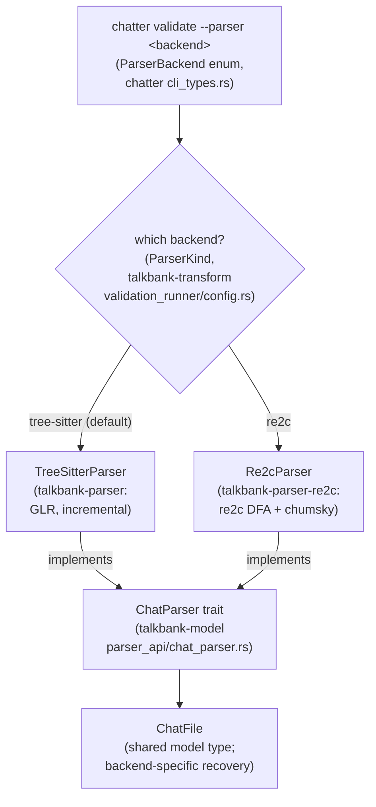
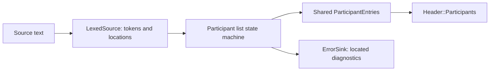

# Parser Backends

**Status:** Current
**Last updated:** {{git-dates:page}}

TalkBank has two CHAT parser implementations. Both implement the `ChatParser`
trait and produce the same `ChatFile` model type, not necessarily identical
values or recovery results.

The native lexer accepts a closed `lexer::StartCondition` for full-file and
fragment entry points. Its source, cursor, marker, tags and internal numeric DFA
state are private. Public `COND_*` constants carry the same enum; `%wor` uses the
main-content condition. Numeric states cannot be injected, and callers cannot
replace the source or coordinates during iteration. This protects the lexer
boundary; it does not prove that every generated transition is panic-free.

Native text-backed dependent tiers retain a `TextTierLabel` admitted once from
an observed prefix. Empty labels cannot reach lowering. Dependent-tier lowering
is total over admitted entries, including retained recovery variants, so file
conversion maps every entry rather than filtering failed conversions. Separator
recovery and rejected-body provenance remain distinct from label admission.

Native plain-text dependent-tier lowering admits its ten supported labels into
`PlainTextTierKind` once. An exhaustive match consumes that kind to construct the
shared tier; it has no second string dispatch or impossible panic arm. Empty
content keeps the shared explicit empty state and the tier's identity.

## Equal backends, one shared model

Tree-sitter and re2c are peers. The Tree-sitter implementation was prototyped
first; that history gives it no ownership of CHAT semantics or the shared AST.
`talkbank-model` serves both parsers and their consumers. Both implementations
may drive changes to its types, constructors and recovery representations.

Native word lowering constructs `Word` directly from its shared structured
content. Cleaned text has one owner in the model; no native cleaning copy or
raw-text fallback seeds a temporary lexical word. Construction alone still
does not certify CHAT validity.

Native lexical words have one producer, consuming the lexer's complete rich-word
token. Standalone zero actions use a separate production with no lexical suffix
fields. Marker-only subtokens cannot be assembled into lexical words.

Native word categories are shared `WordCategory` values from grammar admission
onward; there is no native category enum or conversion table. Unknown rich-token
prefixes are rejected instead of being treated as an absent prefix.

Native word language suffixes are admitted by the rich-word producer and
retained as shared `WordLanguageMarker` values. Lowering does not split or
reinterpret unchecked suffix strings. Empty language segments are refused;
missing source data must never be manufactured as the legitimate ISO code `und`.
An explicitly authored `und` remains ordinary model data.

Native replacement carriers retain the complete source lexeme when their
ordered delimiters are admitted against the parser source. Orphan recovery
uses those exact bytes; it never reconstructs spacing from replacement words
when a conversion caller supplies a different source. Source mismatch remains
explicitly unlocated at that low-level conversion boundary.

The native word producer also admits shared `WordText` and
`WordShortening` values before retaining them in the word body. Empty lexical
segments reject; lowering copies the admitted values without unchecked text
construction. Marker lexemes and whole-word source slices remain available for
location mapping. This admission is non-emptiness, not whole-word CHAT validity
or a guarantee about model values constructed through legacy JSON recovery.

The native word-body scanner refuses an underline prefix without its begin/end
control discriminator as `WordBodyError::MalformedUnderline`. It never converts
that failed structural marker into ordinary word text. Complete rich lexer
words already exclude this shape; the direct scanner API preserves rejection
as well. This boundary is distinct from full-file CHAT validation.

All rich-word lexer rules extract their body from the same `w_body` production,
including the malformed-suffix recovery rule. Its shortening atoms contain
nonempty text and a closing parenthesis; its underline atoms contain both
control characters. Word-text atoms exclude those structural characters, so
they cannot introduce partial shortenings or underline markers. The scanner's
fallible API remains necessary for independently supplied bodies. Admission
here does not certify suffixes, annotations or whole-word validity.

Native CA marker carriers retain shared `CAElementType` and `CADelimiterType`
alongside their source lexemes. Character scanning uses the shared generated
symbol registry; lowering only adds location to the retained kind. There is no
second native CA vocabulary or semantic conversion table.

Stress and overlap carriers likewise retain shared `WordStressMarkerType` and
`OverlapPointKind`. Word-internal, standalone and bracketed lowering use those
kinds directly; observed overlap indices and source lexemes remain separate
evidence and are not replaced by defaults.

The shared model already represents some malformed and recovered input; a model
value is not a validity certificate. When either parser needs another meaningful
state, consider extending the shared model rather than treating its current
shape as fixed or creating a parallel semantic AST. Preserve the distinction
between recovered data, producer failure and validated data in those types.
The [no-defaults/no-sentinels principle](chat-model/chat-model.md#no-silent-defaults-or-sentinels)
is mandatory: neither parser may invent plausible model values to make
lowering total. Explicit recovery states retain uncertainty; failed lowering
must propagate failure instead of creating spurious diagnostic cascades or
silently corrupting output.

Backend-specific tokens, CST views and parser-progress carriers are appropriate
when they retain parsing mechanics or syntax evidence. A duplicate semantic tree
needs a concrete justification: which information cannot the shared model
represent, and why should the shared model not be extended to represent it?
Remove redundant intermediate types and conversions when the shared model fits.
Validation's `ParticipantRoster` reads current declaration headers independently
of the participant metadata join. Missing ID metadata does not erase a declared
speaker. It distinguishes absent, empty, repeated and unscoped declarations;
repeated or unscoped declarations cannot justify an undeclared-speaker finding.
The shared metadata join supplies diagnostics to model validation as well as
parsing, so JSON import does not erase missing-ID errors. Its borrowed plan
materializes owned metadata only when a producer requests that map. A birth
header's declared speaker remains known even when its ID metadata is missing.
Both parsers retain a role-less declaration as shared `ParticipantDetails::MissingRole {}`.
The observed code remains declared, while E513 survives model validation and JSON
round-tripping. Neither backend borrows a role from ID metadata. Single-entry
fragment APIs reject this incomplete syntax. Structural participant-header
recovery instead retains `UnparsedParticipants` source: recovered token fragments
cannot become speaker identities. Both backends use the same declaration admission,
which also rejects competing headers before roster access or metadata joins.
Tree-sitter also retains a document-level recovery region as `UnparsedMor` or
`UnparsedGra` when generated prefix and separator nodes identify it and its
source directly follows an utterance. Internal line breaks must belong to
observed typed continuation nodes. Immediate and header-dependent lowering both
carry that evidence. Recovery is not attached across a header or without an
owning utterance; regions spanning independent lines remain unclassified. No
tier identity is inferred by reparsing ERROR text. Alignment remains
conservatively tainted, and sanitization refuses the retained raw tier.

Native ID bodies produce the shared `IDHeader` directly. File and full-header
fragment parsing use that same construction path. An empty language field
remains observed absence for E510; empty elements within a nonempty list reject
instead of being filtered away. File recovery preserves the original rejected
ID header as `Header::UnparsedID`, while the ID fragment API rejects it.
Tree-sitter uses the same recovery state when its typed ID fields reject.
The state retains original source through JSON and remains invalid. An unreadable
ID cannot prove that a declared speaker lacks metadata, so the shared join withholds
missing-ID diagnostics while such evidence exists. Readable orphan-ID and birth
checks still apply. No speaker or demographic value is inferred from raw recovery.
Sanitization refuses unparsed IDs because their demographic fields are unavailable.
Speaker mapping, rediarization and merge share a `SpeakerRewriteInput` admission
boundary: one readable participant declaration and no recognized unparsed IDs.
They refuse before rewriting, including for models imported from JSON. The public
`SpeakerRewriteError` distinguishes declaration failure from unreadable ID metadata.
This admission is narrower than full CHAT validity and does not infer identities
from raw text.

Native media bodies also construct shared `MediaHeader` values directly. The
field grammar consumes the filename, modality and optional status once, retaining
the source span of whitespace before the first comma for E767. Rejected
structure retains the original header as unknown; conversion does not rescan
fields or invent omitted values.

Other native header families retain a lexer-token view with the original header
slice. Rejected lowering uses that slice, including the header name and separator,
in the shared `Header::Unknown` recovery representation. Structurally malformed
headers cannot be lowered as partial parsed metadata. This preserves rejected
source through CHAT rendering and JSON without creating another semantic AST.

Native text, MOR, GRA, PHO and SIN parsing now construct shared values directly.
Pauses are shared values at grammar admission. The lexer-issued payload and full
parenthesized extent supply their duration and location; main and bracketed
conversion retain that same value without a native pause-kind enum.
Main-tier separators are shared values at grammar admission, with required source
placement. WOR uses the same separator grammar and shared rendering; nested
conversion retains the admitted value without a second kind/spelling table or
an unlocated fallback.
Main-tier terminators are also shared values at the grammar boundary, using the
same source-located parser as MOR and WOR. The native tier body cannot store an
arbitrary token in that slot, and conversion cannot silently discard it. The
line-phase classifier and grammar construction share one lexical dispatch table
of shared-model constructors. No native terminator-kind enum or second conversion
table remains. Each constructor requires a real span; a token outside the supplied
source is rejected instead of becoming an unlocated terminator.
PHO compounds are assembled from their first admitted segment; PHO/SIN groups
require content before construction. Their fragment APIs return explicit
ParseOutcome rejection instead of substituting an empty tier. File-tier
locations are supplied by the admitted line, and fragment locations are rebased
only at the public API boundary. GRA's
numeric admission rejects unrepresentable fields instead of inventing indices
or ROOT heads. Both file parsers preserve rejected PHO/MOD/SIN tiers as
`UnparsedPho`, `UnparsedMod` and `UnparsedSin`, retaining original source rather
than dropping the tier or relabeling it unsupported. These shared recovery states
remain invalid after JSON import and withdraw only their own alignment trust.
Redaction and splitting drop them; the tier-replacement helper updates the matching slot.
Native WOR parsing also constructs shared items and tiers directly, using the
admitted file-line extent or fragment extent at construction. Word conversion
still consumes the native word representation. Unsupported word shapes reject
instead of producing empty words; language and terminator admission cannot
silently omit an observed field. Both file parsers retain rejected WOR as `UnparsedWor`, with exact original
source, tier identity and model-owned invalidity through JSON. Tree-sitter's
source admission retains separator and available body geometry before semantic
lowering; rejection returns that same source owner for raw recovery. A known
body span therefore survives rejection, while an unavailable newline boundary
remains unknown. Source geometry is not serialized as parser evidence. Raw WOR is not
parsed timing evidence. Replacement updates its slot; redaction and splitting
drop it. The native file path never reparses reconstructed text. Standalone word parsing leaves scoped annotations unconsumed, so annotated
WOR rejects without loss. Bare actions cannot become empty words. Unassociated
or duplicate timing bullets likewise retain the complete tier as raw recovery.
Top-level MOR/GRA recovery has a different source contract: surviving typed
prefix and separator nodes admit raw retention from an ERROR region, without a
complete dependent-tier envelope or selected newline. Its body geometry remains
unknown; the ERROR endpoint is not promoted to a body boundary.
Both file parsers preserve a rejected GRA tier as
`DependentTier::UnparsedGra`, with its original source and position. This
recovery variant survives JSON, remains invalid without source locations, and
cannot be consumed as a parsed dependency graph. Regeneration replaces its
original slot; redaction refuses it because unparsed text is not known to be
nonlexical.

Standalone GRA lowering also rejects the entire construction when a relation
fails. `GraLowering::finish(location)` consumes its recorded outcomes into
`ParseOutcome<GraTier>`; a later successful relation cannot undo rejection.
There is no partial `GraTier`, completeness flag or intermediate receipt to
lose during JSON serialization. The source-bound Tree-sitter API distinguishes
`CstFailure` from `ParseOutcome::Rejected`; the re2c API returns the same shared
outcome. Ordinary builders and JSON still do not certify source origin or CHAT
validity. They describe their supplied graph, which must be validated.

`WriteChat` now uses destination-specific errors, with an `Infallible` sink for
owned-string helpers. GRA rejection still occurs before a serializable model
exists: output-sink failure is not a domain rejection mechanism. See the
[rendering boundary](chat-model/chat-model.md#serialization).

The current CLI default, incremental-editor integration and measured coverage
are implementation and qualification facts. They do not establish a hierarchy
between the parsers or make either implementation a specification oracle.

The `--parser` flag selects the backend at the CLI boundary; everything
downstream consumes the shared model API. Backend differences remain observable
in supported input, diagnostics and recovery:



In the validation runner, `ParserDispatch::new(kind)` (in
`validation_runner/worker.rs`) constructs the selected backend. The private
enum does not itself implement `ChatParser`: its inherent streaming adapter
matches the variant for each file. Both variants call the shared trait file
method at offset zero and preserve
`ParseOutcome::Rejected`. Rejection never creates an empty replacement model:
the runner skips model validation, serialization and cache admission. Producer
faults remain internal failures; ordinary rejection remains invalid even when
presentation settings suppress its diagnostics. If a rejecting producer reports
no error, the runner reports the missing model explicitly. A rejected roundtrip
reparse is a distinct failure, with no fabricated second serialization or diff.
Other consumers can use the trait directly.

## The shared `ChatParser` trait

### Backend compatibility mandate

This section is the authoritative policy for re2c/tree-sitter compatibility.
Backend measurements and regression baselines record evidence; they do not
override this contract.

Both implementations must pursue the same independently justified CHAT syntax,
meaning and validity rules **idiomatically within their own architectures**.
Neither parser is an oracle for the other. For supported valid input, the goal
is semantic agreement in the shared model, not identical internal representation.

The re2c backend is important for **1.0**. Every input that produces an error
with tree-sitter must produce some error with re2c through the corresponding
supported API and validation policy. A warning alone does not satisfy this
one-way requirement. An internal tool failure is failed measurement, not proof
that a CHAT fault was detected. Diagnose concrete tree-sitter defects against the
specification; a difference does not authorize ignoring its error.

This existing one-way regression check addresses a measured acceptance gap.
Its direction does not give Tree-sitter authority over the shared model or
exempt either backend from independently justified syntax and semantic rules.

For developers, these are mandatory constraints:

- Use re2c lexer states, rich tokens, parser-owned recovery and typed,
  source-bound evidence. Use typestate, ownership and validated constructors
  to preserve admission and recovery distinctions.
  The raw-token main-tier, dependent-tier and header grammars and their
  token-to-grammar classification helpers are internal. Terminator dispatch
  requires an actual token discriminant; absence belongs to its calling parser.
  Public `ChatParser` methods and input-based helpers lex the supplied string
  before invoking them. A caller cannot pair handcrafted token fields with an
  unrelated source through a second public grammar route. Public token
  inspection is separate from admission of source-bearing parse results.
  The lexical input owner distinguishes a byte from end-of-input; the generated
  DFA uses a checked EOF rule. Embedded or trailing NUL bytes become error
  tokens and do not truncate the token stream. Callers must not append NUL
  padding. Shared parser-level control validation remains a separate policy.
  Retired tier labels use the opaque text path, even when their payload resembles
  morphology. `%trn` cannot select the `%mor` grammar or acquire its label during
  lowering; E605 judges the preserved unsupported tier.
  Raw content-item and terminator-token conversion helpers are internal too:
  membership of a lexeme in the source does not certify its token kind or
  independently supplied payload. Public conversion consumes parser-owned
  word, tier, header and file values; inspecting or constructing a raw item
  does not create a second lowering path.
  Interposed speech consumes the ordinary word producer after a located
  `&*SPK:` prefix. Prefix and word must be adjacent in their original source.
  The resulting shared `OtherSpokenEvent` owns a `Word`, so no raw payload
  bypasses word admission or model validation. The structural view keeps it
  an interposed leaf rather than a main-speaker alignment word.
  Long-event and nonvocal markers enter the shared model with distinct checked
  label types. Their common alphabet comes from the symbol registry, used by
  both grammars, the constructors and JSON schemas. Native conversion preserves
  these admitted, located values without reconstructing labels from raw text.
  Non-speech events also enter the shared model in the parser. `EventType`
  admits a nonempty descriptor using the registry-owned event character class;
  model builders and JSON import use the same boundary. Annotation chains carry
  the located shared `Event`, eliminating raw-description reconstruction during
  conversion. Open project-specific labels remain supported.
  The native line machine admits nonempty lexer regions before deriving
  diagnostic extents, header provenance or dependent-tier body geometry.
  Each region retains its original tokens, spans and source together;
  consumers do not accept an independent source or token-index range.
  Whitespace-item inspection uses the same admission; a valid empty region
  produces no items without inventing a source position.
  Invalid region selection is an internal producer fault, not invalid CHAT.
  Text-tier diagnosis and participant parsing consume `LocatedTokens`, selected
  once by that lexer owner. The selection retains token/span slices with their
  diagnostic source; a legitimate empty body remains distinct from an invalid
  range. Whole-stream inspection takes no caller-supplied indices. Nonempty
  region admission reuses the same range-selection edge before checking bytes.
  File and dependent-tier dispatch share an iterator-backed `TokenCursor` from
  that lexer owner. Observed tokens carry their original spans and source;
  callers cannot set the cursor position or index a token through it. Peeking
  preserves progress, newline consumption is conditional, and exhaustion is
  represented by absence. Fragment completion uses the same cursor state.
  Regions retain an admitted `SourceSlice`: byte bounds and UTF-8 boundaries
  are checked before the slice exists. Header recovery and dependent-tier
  lowering reuse its original bytes and coordinates without accepting a new
  source. Public raw range reads use fallible `SourceText::slice`; admitted
  slice accessors cannot panic on an independently supplied range.
  Located main tiers retain the admitted source slice alongside their syntax
  and locations. Main-tier and utterance conversion derive source from that
  owner; public callers cannot replace it with an unrelated buffer.
  Located headers likewise retain syntax, source and separator in one owner.
  Native file access is read-only, with a consuming line accessor for fragment
  admission; header lowering no longer accepts an independently supplied source.
  Native utterances expose `main_tier()` and `dependent_tiers()` as borrowed
  views. Their grouping is fixed by the line machine, so taking ownership of a
  parsed line does not permit replacing its main tier or editing the dependent
  sequence before lowering. This preserves observed grouping, not CHAT validity.
  Dependent-tier entries also seal payload, separator, body geometry and source;
  lowering accepts the entry as a unit. Rich words admit their original slice
  before construction. Word and annotation lowering derive that source, and
  the word span is always present rather than re-discovered through an optional
  foreign-buffer lookup. These owners do not certify arbitrary hand-built token
  streams or independently constructed non-word content.
  These boundaries do not establish whole-parser panic freedom or every span policy.
- Native lexical words consume rich tokens whose body has a grammar entry.
  Marker-only subtokens reject rather than becoming lexical words. A separate
  zero-action production consumes its source-bound marker and annotations;
  actions never own word suffix fields. Word-only consumers receive
  `WordWithAnnotations` directly, without filtering general content items.
  Shortening, stress and lengthening are decoded from rich word bodies. The
  lengthening-run type owns prefix scanning and returns its untouched remainder;
  a rejected run is never replaced with ordinary word text.
- Do not emulate tree-sitter's CST, MISSING nodes, recovery traversal or
  recovered model shape merely to satisfy an equality test. Do not add a
  parallel parser, reparse reconstructed text, or scan raw input after parsing
  to manufacture another backend's diagnostics.
- Report the fault the available evidence supports, at a truthful source
  location. Preserve useful content where sound, but never fabricate valid
  structure, discard faults silently, or treat a recovered result as valid.
  A broader honest diagnostic is preferable to invented specificity.
- Adjudicate differences as a semantic defect, an incomplete implementation,
  or an acceptable architectural difference. Missing required error detection
  remains a 1.0 blocker, including for features still under development.
  Retain valid controls and invalid-input rejection tests. Do not weaken a
  CHAT rule or exempt a missed error to make a comparison pass.
- Exact diagnostic codes, wording, counts, ordering, rejection stage and
  recovery output are **not cross-backend requirements**. Fix an inaccurate
  diagnostic for its user impact, not because the other backend differs.

For users switching `--parser`:

| Aspect | What to expect |
|---|---|
| Supported valid CHAT | The intended meaning and shared-model semantics should agree. A disagreement needs investigation. |
| Invalid input | Diagnostic detail, number, order and highlighted recovery region may differ; identical error reports are not promised. |
| Recovered content | Partial models and retained fragments may differ. Recovery is not validity and is not a portable data-repair contract. |
| Current limitations | Known missed errors are defects blocking the 1.0 detection contract, not experimental exemptions. Finite passing comparisons do not establish specification completeness. |

Tree-sitter is currently the CLI default and incremental LSP backend.
Consumers must not depend on cross-backend diagnostic identity or
interchangeable recovered output. Report concrete validity or semantic
disagreements with a minimal input and parser version; a diagnostic difference
alone does not establish a bug.

One-way error detection is a 1.0 acceptance condition; full diagnostic or
recovered-model equivalence is not. Tree-sitter remains the default and the
incremental LSP backend. The re2c requirement does not waive truthful diagnostics
or authorize architecture-distorting workarounds. Retain valid controls and
isolated invalid variants so an unrelated error cannot conceal a missed fault.

For an unannotated angle group, re2c retains its native `Group` and emits a
missing-required-element error over the containing main tier's lexer region.
It does not invent a retrace marker. The same dispatcher serves the sink-bearing
file, utterance and main-tier APIs, including nested groups. A retained bare
group is recovery content, not proof that its original source was valid.

### API shape

Both backends implement `talkbank_model::ChatParser` directly (the
tree-sitter impl landed 2026-07-24 in
`talkbank-parser/src/api/chat_parser_impl.rs`; the re2c impl has carried it
from the start). The trait is the parser-agnostic API for every
granularity: whole files, headers, utterances, main tiers, `%mor`/`%gra`
and the other dependent tiers, down to single words and relations. Each
base parse method takes `(input, offset, errors)` and returns a `ParseOutcome`;
context-aware methods additionally take `FragmentSemanticContext`. Diagnostics
stream through the caller's `ErrorSink`; `Parsed` alone does not prove validity.
Do not confuse this trait file method with Tree-sitter's single-argument
inherent file method, which returns `ParseProduct`. That product is owned by
`talkbank-model` and re-exported by `talkbank-parser` for existing callers.
`ParseProduct::parse(&parser, source)` collects a whole-file product through
either backend's `ChatParser` implementation. The transform crate's
`parse_validated_with_parser` and `parse_source_with_parser` accept that shared
trait; their admission and refusal policies are identical for both backends.
The optional-validation `_with_parser` and `_named` APIs also accept the trait.
Their ordinary and streaming-recovery policies remain distinct, as described
in the [library guide](../chatter/integrating/library-usage.md). Shared
`ParseProduct::parse_streaming` forwards and retains diagnostics without
inventing a model for a rejected parse.

Production callers match both `ParseProduct` variants. Fixture extraction that
panics on `Unbuildable` is an explicit `ParseProductTestExt` import from
`talkbank-parser-tests`, not an inherent method of the runtime model. It discards
diagnostics only for tests that deliberately retain a recovered model;
`strict_parse` in the same support module applies the separate strict diagnostic
policy. Neither helper certifies CHAT validity.

Downstream consumers should bind on the trait, not on a concrete backend:

```rust,ignore
fn analyze<P: ChatParser>(parser: &P, text: &str) { /* ... */ }
```

selects the backend with one generic bound, including cross-target setups
(tree-sitter natively, pure-Rust re2c on wasm, where compiling
tree-sitter's C runtime is undesirable). No facade or cfg-gated dispatch
module is required merely to express that generic bound. Target-specific
dependency selection still belongs to the consumer. The `wasm` job in
`ci.yml` is configured to run `just wasm-check` for `talkbank-model` and
`talkbank-parser-re2c` on pushes and pull requests targeting `main`.
That is a compilation check for `wasm32-unknown-unknown`, not execution in a
browser or a current successful CI receipt.

Two notes on the trait's shape:

- The trait has generic methods (`errors: &impl ErrorSink`), so it is not
  dyn-compatible; runtime backend selection uses a small enum such as
  `ParserDispatch` rather than `Box<dyn ChatParser>`.
- Tree-sitter's base parse methods delegate to inherent fragment methods.
  Context-aware overrides forward context for words, main tiers and utterances;
  other context-aware methods can inherit the trait's context-ignoring default.
  Do not infer that every fragment applies every context field. The trait
  conformance tests live in
  `crates/talkbank-parser/tests/integration/chat_parser_trait.rs`.

## Where values are placed

Both backends place every model value by one convention, and the cross-backend
deck (`equivalence_container_locations` in the re2c crate's equivalence tests)
holds them to it. The convention is the rule "a location is exactly the item":

- A **line** (header, main tier, dependent tier) includes its line ending when
  the source has one. **Main-tier content** starts after the separator's colon,
  so the tab is content; `MainTierLocations` documents this once.
- A **word** is its rich token's text as written, borrowed from its source.
- A **group** is its brackets, `<` through `>`; a **quotation** its two marks;
  an **event**, **freecode**, **marker** or **bullet** its own lexeme.
- A **retrace** runs from its content (the brackets it took from a bare group,
  or the one item it wraps) through its marker. `Retrace::marker_location` is
  the marker alone.
- A **replaced word** runs from the word through its last annotation, the
  replacement's `]` included.
- An **`Annotated<T>` wrapper** runs from its construct through its own last
  annotation. In a chain such as `a [?] [/] [!]` the inner annotated word
  ends at `[?]`, the retrace at `[/]`, and the outer wrapper at `[!]`; the
  outermost wrapper therefore ends at the chain's final `]`, which the
  glued-code rule (E757) relies on.
- A **hull** that cannot place one of its parts is `Unlocated`, never a span
  that stops short of the construct; `Unlocated` is otherwise reached only for
  a slice that is not from the source being converted, which is a programming
  error.

Two policies follow from this and are rulings, not conventions:

- **Diagnostics are owned by the model's rules, never mirrored by a parser.**
  A parser-side token scan that exists to emit a specific diagnostic (the re2c
  backend carried one for E757 while its wrappers were unlocated) fires beside
  the rule once the typed path reaches the construct, and encodes the message
  rather than the fact. When a diagnostic seems missing on one backend, place
  the construct so the rule reaches it; do not add text-level scanning to
  produce the code.
- **One flagged error is enough.** A line already reported malformed at a byte
  (an orphan `[/]` opening an utterance, E759) does not also get the glued-code
  error there to match CLAN's count; CHECK parity for a second message on the
  same bytes is not a goal.

## TreeSitterParser (default)

### Structured metadata header boundaries

`@Languages` retains its ordered code list; list structure and ISO 639-3
membership are separate parsing and validation obligations. `@Types` carries
design, activity and group as alphanumeric atoms. Optional whitespace around
its commas is structure, not part of those values. Tree-sitter's generated field
kinds own the Types reader's diagnostic identity; re2c's lexer tags capture the
atoms without separator whitespace. `@Situation` remains free text, including
Unicode, rather than inheriting the restricted Types field grammar. The shared
`DesignType`, `ActivityType` and `GroupType` constructors and JSON readers admit
nonempty ASCII alphanumeric atoms without normalizing custom spellings.
Tree-sitter's field reader returns those distinct checked values. Native Types
parsing consumes exactly one complete triple before constructing the shared
header; additional continued fields retain source as rejected header content.

Header fragments and whole documents use the same lowering boundaries. Invalid
Types atoms must be detected without treating an internal failure as a CHAT
diagnostic. Parse diagnostics also remain distinct from model checks: validation
of a salvaged model does not certify the original source bytes. Keep the parse
product and its diagnostics when deciding whether the input was accepted; JSON
payload replay does not recreate parse-health evidence.

For isolated words, `parse_word_with_context` (or the inherent
`parse_word_fragment_with_context`) applies the enclosing document's effective
`@Options: CA` to the admitted typed word. A standalone parenthesized word then
has the same CA-omission interpretation as whole-document parsing; mixed lexical
shortenings remain shortenings. This transition preserves raw spelling and
source coordinates and does not retry rejected input. The context-free word API
does not infer file options: callers that know them should supply the context.

- **Crate:** `talkbank-parser`
- **Technology:** [tree-sitter](https://tree-sitter.github.io/) GLR parser
- **Grammar:** `grammar/grammar.js` → generated C parser
- **Strengths:** Incremental reparsing (LSP), robust error recovery (GLR),
  CST-level diagnostics
- **Concurrency:** Reuse one parser handle per worker; its mutable parser
  state is internally borrowed and is not shared concurrently.

Used by the LSP and the default CLI validation path.

## Re2cParser

- **Crate:** `talkbank-parser-re2c`
- **Technology:** [re2c](https://re2c.org/) DFA lexer + [chumsky](https://docs.rs/chumsky/1.0.0-alpha.8) parser combinators
- **Grammar:** Independently maintained re2c conditions and chumsky combinators,
  reviewed against the shared syntax contracts; not generated from `grammar.js`
- **Design:** Stateless parser handle, DFA lexing and independent native
  parsing/recovery. Measure performance for the intended workload.
- **Limits:** No incremental reparsing. Full specification and backend
  completeness remain unproven; finite passing comparisons do not establish
  1.0 readiness. Exact diagnostic identity is not a requirement.

Used for parser parity testing and performance benchmarking.

### Native linker admission

The native main-tier grammar resolves linker membership and meaning together,
then constructs located shared-model `Linker` values. `TierBody` carries those
values through conversion without reclassifying tokens or filtering an
unmatched token away. The line scanner uses the same kind classifier when
reporting a misplaced linker; that diagnostic scan does not construct the
admitted linker list. The shared AST and CHAT spelling remain unchanged.

### Recognized freecode recovery

A recognized `[^  ]` has no nonblank freecode payload. Both backends retain its
complete spelling and report E316; an utterance containing other content is
not empty merely because a freecode is malformed. The shared model validates
this recovery at every content depth and after JSON import. Sanitization
refuses it instead of replacing it with a valid redacted annotation.

Freecodes and postcodes share private payload admission and wire handling, but
remain distinct model types with separate syntax and diagnostics. Valid `text`
objects keep their wire shape; missing structured text remains invalid, and
raw recovery uses `unparsed`. The primary freecode adapter consumes its original
source-bound typed node. Neither backend reconstructs a freecode from arbitrary
ERROR text.

### Recognized postcode recovery

A recognized `[+  ]` token has no admitted code payload. Both parsers retain
its complete spelling in `Postcode` recovery and report E363. The shared model
owns payload admission: `text()` exposes only nonblank code text, while
`unparsed_source()` exposes retained source. Blank structured constructor or
JSON input remains missing-content recovery. Main-tier validation reports E363
for either recovery form even without locations, so JSON cannot turn it valid.
Valid postcode JSON retains its `text` field; raw recovery uses `unparsed`.
Sanitization refuses recovery with no admitted payload. Grammar-unmatched input
such as `[+ ]` follows each backend's ordinary error recovery; this contract
does not reconstruct a postcode from arbitrary ERROR text.

A rich word's optional language suffix carries `WordLanguagePayload::Shortcut`
for bare `@s` or `Codes(text)` for an explicit payload. Absence is the outer
`None`; empty code text cannot become a shortcut during lowering. The parser
admits code components through the shared `LanguageCode` constructor before
building `WordWithAnnotations`. Registry and spelling validity remain later
validation responsibilities. Debugging token JSON records the payload kind;
this does not change the shared-model wire format.

Retrace annotations retain a `RetraceMarker` admitted against the parser's
source. Marker folding preserves that evidence; conversion reads its span
instead of trying to locate the text again. A foreign-source marker token is
refused at annotation admission. Explicit inspection against another source
still checks ownership. Marker JSON and equality retain their spelling-based
contract; enclosing content has its own source-admission requirements.

Group and quotation delimiters enter an `Enclosure` only after source ownership,
nonempty spelling and nonoverlapping order have been checked. Delimiter kinds
and enclosed content still belong to the grammar. The enclosure retains the
complete source slice; replacement admission reuses this boundary and retains
its own slice. Conversion reads stored spans instead of repeating delimiter
lookups. Inspection against a supplied source remains fallible, while native
JSON and the existing spelling/content equality contracts are preserved.

Marker-chain event and action leaves retain their admitted source in
`ParsedEvent` and `ZeroAction`. The event descriptor remains the shared checked
`EventType`; converting it produces a located model event without exposing a
mutable location inside the native chain. Zero admission refuses a token whose
text is not exactly `0`. With word, enclosure and marker evidence retained too,
chain and retrace extent calculation is total and takes no replacement source.
This establishes geometry for the admitted chain, not validity of its CHAT
semantics or one owner for arbitrary independently assembled native values.

### Source ownership and participant recovery

The native intermediate AST borrows caller source. Conversion produces the
owned shared model; do not confuse an intermediate AST's lifetime with the
public `ChatFile` lifetime. Source borrowing and scoped token storage are
ownership choices, not a general proof of leak freedom or a memory bound.

File parsing receives a `LexedSource` that privately owns tokens and their
lexer locations alongside the borrowed source. Its only constructor lexes
that source, preventing callers from pairing unrelated token and location
arrays. Participant lists consume those located tokens through one parser
shared with the fragment entry point:



The list distinguishes its initial state, a nonempty entry, and a consumed
comma awaiting another entry. A trailing comma therefore reports E550 while
preserving the preceding participants. The parser builds shared entries directly;
`HeaderParsed::Shared` carries the resulting header without a duplicate native
participant AST or conversion. Header fragments forward the same diagnostics
with the caller's offset. A code without a role retains explicit `MissingRole`
details in full-file recovery; the single-entry fragment rejects it.

The re2c newline token represents one LF, CRLF or lone CR, matching the
canonical grammar. It does not fuse consecutive breaks, so blank-line
structure is kept. Source-aware file dispatch reports an unconsumed blank newline at
its lexer span. Generated error fixtures preserve their exact line-ending
bytes in Git; published Markdown normalizes display line breaks and labels
that presentation.

### Shared age admission

`AgeValue` admits numeric age components and their original spelling
in one constructor. Read-only `components()` preserves unspecified months/days
as absence and returns no components for unsupported text. Shape evidence is
retained at admission, so age validation does not parse the spelling again.
Numeric representability and the age-format policy remain separate; JSON uses
the original string and passes through the same admission constructor.

### Full-file language declaration admission

Both backends retain rejected language-list syntax with recognized header identity as the shared
`Header::UnparsedLanguages(UnparsedLanguageHeader)`. Its original source remains raw
through CHAT rendering and JSON import. The variant still names `Languages`
for required/duplicate-header checks; it never supplies an admitted code list.
The value retains whether the header envelope or its language list failed.
Model validation rejects its presence even when JSON has no source locations.

`ChatFile::language_declaration()` reads the current headers and admits exactly
one nonempty structured list. Absence, empty structured lists, rejected syntax
and repeated declarations have distinct errors. There is no separately writable
or serialized language cache, and repeated headers never pick a winner by order.
Language-code registry validation remains separate from structural admission.

Successful admission returns `DeclaredLanguagesRef`, with a required `primary()`
code and ordered `additional()` codes. Validation contexts own the corresponding
`DeclaredLanguages` state. Raw-list constructors reject emptiness as `Empty`;
they cannot manufacture successful empty evidence. Declaration-aware resolution
consumes the admitted view, including through extraction and language rewrites.

Validation carries declaration failure explicitly. Default-language and
membership checks cannot consume a partial recovered list; explicit word codes
remain independently checkable. Language rewrites require an admitted declaration
before changing the file. These are shared contracts, not a requirement that
backend diagnostics or recovery trees be identical.

### Low-level native fragment control admission

The native word, main-tier, ID-header body, phonology-tier and sign-tier helpers
admit the shared CHAT control-character policy before lexing. An embedded NUL
cannot turn the remainder of a fragment into an invisible suffix and return a
successful prefix. Rejection uses each helper's existing `None` or `Rejected`
result; callers needing diagnostics should use the `ChatParser` interface.
This admission permits CHAT delimiters and underline pairs and does not certify
fragment grammar or full-file validity.

### Language-list fragment admission

The low-level native `parse_languages_header` returns the shared
`LanguageCodes` inside an explicit `ParseOutcome`. Its diagnostic variant,
`parse_languages_header_with_errors`, reports failures in fragment coordinates.
Empty or malformed lists reject; they never become successful empty lists.
The combinator constructs checked shared codes directly, removing a second
string-list representation and a later infallible conversion.

File parsing consumes the combinator's admitted shared codes or retains an
explicit rejected header, as described above. The fragment API's rejection and
the file API's retained recovery are distinct outcomes; neither admits a partial
list as a successful declaration.

### Annotation categories survive conversion

Token classification constructs shared `ContentAnnotation` values directly.
`ParsedAnnotation::Scoped` retains that shared payload alongside its original
lexeme as a checked `SourceSlice`; it has no second semantic annotation enum.
Classification rejects scoped lexemes borrowed from a different source buffer.
Lowering widens wrapper hulls with the retained spans without repeating source
lookup or introducing an annotation-placement failure. The native serialized
`lexeme` remains a string, and equality still compares payload and spelling.
Retraces, replacements, language codes and postcodes remain distinct parser
constructs because they affect surrounding structure. Conversion copies the
already-admitted shared annotation; it cannot reclassify it or silently discard
it through an optional result. Replacement lookup likewise returns its payload
rather than an index requiring a second match or an unreachable branch.

The file-level E757 spacing check uses the same classified categories for
closing annotations and retraces. It reads adjacent tokens from `LexedSource`
and reports the following word's complete lexer span when the code is glued to
that word. The specification includes both glued examples and a spaced control;
the cross-backend gate checks those generated cases. The same located-token pass
rejects replacements glued to rich or reconstructed words with E375/E316, matching
`word_with_optional_annotations` and CHECK 161. The bracket-location boundary
test compares both backends against the violation and its spaced legal control.
Canonical closing-bracket recovery excludes absorbed trailing whitespace from
its highlight and builds its context from the original source. The internal AST snapshot
changes to show the category. Reference-corpus equivalence checks shared-model
semantics; byte-exact CHAT serialization needs its own roundtrip controls.

### Numeric bullet admission

The native lexer retains each bullet's original spelling together with checked
numeric admission. Main-tier terminal slots, inline/nested content, header and
text-tier segments, and WOR words consume that result; conversion never turns
overflow into zero timing. Rejected timing is distinct from an absent source
slot, so dropping it cannot promote an earlier inline bullet into terminal
timing. Surrounding content remains available as recovery, not valid source.

Both backends retain rejected numeric main-tier bullets using the shared
`BulletState`: `Parsed(Bullet)` or `Unparsed { unparsed: UnparsedBullet }`.
The terminal field is `Option<BulletState>`, so absence, numeric timing and
rejected source are distinct. Inline and nested bullets carry the same state.
A rejected terminal slot remains occupied and cannot promote an earlier inline
bullet. Native content conversion is total; no content item is filtered out
because its numeric bullet failed admission.

CHAT output preserves rejected spelling. JSON retains the explicit `unparsed`
payload and validation reports E360 by presence even after source locations
are omitted. Parsed timing retains its existing JSON shape. No numeric accessor
or default timing is available on rejected source. Source recovery remains
invalid and does not certify that arbitrary malformed syntax is represented.

Timing consumers project numeric values explicitly. Split/join and merge
placement refuse rejected main-tier timing; rediarization retains a rejected
terminal utterance and reports `UnparsedBullet`. Sidecars and overlap timing
views withhold rejected numeric values. Redaction preserves the raw payload,
and dependent-tier replacement cannot admit invalid main timing. A failed
numeric decode does not create a missing-timing E544 cascade.

Native text-tier fragments still reject unrepresentable timing, and rejected
WOR tiers retain their complete source as described above.

Numeric representability does not establish leading-zero spelling, inline
all-zero policy, chronological ordering or alignment validity. Those checks
retain their own owners. Both backends report WOR numeric overflow through
whole-file and fragment APIs; native fragment diagnostics retain caller offsets.

### Rejected bullets in structured text

Both backends retain a rejected media bullet in `@Comment` and structured
text-dependent bodies as `BulletContentSegment::UnparsedBullet`. Its shared
`UnparsedBullet` payload holds the observed spelling and source location;
it has no numeric timing accessors. CHAT serialization preserves the spelling,
and JSON preserves the recovery variant even though locations are omitted.
Model validation rejects the variant by presence, including after JSON import.
Standalone header/text-fragment APIs may reject the whole fragment when
diagnostics prevent admission.


### Postcode admission and diagnostic offsets

A `PostcodeToken` owns its lexer's full span and a private payload state:
nonempty content after trimming trailing whitespace, or recoverable missing
content. The lexer preserves leading payload whitespace. `TierBody::postcodes`
contains only these tokens, so lowering cannot accidentally treat another token
kind as a postcode. Missing content emits E363 and contributes no model postcode;
valid content retains its source span. Main-tier and utterance lowering require
an error sink explicitly.

Native entry points use the shared `ErrorSink`, `ParseError` and `ParseOutcome`
contracts. The obsolete native diagnostic/result types have no producer and are
removed; they are not a second recovery or severity policy. The native crate is
a library, without a standalone command.

The re2c trait implementation streams diagnostics through one offset adapter.
File diagnostics, utterance fragments, main-tier lowering and header/participant
fragments therefore use the same rebasing operation as their models. This
removes temporary diagnostic collection in header fragments and the discarded
utterance diagnostics. The dated parity report distinguishes the finite fragment detection checks
from broader completeness obligations. The postcode boundary test loads
the authored E363 examples and checks actual token spans, nonzero offsets,
recovered tier content and canonical-parser normalization.

### Morphology admission and recovery

The morphology lexer distinguishes the stricter first lemma character from its
continuation characters and requires content after each feature separator.
The parser splits an admitted token without inventing an empty lemma fallback.
On failed `%mor` parsing, `RejectedMorTier` retains raw tokens and reports E600
at construction, alongside the primary syntax diagnostic. It cannot convert to
a model tier or masquerade as an unsupported dependent tier. Utterance lowering
retains morphology taint so alignment does not treat the dropped tier as clean.
The authored E316 examples and a legal lemma/feature control exercise this path.
This does not change the grammar's allowance for angle brackets inside a lemma;
it rejects the forbidden leading angle bracket shown by the source examples.

### Dependent-tier prefix admission

The lexer distinguishes a complete `TierPrefix`, including its required colon
and tab, from an `IncompleteTierPrefix` recovered from a label. File dispatch
recognizes both forms. Dependent-tier recovery consumes this classification
rather than inferring malformed syntax from an empty body and a suffix check.
It reports E602 over the original complete line and retains the recovered
content for inspection. A complete prefix with no body remains a separate
content-validation question (E756). The E602 boundary test loads both malformed
specification examples and the valid colon-tab control and checks source spans.

### Separator provenance belongs to lexical admission

`PrefixToken` owns the matched payload and separator provenance. Prefix lexer
rules consume spaces after the required tab, so those spaces never become
header or tier content. The same carrier covers ordinary headers, embedded
speaker headers, dependent prefixes, and main-tier separators. AST header lines,
main tiers and dependent entries retain the admitted `TierSeparator` through
model lowering. Both backends use the shared file validator and its CA
policy; there is no main-tier-only whitespace scan or separate CA probe. Separator spans are omitted from serialized AST/model metadata, and
CHAT serialization writes the canonical tab in both CA and non-CA files.

The source-spec boundary test covers all E758 examples, padded CA headers and
tiers, canonical non-CA controls, exact byte spans and nonzero source offsets.
It compares canonical serialized CHAT with tree-sitter. The lexer prefix payload
and header/dependent-entry AST shapes change; the file inspection snapshot
records that API change.

### Registry-owned native character classes

The native lexer includes `generated_symbol_sets.re`, generated from the same
symbol registry as the grammar and shared model. Word-start, word-rest and
event-description classes remain distinct. A backslash may start a text segment
but cannot extend one; event descriptions admit some characters excluded from
word text. Rich word rules consume every admitted word segment, so there is no
broader fallback text token that can bypass these exclusions. The native body
scanner uses the generated shared-model continuation predicate too, preserving
adjacent segment boundaries when constructing word contents.

Run `just symbols-gen` after changing the registry, then regenerate the native
lexer under the version pinned in `re2c-version.toml`. The symbol-generator
currency test checks the include; `just verify-vendored-lexer` checks the
vendored Rust output. Neither check alone establishes parser behavior.

### Lengthening counts preserve their source

The grammar admits a nonempty run of colons with no 255-character limit.
`WordLengthening::count` and the re2c AST carry `NonZeroUsize`, measured at the
parser boundary. Neither backend narrows source length to `u8`; the count is
bounded by addressable input length rather than 255. This does not promise
unbounded memory or parser capacity. A zero count cannot be constructed or decoded
from JSON, and both the default constructor and omitted JSON count mean one
colon. Serialization does not repair zero counts with `max(1)`.

The Rust count field and `with_count` argument are `NonZeroUsize`. JSON retains the integer `count` field, omitted for one colon,
but accepts longer runs and rejects zero. The schema describes that boundary.
The public-parser regression checks both source roundtrip and semantic equality
at the former `u8` boundary (255 colons); equality alone would allow both
backends to lose the same information.

### Remaining parity limits

The [dated re2c measurements](https://github.com/TalkBank/chatter/blob/main/crates/talkbank-parser-re2c/docs/parity-report.md)
include historical silent invalid cases and subsequent finite repairs. Do not
treat either old failures as a current defect list or passing results as
completeness guarantees. A clean `--parser re2c` run is not a general validity
guarantee. Differences in diagnostic specificity, additional diagnostics,
source locations and recovery remain permissible. Missed errors do not.
Run the one-way comparison for the complete authored-example failure inventory;
a historical diagnostic-set baseline cannot waive the requirement.

Both backends feed the shared model validator, but source information discarded
before lowering cannot be checked there. Rejected morphology preserves taint;
other recovery paths and remaining dummy diagnostic locations still need review.

Re2c's file dispatcher reports lexical faults at the original token region:
leading-zero bullet spelling, angle-edge whitespace, illegal curly quotes and
misplaced linkers retain their lexer locations through caller-offset rebasing.
Structural failures use the source owner's enclosing region: a missing group
annotation highlights its main tier, and an orphan dependent tier its own line.
These are truthful native locations, not a promise to match tree-sitter's
recovery point or diagnostic extent.

## CLI Usage

```bash
# Default: tree-sitter
chatter validate corpus/

# Select the independent re2c backend
chatter validate --parser re2c corpus/

# Roundtrip with re2c
chatter validate --parser re2c --roundtrip corpus/
```

The `--parser` flag accepts `tree-sitter` (default) or `re2c`. Cache entries
are parser-specific, switching parsers does not invalidate the other's cache.

## Parity Status

`equivalence_tests::equivalence_reference_corpus` checks each reference file
as authored and with CRLF and lone-CR transport newlines. Each backend's own
parse observation must produce a model without error-severity or internal
diagnostics before `SemanticEq` comparison. Ordinary warnings need not agree.
The batch retains failures and rejects an empty comparison population.
This does not run complete shared-model validation, compare serialized bytes,
or compare each transport's model against that backend's authored-input model.

The spec workspace's `construct_parsing` integration test loads all authored
construct examples through the canonical loader and selects each public API
from its declared level and input shape. It compares both parsers with authored,
CRLF and lone-CR input, at zero and nonzero offsets, and with implicit,
explicit-empty, NoAlign, CA and combined CA/NoAlign context where the API
provides contextual parsing. Whole-file calls have no
contextual overload. The maintained template wraps overlap-point fragments.
Empty populations or categories, duplicate identities, unknown shapes, rejected models and
error-bearing or internally failed observations refuse acceptance.

This test runs in `just test-spec` and the existing spec-workspace CI test step.
For focused feedback:

```bash
cargo test --manifest-path spec/Cargo.toml -p spec-runtime-tools --test construct_parsing --locked -- --nocapture
```

It does not compare authored CSTs, run whole-file validation, prove location
correctness or require identical models across transports or between ordinary
and CA interpretation.
Each peer comparison uses the same invocation policy. Separate within-backend
comparisons check that adding NoAlign preserves interpretation, both with and
without CA. No ordinary-versus-CA invariance is asserted: CA can reinterpret
standalone parentheticals. A reference-owned parenthetical supplies independent
category/content expectations and planted reversed-policy controls, so two
agreeing parsers or two dropped contexts cannot establish that policy by
themselves. These are finite parse-only expectations; the existing omission
refusal controls remain separate, and typed-subcomponent populations still
require their own coverage.

The error-spec comparison `backends_report_every_tree_sitter_error` measures every
declared example, including legal claims and deferred codes. It retains parsing
and shared-validation findings separately, and rejects silence or warning-only
re2c output whenever tree-sitter reports an error. Error codes and rejection
stages may differ; code-set equality is informational only. Internal failures
refuse measurement rather than passing as generic input errors.

Passing this finite file-level comparison does not prove every CHAT rule, every
supported fragment API or every fault within a multi-fault input is covered.
Fragment/coordinate contracts and isolated invalid controls remain separate.
Run the current report with:

```bash
cargo test -p talkbank-parser-re2c --test integration error_parity::backends_report_every_tree_sitter_error --locked -- --exact --nocapture
```

No wild-corpus percentage or performance figure is recorded here; measure
the current build rather than relying on a stored number.

### Performance

Run benchmarks: `cargo bench -p talkbank-parser-re2c --bench parse_comparison`

Inspect the selected operation before comparing numbers. The suite separates
Tree-sitter construction from reuse, fixed reference-file batches, fragments
and lexing. Native free-function cases return intermediate AST results, while
Tree-sitter file cases produce shared models; these are not uniformly equivalent
end-to-end operations. The benchmark is not a validity/equivalence test or a
measurement of complete CLI validation, cache use, I/O or diagnostics rendering.

## When to Use Which

| Use Case | Recommended Parser | Why |
|----------|-------------------|-----|
| LSP / editor integration | tree-sitter | Incremental reparsing |
| Batch validation | tree-sitter by default | Production default; measure workload performance separately |
| CI validation | tree-sitter by default | Default validation policy; compare both backends when changing shared language support |
| Error diagnostics (user-facing) | tree-sitter by default | Default user workflow; specificity and recovery may differ by backend |
| Parser comparison testing | Both | Disagreements require adjudication against the specs; neither backend is an oracle |
| Profiling / benchmarking | Both | Measure the selected operation, input set and build; neither supplies a universal performance bound |

## Shared Model Infrastructure

Both parsers convert to the same `talkbank_model::ChatFile` type and use shared
model validation and alignment. Backend-specific token/CST lowering remains
separate; a Tree-sitter node helper is not a shared re2c parsing primitive.

CA intonation arrows are not promoted to terminators at the
parser/model boundary; both parsers leave them as `Separator` items.
See [CA Terminator Resolution](parser-and-grammar/ca-terminator-resolution.md).

## Detailed Parity Report

See [`crates/talkbank-parser-re2c/docs/parity-report.md`](https://github.com/TalkBank/chatter/blob/main/crates/talkbank-parser-re2c/docs/parity-report.md)
for retained measurements, divergence categories and their stated limits.
Its historical entries are not an authoritative current defect queue.

### Native text-tier lexical rejection

The native whole-file parser admits text-body tokens as a complete sequence.
A lexical error rejects that sequence, retaining the original label and full
source in `DependentTier::UnparsedText`; it cannot construct successful text
from a filtered subsequence. Numeric bullets already represented explicitly as
`UnparsedBullet` keep that narrower recovery. Alignment-bearing Phon tiers keep
their existing dedicated unparsed variants and alignment taint.

An incomplete dependent prefix also enters rejected-text recovery before any
body grammar can run. Only a complete lexer-owned prefix selects the body
parser. Missing colon/tab delimiters remain in the retained original line;
serialization cannot silently insert them or turn the content into an ordinary
text tier. File and dependent-fragment APIs share this admission boundary.

`UnparsedText` is always invalid, including after JSON import, and retains its
label for duplicate detection and replacement. Sanitization and utterance
splitting drop it because its text has not been admitted for transformation.
The native text-fragment API continues to reject diagnosed malformed content.
This does not require Tree-sitter to recover an identical model.

### Native unattached annotations

An annotation without preceding content is retained as `OrphanAnnotation` in
both main-tier and bracketed content. Its complete observed spelling is raw
recovery, not a `Freecode` payload: rendering never adds `[^ ...]` around it.
The shared validator reports E759 for this variant at any nesting depth,
including unlocated JSON readback. Ordinary freecodes and annotations with a
host keep their admitted representations. Content walkers expose the rejected
variant explicitly; it contributes no words or timing scope. Sanitization
refuses it because its raw payload has not been admitted for lexical rewriting.

### Required angle-group annotations after recovery

A bare angle group remains a `Group` in the model so its written brackets and
contents can be preserved. Its structural view carries `AngleAnnotations::Missing`;
an annotated group carries `Present` borrowing the admitted nonempty wrapper.
Group identity stays separate from annotation presence. The existing recursive
content validator reports E342 for every missing angle-group annotation,
including nested groups and unlocated JSON imports. Quotations, phonological
groups and sign groups need no annotation of their own, but their enclosed
angle groups retain that requirement. This does not reconstruct a group from a
backend's discarded ERROR text or require identical backend recovery.
