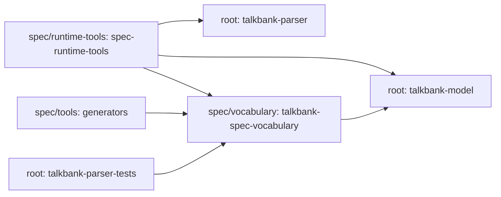

# Repository Architecture and Boundaries

**Status:** Current
**Last modified:** {{git-dates:page}}

Use this page to locate an owner, then follow its workflow. It is an orientation
map, not proof that every boundary is already enforced or every package is
published.

## Top-level layout

| Location | Owner and purpose |
| --- | --- |
| `spec/` | Authored construct/error examples, claims and registries; separate Cargo workspace |
| `spec/tools/` | `generators` package for core spec tooling |
| `spec/runtime-tools/` | `spec-runtime-tools`, including real-parser generation and validation |
| `spec/vocabulary/` | `talkbank-spec-vocabulary`, shared spec vocabulary used by tooling and test support |
| `grammar/` | Grammar source, queries, generated parser/metadata and `tree-sitter-talkbank` bindings |
| `crates/` | Shared Rust libraries, CLI package, LSP and test/build support |
| `apps/chatter-desktop/` | Tauri backend plus frontend; backend is a root-workspace member |
| `corpus/` | Reference and generated validation inputs; not production-corpus custody |
| `schema/` | Generated model JSON schema |
| `tests/` | Workspace test fixtures and integration support |
| `xtask/` | Repository maintenance commands |
| `book/` | Primary human documentation |
| `docs/` | Release/operator contracts, retained audits and generated diagnostic reference |

The [Crate Reference](crate-reference.md) supplies package-to-directory mappings.
The [Spec System](spec-system.md) identifies generated artifact owners; edit
those inputs and regenerate rather than modifying generated outputs.

## Two workspaces, not two isolated dependency graphs

The root `Cargo.toml` owns application, library, grammar and maintenance packages.
`spec/Cargo.toml` owns `tools`, `runtime-tools` and `vocabulary`.
Workspace membership selects lockfiles, profiles and commands; it does not
forbid path dependencies across the boundary.

In particular, `spec-runtime-tools` depends on the real model and primary
parser, and `talkbank-spec-vocabulary` depends on the model. Root test support
also uses the shared vocabulary. Do not describe spec tooling as universally
independent of runtime crates or infer a normal application dependency from a
test dependency.

This diagram shows selected cross-workspace dependencies; arrows mean
"depends on," not generation order:

For ordinary authoring, use the repository's `just` recipes from the root.
When invoking Cargo directly for spec tooling, select
`--manifest-path spec/Cargo.toml` and the intended package, or its package
manifest. See [Spec Workflow](../contributing/spec-workflow.md) for the
supported commands and acceptance boundaries.

## Responsibility and admission

- Specs retain intended examples, claims and rationale; observed parser output
  is evidence, not authority to silently change a claim.
- Grammar owns tokenization and CST shape. It includes recovery, which is not
  itself a declaration of valid CHAT.
- The model owns typed data, semantic validation, serialization and the shared
  parser API; frontends retain distinct source/recovery evidence.
- Transforms own admitted workflows and edits, not corpus-specific policy.
  JSON shape admission and CHAT semantic validation remain distinct steps.
- Cache reuse has its own identity and outcome admission. A lookup is not
  a new validation or roundtrip result.
- Application boundaries choose policies and presentation. They consume
  public crate APIs; this is not a claim that all internal APIs are stable
  across pre-1.0 revisions.

Source builds and regeneration are separate workflows. Follow
[Grammar Workflow](../contributing/grammar-workflow.md) for the pinned external
traversal generator and [Development Checks](../contributing/dev-checks.md)
for explicit verification. No layout diagram certifies public package
availability, supported-platform qualification or independent handover.

## Contributor review questions

Can the contributor identify the authored input, generated consumers and
owning crate? Does a proposed change preserve the source/recovery/admission
contract at each affected boundary? Which real workflow and retained evidence
will establish the change, and which release or operator acceptance remains?

Use the current manifests for exact dependencies and features. A crate's name,
field count or position in this map is not a correctness argument.
