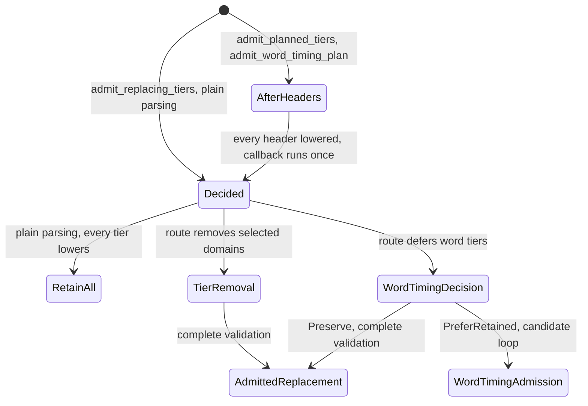
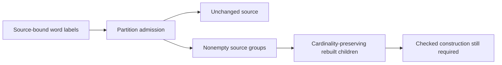
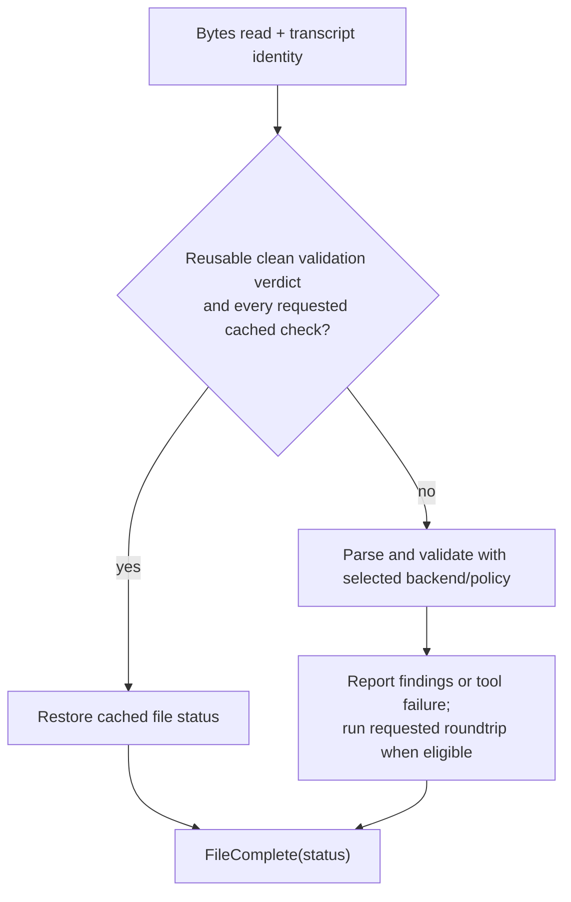
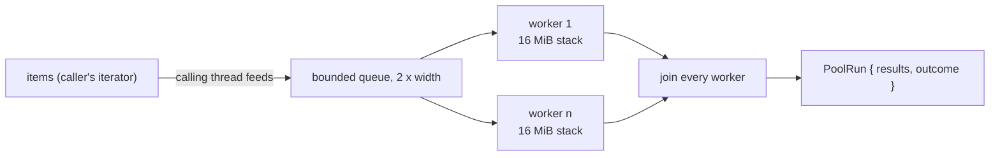
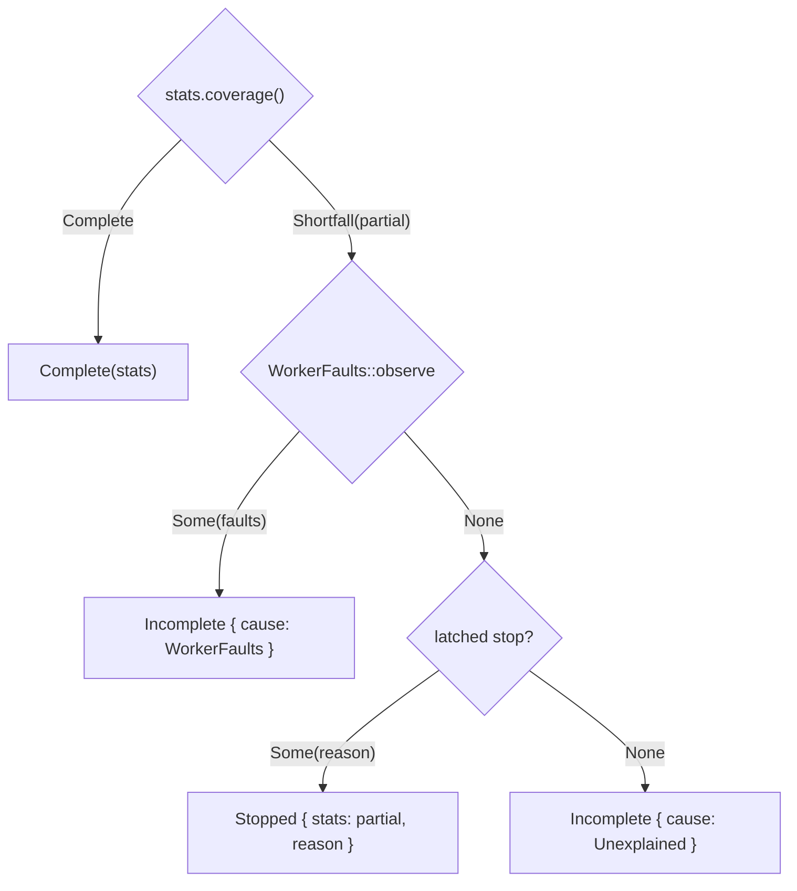

# Transform Pipeline

**Status:** Current
**Last updated:** {{git-dates:page}}

The `talkbank-transform` crate provides high-level pipelines that compose parsing, validation, and serialization into reusable workflows.

Start with the [runnable library recipes](../chatter/integrating/library-usage.md)
for parsing, validation and serialization. This chapter explains the admission
boundaries and the more specialized transformation and batch-runner contracts.
Returning a model, validating it, preserving original bytes and admitting a
rewrite are distinct operations.

## Core Pipelines

### Transcript construction

`build_chat` assembles a typed `TranscriptDescription` into a mutable CHAT
document; validation remains a separate step. Media names accepted by
`MediaFilename` as HTTP/HTTPS references are preserved verbatim, including
quotes, extensions and Unicode spelling. They are not filesystem paths and
are never fetched. Complete input spelling must pass media representability
admission before local basename/extension reduction; malformed directory text
cannot be hidden by normalization. The resulting local stem is admitted again.

### Parse + Validate

`parse_and_validate(source, options)` creates a parser and returns
`Result<ChatFile, PipelineError>`. Validation depends on `ParseValidateOptions`:
`with_validation()` requests structural checks; `with_alignment()` additionally
requests tier alignment. The default is parse-only. The returned model is
mutable, so even successful validation does not leave a retained capability
after subsequent edits.

| Need | Entry point and boundary |
|---|---|
| Reuse a parser | `parse_and_validate_with_parser(&parser, source, options)` |
| Receive diagnostics as they are produced | `parse_and_validate_streaming(source, options, &sink)`; this still takes the whole source string, not chunks of input |
| Preserve the input filename for filename-dependent rules | `parse_file_and_validate(path, options)` or a named variant taking `TranscriptName` |
| Retain immutable validation evidence | `parse_validated_with_parser` returns `ValidChatFile` under an explicit validation policy |

The non-streaming parse-only path rejects parser errors. Streaming parse-only
can return recovered content alongside error diagnostics, so `Ok(ChatFile)`
alone is not a valid-input verdict. Required validation uses the shared checked
producer; internal failures remain separate from CHAT findings. See the
[tested parsing recipes](../chatter/integrating/library-usage.md#parsing-and-validating-a-chat-file)
and [diagnostic contract](../chatter/integrating/diagnostic-contract.md).

`PipelineError::from(ValidatedParseError)` owns the compatibility conversion.
Parse rejection keeps its diagnostics but discards the parse product; ordinary
validation rejection keeps its complete diagnostic list. Incomplete validation
retains the rejected document, policy and transcript name as well as diagnostics.
Internal failure takes precedence, even when its diagnostic has warning severity
or the model also has unknown provenance. The publicly constructible parse-error
tag cannot override an internal diagnostic in its product. These are distinct failure states,
not interchangeable ways to report invalid CHAT. Boundary tests exercise the
conversion with real model admission and explicitly injected tool faults;
they do not prove that each failure is reachable from authored CHAT source.

### Source-bound preservation versus replacement

`TreeSitterParser::admit_planned_tiers` selects a tier-removal policy from the
headers of the same producing parse. It fully validates the retained document;
this does not certify original bytes when replacement was selected.
`AdmittedReplacement::into_disposition` consumes that result and distinguishes:

- `AdmittedDisposition::Preserved(AdmittedPreservation)`: no replacement was
  selected and no concrete tier was removed. The capability binds complete
  admission to the exact original source, including its formatting.
- `AdmittedDisposition::Replaced(AdmittedReplacement)`: only the retained
  document is admitted. Even a selected replacement that matched no tier cannot
  manufacture original-source admission through this transition.

`AdmittedSourceChat::from_preservation` transfers the opaque preservation
capability directly to an unchanged-output proof without parsing again or
accepting independently supplied source/model arguments. Editing still consumes
admission and requires fresh checked construction before output. Recovery and
internal failures cannot produce either successful admission state.

`TreeSitterParser::admit_word_timing_plan` additionally supports
`WordTimingPlan::PreferRetained`. Its producer defers concrete `%wor` candidates
and their own diagnostics while lowering every other component normally.
Complete original admission retains valid timing, including partial timing and
legal stale sidecars; reusability is a separate downstream decision. If original
admission fails, the plan physically omits only the concrete word tiers the
evidence names (their own lowering failed, or a validation error lies inside
their source span), binds those diagnostics to each removal receipt, and
validates the reduced document again; errors located in no word tier remove
every remaining word tier. It requires complete retained admission before
returning a word-timing replacement receipt, never clears recovered-model taint
and never filters diagnostic codes. Internal producer failures cannot select
regeneration. The [word-timing chapter](wor-timing.md) describes the loop.

Components parse and lower once. Word-tier entries move into the document
rather than being copied, and a rejected attempt returns the document with its
diagnostics (`ValidationFailure::into_rejection`), so no model copy is made;
removal finds each entry again by its own source span. `WordTimingPlan::Preserve`
gives no exemption and is appropriate for actual pass-through or preservation
policies.

The plan's phases are types. Lowering consumes a `PlanEntry`, either already
decided or a header callback, and hands back the decided plan beside the
producing source, so nothing can route a tier or read a selection before the
decision. Each decided plan implements `TierRouting`: `RetainAll` (plain
parsing) and `TierRemoval` (nothing, or a fixed selection with its removal
receipts) never defer a tier, and their deferred type is uninhabited, so their
utterances carry no word candidates by type;
`WordTimingDecision::PreferRetained` defers word tiers and makes no removal
receipt during lowering. Removal receipts and deferred candidates therefore
never coexist in one plan.



### Source-bound utterance partitions

`utterance_split::UtteranceSplitPlan` selects morphology-domain or original-word
timing-domain assignments against one borrowed utterance. Execution accepts no
second model or assignment vector. It refuses count drift, disjoint child runs,
boundaries inside indivisible groups/replacements and separator-stranding
boundaries. Child-label magnitudes do not determine allocation sizes.
Execution returns `SplitOutcome::Unchanged` when every slot names one child, so
the caller keeps the utterance it holds and nothing is copied; only
`SplitOutcome::Split` rebuilds children.

The shared partition policy retains free-text dependent tiers on the first
child, preserves only count- and lexically corroborated `%wor`, and derives a
child's main timing only from complete measured word timing. Original-turn
analysis and uncorroborated word timing are returned as explicit, source-bound
invalidation receipts, not merely logged. No full parent interval is assigned
to a partial child. Rebuilt children still need checked construction before
output; structural partition admission is not whole-file validity.

The authored `content/split-metadata.cha` reference combines utterance-language
metadata, linkers, postcodes, measured word timing and tier retention policies.
Language and coarse parent spans accompany every child; linkers and free-text
tiers accompany the first, while the original terminator and postcodes accompany
the last. Positional phonology and document-scoped coreference are invalidated
with receipts pointing to their original tiers. Count-drifted timing is neither
retained nor replaced by the parent's whole-turn bullet.

Internally, partition admission owns the producing utterance and borrows its
content as distinct nonempty first/last groups and optional interior groups.
Rebuilding consumes that ordering through a cardinality-preserving producer;
readers cannot create empty buckets, omit an endpoint or supply another source.
The word-tier partition receives the same producer-owned affiliations, including
leading word-tier separators, rather than an independently supplied group count.
`WorMainTierProjection` constructs each selected word's `WorSourceContent`
against its producing main tier. Count matching, lexical corroboration and
complete timing retain that borrowed root and position. Both ordinary timing
assignments and measured speaker ownership consume those positions; neither
reconstructs the selected population with a second word walk. Word-tier
partitioning streams the same positions through the admitted source groups,
without an independent word/group vector or membership-agreement recheck.
Timing is assessed from the tiers actually attached to the rebuilt children,
not a second indexed rematch. Empty word tiers remain possible and are omitted;
that does not erase their child's main-tier content.



The final child inherits the source's terminator **including absence**. CA
intonation contours can end an utterance without a separate terminator; a split
must not invent a final period. Earlier children receive derived periods, while
the final child's original contour, ending and postcodes stay together.
The authored `tiers/wor-replacements.cha` control additionally preserves spoken
original-word timing through single- and multiple-word replacement targets.

`utterance_split::WordSpeakerSource` admits complete source timing before
requesting acoustic inference and keeps its immutable source borrow through
that request. `bind_timeline` then establishes `WordSpeakerSplitPlan`, without
rematching timing or accepting another source. The convenience split-plan
constructor performs those same transitions when evidence already exists.

Complete timing retains `CompleteWorTimingSlots`: a mandatory first slot and an
ordered tail, rather than a vector whose nonempty proof is lost at an accessor.
Speaker admission measures that first slot before constructing
`WordSpeakerOwnership`. Its first distribution and ordered tail travel unchanged
through the plan, outcome and consumed parts. Neither stage can substitute an
empty population; acoustic gaps and ties remain genuine refusals. Ownership
serialization remains a JSON array in source-word order. These collection APIs
provide infallible `first`, `following`, `len` and ordered iteration, not slice
indexing or mutable-vector access.

Complete timing and unique acoustic winners do not establish structural
divisibility. Speaker changes inside an annotated or nested group refuse with
the underlying partition error; a change before the whole group preserves its
content and corroborated child word tiers. Replacements retain their spoken
original's timing, including when the replacement target contains several words.

The split plan adds measured word-level speaker ownership to that same partition
owner. It requires complete, lexically corroborated `%wor`, uses
union-of-held-time attribution from `rediarize`, and refuses uncovered or tied
words. It never picks the nearest turn or carries a previous speaker through a
gap. Returning to a prior speaker creates a new contiguous child run rather than
reordering words. A single run is `WordSpeakerPartition::Relabeled`, which names
the owning track and leaves the source for the caller to relabel; only several
runs rebuild children. Execution retains ownership evidence and invalidation
receipts; participant identities, headers and final output admission remain the
caller's responsibility. The existing whole-turn rediarization API and its
contestation reporting are unchanged.

Each nonempty content group receives its speaker from the source-word slot that
established that run, during partition admission. The rebuilding producer uses
that attached affiliation when constructing the child. Execution does not
reconstruct a run list, zip an independent speaker vector with children or
repair a count mismatch. The legacy `ProducerChildCount` refusal and fallible
`execute` signature remain API-compatible but are no longer produced. A single
run retains its source borrow and measured speaker without copying its content.
`into_parts` consumes the partition and all measured word distributions together.

### CHAT → JSON

Convert a CHAT file to its JSON representation:

```rust,ignore
use talkbank_model::ParseValidateOptions;
use talkbank_transform::{JsonLayout, chat_to_json};

let json = chat_to_json(source, ParseValidateOptions::default().with_validation(), JsonLayout::Pretty)?;
```

The JSON follows the schema at `schema/chat-file.schema.json`, and is checked
against it before it is returned.

`JsonLayout` is `Pretty` (indented, the CLI's default) or `Compact` (one line,
`chatter to-json --compact`, which chatter's clap parsing turns into the
value). It was a `pretty: bool`, which every caller had to
spell as a bare `true` or `false`. `chat_to_json_named` adds the transcript's
name (so E531 can run), `chat_to_json_with_schema_policy` adds a
`JsonSchemaPolicy`, and `chat_to_json_unvalidated` skips the schema check; all
four take the layout the same way, and the schema policy and the layout are
matched as one pair, so every combination has exactly one serializer.

### JSON → CHAT

`chat_to_json` checks its emitted JSON against the schema. That is distinct
from the CHAT checks selected by its options. JSON can be deserialized into
`ChatFile` and serialized with `WriteChat`, but this does not recreate the
original parser evidence, formatting or byte sequence. Deserialization enforces
the model's serde boundaries, not every CHAT validity rule.

`chatter from-json` performs this deserialize/serialize path without a separate
JSON Schema or CHAT-validation pass. Validate the resulting CHAT before treating
it as accepted input. The [JSON Schema guide](../chatter/integrating/json-schema.md#roundtrip-expectations)
states the roundtrip limits; the
[library recipes](../chatter/integrating/library-usage.md) provide the maintained
serialization examples.

### CHAT → CHAT (Normalize)

Parse and reserialize to normalize formatting, selecting validation explicitly:

```rust,ignore
use talkbank_model::ParseValidateOptions;
use talkbank_transform::normalize_chat;

let rewrite = normalize_chat(source, ParseValidateOptions::default().with_alignment())?;
let normalized_text = rewrite.text();
```

`normalize_chat` lives in
`crates/talkbank-transform/src/pipeline/convert.rs` and returns `Rewrite`, not a
bare string. It does not write a destination. Its loss guard rejects a source
line whose non-whitespace content has no remaining ordered match in a serialized
line; identical bytes take the fast path. Each match consumes its output bytes,
so a surviving duplicate cannot stand in for a deleted occurrence. Continuation
lines can consume successive parts of one joined output line. This guard ignores
whitespace and is not a source-bound edit or semantic-equivalence proof.
Do not infer arbitrary-transform preservation or whole-file validity from
`Rewrite` alone. Keep the input and review output before replacement; source-bound
preservation and checked transformation APIs above serve different contracts.

### Selective name pseudonymization: planning API under development

`pseudonymize::NameMap` admits a private caller-supplied mapping.
`TranscriptNames::admit_document` binds that mapping to parsed, validated source,
including alignment checks. `PseudonymizationInput::plan_words` creates sensitive
review previews without mutating the input. `PseudonymizationInput::prepare_output`
can produce an admitted in-memory `PseudonymizedDocument`, but this is
**not yet a user-facing de-identification command**. Private receipt persistence,
CLI integration and broader policy/corpus acceptance remain unfinished.

Output preparation refuses unsafe lexical, morphology, timing or pronunciation
plans. It applies only their source-bound edit ranges, copying every intervening
byte unchanged; applied private receipt entries are built during that same
operation. The rewritten source must pass parsing and alignment-aware validation
under the input's filename and rule context. The output parse is reused for a
follow-up plan, which must propose no further changes. A refusal retains original
review findings but exposes no partial output text. Accepted output still is not
a promise of complete de-identification: report-only findings remain visible in
its private review and callers must protect both output and receipts.

Lexical reviews retain a producer-assigned `WordLocation`: zero-based utterance
and original-word indices, plus `WordSpelling` distinguishing spoken material
from an indexed editorial replacement target. Retraced words count; separators
and targets do not advance the original-word index. These are review coordinates,
not morphology or phonology alignment indices. Aligned morphology, corroborated
timing and pronunciation refusals carry the selecting word's location through
their existing bindings. Applied lexical edits retain it in `EditOrigin`; their
`EditKind` is derived from that origin rather than stored independently. Multiple
source fields removed from one shortening retain the same word location.
Metadata findings and edits carry `HeaderFieldLocation` (header index plus typed
field); prose uses `ProseLocation`, which distinguishes a document header from
an utterance's dependent tier. Header indices count all headers, including
structural ones; dependent-tier indices count all tier kinds. Independently
reported morphology uses `LemmaLocation`: utterance, morphology-item index and
`LemmaPart::Main` or a specific post-clitic. It never invents a main-tier match
for an unmatched lemma. Exact source ranges remain available alongside this
context. All indices are zero-based. The receipt prototype described below is
test-only, not an available CLI persistence workflow.

The CLI repository contains a publication/receipt prototype separately from the
transform. Its module is compiled only under `#[cfg(test)]`; command routing and
end-to-end acceptance remain unfinished. Within that prototype, the publisher
stages only admitted `PseudonymizedDocument` bytes beside an explicit output
destination and uses no-clobber publication. Existing files, directories and
symlinks are not replaced; a collision after staging also refuses publication.
Abandoning preparation removes its temporary file, not the input or destination.
Unix staging files are owner-only; other systems require a protected destination
directory's inherited ACL. This does not establish a cross-file transaction or
crash-durable directory update.

The prototype's receipt owner encloses the low-level publisher. Its
`PreparedPublication` owns both the staged file and a committed private SQLite receipt; callers cannot
separate that evidence from its output or call the enclosed publisher directly.
The receipt records source/output BLAKE3 identities, the exact applied edits,
typed locations and report-only findings in queryable tables, not JSON blobs.
It starts as `prepared`, becomes `written` only after publication and file sync,
or records `publication_failed` on a no-clobber failure. An interruption or failed
completion update can leave `prepared`; that state means uncertain publication,
not success or proof of absence. Failed receipt initialization can leave an
incomplete database; its existence alone is not a prepared receipt. Existing
receipt files are never overwritten.
SQL dependencies live in the CLI, not the transform core. The user command
remains unavailable pending command routing and end-to-end acceptance. Refused
plans have separate `output_refused` receipts: proposals are labeled `proposed`,
never applied, and output coordinates and identity are absent. Input admission
refusals and missing map entries are distinct states. A derived summary view
distinguishes a mapped document with no findings from an unmapped document.

The authored `word-features/pseudonymizer-source.cha` / `pseudonymizer-expected.cha`
pair tests exact output, every untouched gap, cross-tier changes, metadata,
possessive retention, deterministic application and idempotence. Existing
pronunciation, morphology and timing mismatch references also exercise whole-
document refusal. A placeholder that reintroduces a mapped word at a Unicode
boundary is refused during map admission, before document planning. Placeholders
must first be plain CHAT lexical tokens; invalid tokens are refused separately.
The output stability check remains an independent boundary safeguard.

Admission retains the producer-owned `ParsedSource` alongside the validated
model. `TreeSitterParser::parse_chat_file_with_source` returns both from one
parse; its diagnostics still require review and its model still requires
validation. The retained CST enables generated source-bound field traversal
without a second parse, raw-line searches, or assuming whole-header serialization
preserves untouched formatting. CST ownership alone is not a validity proof.
Admission refuses both errors and warnings. Canonical controls exercise empty
input, missing participant roles, forbidden controls inside free text, and a
warning-only non-NFC media name paired with its canonical spelling. Even rejected
empty input can retain a CST; its existence never authorizes transformation.

Header-field review covers whole Unicode-bounded names within participant names and
typed `@ID` group, education and custom fields, including repeated names within
longer metadata text. It uses the same matcher and report-only possessive
policy as prose, not a second whole-field replacement path. Generated field
projections supply exact source ranges; a binding failure is a refusal, not
permission to search raw lines. `ParticipantWordRoles` owns the name/role
partition for both parser lowering and source-bound review. Speaker codes,
participant roles, spacing and structural pipes are not selected. Each match
has exactly one metadata or prose owner; these are still review findings, not
complete writable pseudonymization.

The current planning policy uses exact-case typed lexical components, reports
case near misses, and derives dependent-tier changes from selected main-tier
words. Main-tier previews retain exact generated text/shortening edits;
each shortening owns its parentheses and inner segment, so it cannot create
overlapping edits. Marker bytes, suffixes, annotations and unselected compound
partners remain outside those ranges. Source association and lexical-piece
corroboration are required: failure creates a refusal instead of an unbound
proposal. The `word-features/selective-name-fields.cha` reference exercises
lengthening and names on either side of a compound boundary.

Free-text planning uses `unicode-segmentation` word boundaries on typed prose
payloads, with apostrophe-s possessives such as `Rose’s` and `Rose's` reported
rather than partially rewritten. A mapped name may span several segments, such
as `Rose-Marie`. At each boundary the longest recognized spelling takes
precedence, including report-only near misses and possessives: mapping both
`Rose` and `Rose-Marie` never partly rewrites `Rose-marie` as `Rose`.
The `headers/unicode-name-boundaries.cha` reference exercises this policy in
participant names, ID metadata and prose. `LexicalPlan::free_text` returns private
source-bound exact matches, case near misses and possessive review findings.
The CST supplies prose segments within descriptive headers and free-text
dependent tiers (including user-defined tiers); timing bullets, identifiers,
configuration headers and structured tiers are not treated as prose. This does
not tokenize raw CHAT structure. Header-field review above reuses this matcher
while retaining its own typed metadata classification.
The `headers/free-text-names.cha` reference covers accented names, punctuation,
continuation lines, timing, possessives and several dependent-tier kinds.

Dependent-tier proposals are driven by the selected main-tier
words. Morphology requires established lemma correspondence. Edit locations
are not inferred from text searches: each morphology proposal retains
the generated, source-bound main-lemma field from the same admitted parse.
Tier item counts and lemma values corroborate the association; failure refuses
the proposal. Post-clitic fields are not mistaken for subsequent main items.
The canonical `tiers/mor-name-source-fields.cha` example exercises repeated
names, both shortening forms, uneven spacing and a preceding post-clitic item.
This establishes exact edit locations, not writable document output.
Unchanged mapped lemmas, including post-clitics, are reported separately as
exact matches or case near misses; the lemma scan cannot authorize an
independent replacement. Compound
components without proven lemma-part correspondence produce a refusal.
Timing uses the [`%wor` corroboration transition](wor-timing.md). Words within a
timing tier receive the selected main word's existing component decisions, not
another name-map lookup. Equal cleaned spellings with different compound
structure refuse the change. Exact timing-word lexical edits preserve markers
and leave timing bullets outside their ranges; a failure refuses the tier's
proposal rather than exposing a partial list. The selective-name reference
also covers a name that occurs only in the timing tier: it is not independently
replaced.

Words within a phonological group share the group's alignment position.
Pronunciation findings retain the
original `%pho`/`%mod` item and refuse automatic output; structured Phon
companions require correspondence review. No tier is silently dropped and no
orthographic placeholder is treated as a pronunciation. These review objects
contain protected transcript content and must not be logged by default.

## Catalog selection and source-owned splicing

`FixDiagnosis::observe` retains one actual parse's source/CST, produced model,
complete findings, validation policy and transcript name. Readonly
`FixFinding` views are issued only by that owner. Their `catalog()` resolves
against its source and distinguishes Offered, Unsupported, Ineligible,
SourceUnavailable and Fault. Missing repair policy is not a source-capability
failure. Diagnosis is not validity; recovery and warnings remain visible.

An offered opaque `CatalogFix` is Mechanical, Semantic or Alternatives;
`safety()` derives from that closed variant. Its consuming `into_kind()`
exposes raw candidates without issuing application authority. The diagnosis's
consuming `select(&FixCodeSelection)` aggregates only its own findings:
mechanical proposals select by default, semantic proposals require an explicit
code, and alternatives never batch-select. No append accepts another session.

`SelectedRepairs::admit()` obtains the model from its diagnosis.
`AdmittedRepairs::apply_verified()` obtains that same owner's source and
returns `VerifiedRepairs`, retaining the diagnosis beside verified bytes.
Neither transition accepts substitute arguments. Existing recovery exceptions
and unknown/constructed-health refusal remain.

`AdmittedEdits::map(source)` produces `MappedPlan`, which retains the exact
immutable source, checked extents and computed edit sites. Assembly and the
byte verifier share that one owner. `MappedPlan::apply_verified()` issues
`ByteVerifiedSplice`. The repair path retains it inside `VerifiedRepairs`;
the CLI derives baseline counts, policy and name from its actual diagnosis
before issuing its private post-checked result after full diagnostic-multiset
nonincrease and targeted-site clearance. The
writer receives that result, not an arbitrary string beside a success flag.
It does not recompute the mapping.

Raw `apply_edits`, independent `verify_splice`, and plain-text
`apply_edits_verified` remain available for numeric and external-byte contracts.
Generic `admit_edits(model, edits)` likewise remains an intentional boundary.
These raw routes cannot construct diagnosis-associated phases or CLI authority.
Checked `u32` extents add no CHAT-size policy. These local phases do not prove
semantic correctness, whole-document validity or filesystem
race safety; report mode and explicit application retain their existing policy.

## Validation + Roundtrip Cache Lifecycle

The runner decides whether cached evidence covers the requested work before
processing a file. A cache hit is not automatically a successful file result:
for example, a cached failed roundtrip remains a failure.



The roundtrip check serializes the parsed model, reparses that serialization
with the selected backend, serializes again and compares those two strings.
It tests serialization idempotence, not equality with the original input bytes.
The reparse is parse-only; internal failures remain separate from mismatches.
See [cache reuse policy](parser-and-grammar/validation-cache.md) for why a cached
invalid verdict still requires diagnostic-producing work and why internal
failures do not become cached CHAT verdicts.

## Streaming Parse

Here, streaming means diagnostics or per-file results arrive as work proceeds.
`parse_and_validate_streaming` receives a complete source string and constructs
a `ChatFile`; it does not offer bounded-memory, chunk-by-chunk transcript input.
The batch runner streams file-completion events from its workers. Tree-sitter's
incremental reparse API is a separate operation that can reuse an earlier tree.

## The shared batch-validation runner

CLI/TUI and desktop batch validation use the shared `validation_runner` in
`crates/talkbank-transform/src/validation_runner/`:

- `validate_directory_streaming` walks a directory and feeds every CHAT
  transcript to a worker pool;
- `validate_files_streaming` runs an explicit file list through the same
  worker pool;
- `validate_arguments_streaming` consumes expanded command-line arguments,
  including their discovery failures.

These are batch-validation entry points, not the sole parsing or validation
path for every operation. Conversion pipelines and editor document validation
have their own callers and input lifecycles.

### The one worker pool and the one walk

The shared pool helper is `talkbank_transform::worker_pool::fan_out`;
`chatter to-json` uses it for directory conversions too. Each invocation owns
its worker pool, not a process-wide singleton.



- Requested width is `--jobs`, else the machine's available parallelism (one
  if that query fails). Actual width is capped by the iterator's upper bound
  when known, with a minimum of one. Serial work uses the same pool helper.
- Every worker runs on a `CHAT_THREAD_STACK_BYTES` (16 MiB) stack, the size of the
  CLI's program thread, because parsing and validation recurse with the data.
- Each worker RETURNS its result (the validation runner's per-worker tally,
  to-json's counts); the caller combines them after the join. Nothing reads
  shared counters whose exactness rests on a comment. Workers borrow what
  they share (the event sender, the cancellation latch, the cache and the
  configuration) through a `WorkerContext` of references, because the
  pool's threads are scoped: no `Arc` clones, no per-worker config copy.
- A worker that unwinds is joined and counted as `PoolOutcome::SomeUnwound`;
  a thread that cannot be started is `PoolOutcome::CouldNotStart`, with
  nothing fed. The caller measures what was lost against what it fed.
- Stopping early is the caller's iterator (the runner feeds
  `take_while(not cancelled)`); workers stop by returning.

Discovery is `talkbank_transform::paths`. Every walk descends every level.
`walk_files` returns every file found WITH its path relative to the walked
root (a `FoundFile`), built as the walk descends, plus every entry that could
not be read. `keep` is given each entry's file name, so a rejected entry
never has its path built. `walk_transcripts` returns each transcript as a
`FoundTranscript`: its relative path and its `StoredTranscript`, whose name
is the listing entry that found it, so nothing lists the directory again to
learn the stored name (a stem that is not UTF-8, which validation could not
name, is a failure of the walk). What happens at a symbolic link is the
caller's choice, a `Links` value:

- `Links::Follow` (every reading walk): a link is walked as what it points
  to, a directory reached twice is walked once, and a link whose target is
  gone is a failure whatever its name: nothing says whether it was a file
  or a directory, and a link to an unmounted volume's subcorpus hides every
  transcript under it.
- `Links::Skip` (`to-json --prune`, the one walk whose results are
  deleted): links are neither walked nor kept. Following them would let
  `--prune` delete JSON outside `--output-dir` through a linked directory,
  and then remove that directory's emptied parents.

Only native regular-file entries become `FoundFile` or `StoredTranscript`.
Checked file-kind evidence travels from classification through discovery to
stored-name admission; there is no unchecked “every non-directory is a file”
fallback. Direct path and `DirEntry` constructors refuse directories and special
entries. Directory arguments still expand recursively. A selected socket,
device or pipe, including a followed link to one, is an explicit input I/O
failure before content reads; a nonselected entry is outside the walk's filter.
Regular-file links retain their own stored name and cache location. The walker
reuses its native type observation rather than adding a stat per admitted file.
This is admission-time evidence, not a guarantee against later filesystem
replacement: subsequent read failures remain I/O failures, never CHAT invalidity.

A directory the walk cannot list is always a failure, never skipped, even an
operating system's own folder at a volume root (`.Spotlight-V100`,
`System Volume Information`, `lost+found`): nothing can say whether it held
transcripts. Walk the corpus directory, not the volume root.
`expand_transcript_arguments` is the one expansion of command-line paths:
each file argument is resolved to its stored name by one
`StoredNameResolver` (each parent directory listed once), and each directory
argument contributes its walk's transcripts, so the result is
`StoredTranscript` values. The runner's work queue carries those values,
and `validate_files_streaming` resolves a plain path list the same way
before any worker starts, so no worker resolves a name. Nothing is skipped
silently, and there is one policy for what cannot be
read: it is a `FileStatus::ReadError` in the run's own results, counted in
its totals, so the run fails and says which paths. The directory entry
point does this for its walk, and `validate_arguments_streaming` for
command-line arguments (`chatter validate`), so the unreadable path reaches a
JSON consumer as a record. Commands that are not streaming runs (`fix`,
`to-json`, the `debug` commands) refuse an incomplete input before
processing anything.

The entry points share one worker loop and accounting model, including
file-stem-dependent checks such as the `@Media` filename match. Actual rule,
alignment, backend and roundtrip selection come from `ValidationConfig`.
`ValidationRun` binds that configuration to a compatible cache identity or an
explicit uncached run; shared code does not require every frontend to use the
same cache or settings. For the same bytes, stored filename and validation
policy, selecting a file directly or by a directory walk must not change its
validation result. This is the contract, not proof of every frontend workflow.

### What a run checks: typed, end to end

`ValidationConfig` says what each worker checks with typed values, never
booleans: `alignment: AlignmentValidation` (`Structure` or
`IncludeTierAlignment`) and `roundtrip: RoundtripCheck` (`Skip`, the default,
or `Run`). A frontend parses its flags into these once, at its boundary:
chatter's clap arguments are `Flag<AlignmentValidation>` and
`Flag<RoundtripCheck>` (see "Flags parsed into modes" below), and the desktop
translates its request's checkbox where it deserializes it. The CLI's
`ValidationRules`, the TUI and the desktop runner then carry the same values
the worker matches on; the libraries have no bool-to-mode constructors, and
there is one roundtrip type from flag to worker.

### The CLI's side: one presentation, one renderer, one ending

`chatter validate` resolves its output flags once, in dispatch, into a
`ValidationPresentation`, then runs one event loop:

```mermaid
flowchart TD
    flags["--format, --quiet, --audit, --tui-mode"] --> resolve["ValidationPresentation::resolve\n(conflicts are usage errors)"]
    resolve -->|Tui| tui["TUI loop\n(same runner, same error limit)"]
    resolve -->|"Streamed(Lines / Json / Audit)"| renderer["one ValidationRenderer"]
    renderer --> loop["event loop: discovering, started,\none FileComplete per file (status + diagnostics)"]
    loop --> end["the run's RunEnding\n(Aborted(NoEnding) if the stream closed without one)"]
    tui --> end
    end --> finish["renderer.finish(&RunEnding): exhaustive"]
    end --> exit["ValidationOutcome::failed(): !RunEnding::passed()"]
```

Ordinary run outcomes (a stop, a loss, an abort, an input with nothing in it)
travel through `RunEnding` and the renderer rather than a separate ad hoc
stderr message. This keeps those outcomes in JSON mode's structured channel;
it does not guarantee empty stderr under tracing, panic hooks or startup
failures. The TUI shows the same ending
and returns it with the session (`InteractiveEnd::Closed(RunPhase)`), so
the exit status is the run's on every surface: only `RunEnding::passed`
exits 0, and a session closed before its run ended fails. The TUI lists
every file that failed (its diagnostics, or why it could not be read, why
its roundtrip failed, or the tool failure) and shows the run's notices and
cache events, as the other surfaces print them.

### Flags parsed into modes

A presence flag selects one of two values of a typed mode. chatter's
`cli/args/flag_modes.rs` has one generic clap argument, `Flag<M>`, for any
`M: FlagMode` (the flag's name, help, optional short form, and the value
when it is absent or present), so a command's field is
`#[command(flatten)] alignment: Flag<AlignmentValidation>` and its handler
receives the mode. `FlagMode` is chatter's own trait, so it can be
implemented for library types (`AlignmentValidation`, `RoundtripCheck`,
`JsonLayout`, `JsonSchemaPolicy`) as well as chatter's (`FixMode`,
`ClearMode`, `CacheRefreshMode`, `JsonRefresh`, `OrphanJson`,
`AlignmentView`). The translation from flag to mode therefore lives in the
CLI, and the library crates expose no constructor from a `bool`.

Two flags that select one value have their own `Args` impls, which refuse
the combinations that would leave one flag without effect: `ToJsonCheckArgs`
(`--skip-validation` conflicts
with `--skip-alignment`) and `NormalizeCheckArgs` (`--skip-alignment`
requires `--validate`), each yielding one `CheckLevel`.

### How a run ends, and who decides

On normal completion and supported unwind paths, a connected receiver gets
one `ValidationEvent::Finished(RunEnding)`. The guard does not cover process
termination, aborts or failure to start the orchestrating thread. Consumers
must still handle channel closure without an ending. The runner decides which:

- `Complete(stats)`: at least one file was discovered and every one was
  accounted for. The only basis for a claim about the whole input, though
  still not "all files valid": `RunEnding::passed` adds that no file was
  invalid, unreadable or a tool failure. A run that was told to stop after
  its last file had already been taken also ends here, because nothing was
  left to stop.
- `NothingFound`: the input named no transcript and nothing unreadable. It
  has no counts. The runner's `NonZeroUsize::new(total_files)` is the one
  place this is recognised, so every snapshot's `total_files` is non-zero.
- `Stopped { stats, reason }`: the run was told to stop and
  left `stats.missing_files()` (non-zero) files unvalidated. `reason` is a
  `CancelReason`: `ErrorLimit { limit }` (the run's own error limit) or
  `Requested` (the caller's `Canceller`). Its `Display` is the one wording
  every surface uses.
- `Incomplete { stats, cause }`: the run reached its end
  without covering everything it discovered, and no requested stop explains
  it. `cause` is a `LossCause`: `WorkerFaults`, every worker failure the run
  observed (the pool's own `PoolFault`, `Unwound` or `ThreadRefused`, and
  `ParserUnavailable`, none hiding another), or `Unexplained`, a runner defect. `stats` describes only what
  was processed.
- `Aborted(reason)`: no totals at all. A drop guard on the orchestrating
  thread sends `Aborted(Panicked)` during an unwind, so a panicking run
  terminates its stream instead of closing it in silence; a consumer whose
  stream closes with no ending anyway reports `Aborted(NoEnding)`.

`passed()` is the single answer to "may this run be reported as a success":
the CLI's exit status, the TUI's header color and the desktop's all-valid
claim all read it. Counted endings require producer-admitted `CompleteStats`
or `PartialStats`, each exposing read-only `snapshot()` counts. A snapshot
cloned from a stopped run cannot construct `Complete`, even when every
processed file passed. The partial payload owns its derived, nonzero
`missing_files()` count; callers cannot supply a contradictory shortfall.
`RunEnding::stats()` retains the common read-only snapshot view. Text, JSON
and desktop event formats are unchanged; Rust consumers matching an ending
use the admitted payload's accessors instead of the removed count fields.

The ending of a run that reached its end is decided from three facts, each
from its owner:



When coverage has a shortfall, a worker fault outranks a stop: files a worker
took and never finished are lost, and a worker that could not create its parser
took none, whatever else
happened. Each worker returns its tally or a `WorkerSetupFailure`, so a
worker that could not start is a value the runner sees rather than an empty
tally indistinguishable from an idle worker. `WorkerFaults::observe`, the
one constructor, reads the pool's outcome and those setup failures and
answers `None` when every worker started and returned, so a `WorkerFaults`
is never empty.

### Stopping a run: the Canceller and the error limit

There are two ways to stop a run early, and both end in the same latch:

- the caller's `Canceller` (returned by both streaming entry points; the
  CLI's Ctrl-C handler, the TUI's `c` key and the desktop's Cancel button
  hold one), whose only operation is `cancel()`;
- the run's own `ValidationConfig::error_limit`, an `ErrorLimit`
  (`Unlimited` or `StopAfter(n)`), which the runner counts.

The error limit is the runner's, not a consumer's. Each worker spends
`FileStatus::errors_found()` from a shared `ErrorBudget` before taking its
next file: the file's `Severity::Error` diagnostics after suppression, or 1
for a failed roundtrip. Warnings never count. The addition that reaches the
limit latches `CancelReason::ErrorLimit`, so the worker that crossed it takes
no next file; other workers observe the latch at their next loop check.
Already-started work can finish. With one worker, if the first file spends the
limit, the second file does not start. Read failures and internal tool failures
fail the run but do not spend this diagnostic error budget.

The count lives in the runner, not in a consumer reading rendered events,
so warnings cannot spend the limit, a run that covered every file is never
reported as stopped, and the text, JSON, audit and TUI presentations of
`chatter validate` all honour the same limit. The desktop app sets no limit.

`ValidationEvent` and `RunEnding` are deliberately NOT `#[non_exhaustive]`.
Adding a variant breaks external consumers on purpose: a new ending that a
consumer silently ignores is precisely the defect these types exist to
prevent, so a downstream crate gets a non-exhaustive match error and decides
for itself what the new ending means. The compiler-checked
`validate_directory_streaming` rustdoc example shows an exhaustive event
loop. Keep the `Canceller` alive while consuming the stream (dropping it is
not a cancel), and treat channel closure without an ending as
`Aborted(NoEnding)`, never as successful validation.

Dropping the result receiver is also a stop boundary. Once a worker fails to
deliver a file-completion event, it must not start another queued file. This
applies to fresh validation, cached results and file-read failures alike. The
already completed attempt is accounted for before delivery; disconnection does
not turn an unreadable input into a parser error or a cacheable result. With
multiple workers, other in-flight attempts may finish before observing closure.
The reference-backed lifecycle contract synchronizes at a cache lookup and
checks subsequent work counts, rather than relying on sleeps or timing.

Two design points worth keeping:

- **Every short ending is a VARIANT, not a field.** A `lost: usize` or a
  `cancelled: bool` beside the totals would be something every consumer
  must remember to check,
  and forgetting yields a false clean bill of health: files abandoned by
  a crashed worker contribute to no counter, so partial totals look
  immaculate. A 500-file corpus could validate 480 and report "all
  valid".
- **Loss is DERIVED, not counted.** `ValidationStatsSnapshot::coverage`
  reconciles `total_files` against the per-file counters in one place,
  so there is no third counter free to drift from the two it reconciles.
  Whether a shortfall was requested is not a count: the snapshot reports
  only `RunCoverage::{Complete(complete), Shortfall(partial)}`, and the runner
  decides stop versus loss from the latch and the pool. A requested
  shortfall is not lost data, and reporting it as such would make the
  incompleteness report routine, and therefore ignored.

## Caching

The batch runner integrates with the SQLite validation cache; the standalone
conversion functions do not all pass through that runner. Reuse depends on the
path/parser namespace, rules identity, selected validation mode and the hash of
the bytes actually read, not content hash alone. Invalid cached outcomes still
need diagnostic-producing work; requested roundtrip checks require their own
verdict.

`--force` clears cache entries for the selected paths before the run; it does
not disable cache writes or permanently bypass caching. See the
[cache chapter](parser-and-grammar/validation-cache.md) for locations,
`TALKBANK_CHAT_CACHE_DIR`, maintenance and reuse policy.

## Error Collection

Pipelines use the `ErrorSink` trait for error reporting. Callers can provide:

- A collecting sink (gathers all diagnostics for batch output)
- A printing sink (writes diagnostics to stderr in real-time)
- A custom sink (for LSP diagnostics, JSON output, etc.)
