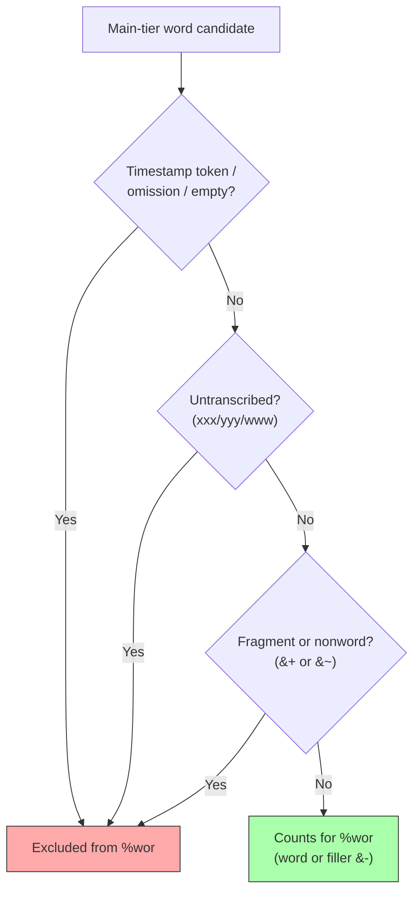

# Dependent Tiers

**Status:** Reference
**Last updated:** {{git-dates:page}}

Dependent tiers appear on lines beginning with `%` immediately after an utterance. They provide annotations linked to the main tier content.

Chatter represents dependent tiers in four broad structural categories:

1. **Structured linguistic tiers**: parsed into typed AST nodes with word-level alignment
2. **Phon phonological tiers**: syllabification and segmental alignment from the Phon project
3. **Bullet-content tiers**: free-form text with optional inline timing markers
4. **Text tiers**: plain text with no structural alignment

## Structured Linguistic Tiers

These tiers have typed representations, but they do not share one universal
word count. `%mor` uses morphosyntactic units; `%gra` uses MOR chunks, including
clitics and a terminator chunk when present. `%pho`, `%mod` and `%sin` use their
own positional domains, which handle pauses, groups and retraces differently.
`%wor` is a separate timing sidecar, not a structural count-validity check.
See the [alignment rules](https://github.com/TalkBank/chatter/blob/main/spec/docs/ALIGNMENT_RULES.md)
for domain-specific membership and terminator handling.

### %mor, Morphological Analysis

The `%mor` tier carries part-of-speech tags, lemmas, and morphological features for each word on the main tier. See [The %mor Tier](mor-tier.md) for full documentation covering the UD-style format, data model, divergences from Universal Dependencies, and migration from traditional CHAT MOR.

Format: `POS|lemma[-Feature]*`, with `~` separating post-clitics.

```chat
*CHI:	she's eating cookies .
%mor:	PRON|she~AUX|be-Pres-S3 VERB|eat-Prog NOUN|cookie-Plur .
```

### %gra, Grammatical Relations

The `%gra` tier encodes dependency syntax using Universal Dependencies relation labels. Each entry has the format `index|head|relation`, where indices are 1-based and head `0` indicates ROOT.

```chat
*CHI:	I want cookies .
%mor:	PRON|I VERB|want NOUN|cookie-Plur .
%gra:	1|2|NSUBJ 2|0|ROOT 3|2|OBJ 4|2|PUNCT
```

The `%gra` tier aligns with `%mor` chunks (clitics expand into multiple chunks). Validation checks sequential indices (E721), ROOT structure (E722 missing root, E723 multiple roots), and circular dependencies (E724). Two of those describe the tier AS A WHOLE and are withheld when the tier in hand is not the one you wrote: E721 and E722, when the parser had to reject a relation it could not represent, or when `%mor`-to-`%gra` alignment has already reported a count or index fault. E723 and E724 are always reported, because dropping a relation cannot create a second root or close a cycle, so a violation among the relations that survive is one the transcript contains.

### %pho / %mod, Phonological Transcription

The `%pho` tier records actual pronunciation; `%mod` records target/model
pronunciation. Both align to Pho-domain units on the main tier. Simple word
sequences align word by word, but pauses and phonological groups also affect
the unit inventory; this is not a count of whitespace-separated words alone.

```chat
*CHI:	I want three cookies .
%pho:	aɪ wɑnt fwi kʊkiz .
%mod:	aɪ wɑnt θri kʊkiz .
```

Phonological tiers support IPA, UNIBET, X-SAMPA, or custom notation systems. They are used for child language, speech disorders, L2 learning, and dialectal variation studies.

> **Parsing strategy:** We deliberately parse only the minimal word/group-level
> structure in `%pho` and `%mod` needed for coarse alignment with the main tier.
> The full IPA phoneme content is stored as opaque strings, deep phonological
> analysis is handled by [Phon](https://www.phon.ca/), and we avoid duplicating
> that work. The Phon extension tiers (`%modsyl`, `%phosyl`, `%phoaln`) follow
> the same strategy.

### %sin, Gesture and Sign Annotation

The `%sin` tier codes gestures and signs aligned with speech. Each token is either `0` (no gesture) or `g:referent:type` (e.g., `g:ball:dpoint` for a deictic point at a ball).

```chat
*CHI:	that ball .
%sin:	g:ball:dpoint 0 .
```

Multiple simultaneous gestures use bracket grouping: `〔g:toy:hold g:toy:shake〕`.

### %wor, Word Timing

The `%wor` tier carries word-level timing annotations for media synchronization.
Words may include inline bullets with millisecond timestamps. Timing data comes
from the bullet fields. Word text is not lexical authority, but consumers may
compare it with chatter's canonical generated display sequence to refuse stale
same-count timing reuse.

> **⚠ IMPORTANT: `%wor` word text is the *cleaned* form, by design.** When
> chatter serializes a `%wor` word it writes the word's **cleaned text**, the
> spoken form with surface markers removed, NOT the raw main-tier surface form.
> This is a deliberate convention (see `WorTier::write_chat` in
> `crates/talkbank-model/src/model/dependent_tier/wor.rs`), chosen for human
> readability and because `%wor` exists to anchor *timing*, not to re-state the
> main tier's orthography. The generated `%wor` text and the TextGrid export both
> use this cleaned form.
>
> **Consequence you must know:** surface markers carried on a word, prosodic
> lengthening (`wabe:`), and similar in-word notation, are **not preserved** in
> `%wor` output. A main-tier word `wabe:` becomes `wabe` on `%wor`. This means a
> `%wor` line containing such words does **not** byte-roundtrip (parse, serialize,
> reparse changes the surface text), and that is expected, not a bug. `%wor` is a
> cleaned, timing-only view; the main tier remains the faithful record of surface
> forms. Do not "fix" the `%wor` serializer to emit raw text without an explicit
> decision to change this convention.

`%wor` is **not** a flat "all tokens except punctuation" tier. It follows a
word-level alignment rule:

- **Regular words** count.
- **Fillers** (`&-um`, `&-uh`, `&-you_know`) count.
- **Fragments** (`&+...`) **do NOT count** under the current policy.
- **Nonwords** (`&~...`) **do NOT count** under the current policy.
- **Untranscribed placeholders** (`xxx`, `yyy`, `www`) **do NOT count**.
- **Replacements** keep the **original spoken word slot** for `%wor`; the
  replacement text matters for `%mor`, not `%wor`. If the original slot is untranscribed
  or a fragment/nonword, it is still excluded.
- **Retrace scope does not change `%wor` membership.**
- **Overlap markers do not change `%wor` membership.**

These are the named `FilteredLexicalV1` membership rules, not empirical proof
of what every acoustic aligner can or cannot time. Inclusion does not establish
a known pronunciation or accurate interval. The
[timing contract](../architecture/wor-timing.md#current-membership-policy)
owns the policy and its checked consumer transitions.

`%wor` is a timing-annotation tier. Its word count equals the number of Wor-domain
words and may differ from a naive main-tier word count. CHAT validation does not
require the `%wor` count to match the current main tier. Timing consumers first
require equal counts and then require every `%wor` display token to match the
canonical token derived from its main-tier position. A mismatch refuses timing
reuse without making the legacy CHAT file invalid.

```chat
*CHI:	I want cookies .
%wor:	I want cookies .
```

For example, `<one &+ss> [/] one play ground` contributes two distinct
`one` slots, then `play` and `ground`: the retraced word remains, while the
fragment does not. `gonna [: going to]` contributes the original `gonna` slot,
not two replacement slots. These are membership examples, not measured timing
intervals. Equal counts or matching display text do not prove acoustic accuracy
or immutable common origin.



## Phon Phonological Tiers

These tiers originate from the [Phon](https://www.phon.ca/)
project and provide syllable-annotated phonological transcription and segmental
alignment. Chatter accepts both unprefixed names and `%x`-prefixed aliases
(`%xmodsyl`, `%xphosyl`, `%xphoaln`, `%xphoint`), and serializes the prefixed
form. See [Phon Tiers](phon-tiers.md) for interval syntax and the complete
validation contract; input aliases do not certify any exporter's output.

### %modsyl / %phosyl, Syllabified Phonology

`%modsyl` is a syllabified version of `%mod` (target pronunciation); `%phosyl`
is a syllabified version of `%pho` (actual pronunciation). Each phoneme is
annotated with a syllable position code (`N`=nucleus, `O`=onset, `C`=coda,
etc.). Words are space-separated and align 1-to-1 with the corresponding
`%mod` or `%pho` tier.

```chat
*CHI:	the best .
%mod:	ðə bɛst
%modsyl:	ð:Oə:N b:Oɛ:Ns:Ct:C
%pho:	ðə bɛs
%phosyl:	ð:Oə:N b:Oɛ:Ns:C
```

**Alignment:** Content-based, stripping position codes (`:N`, `:O`, `:C`, etc.)
from `%modsyl` must reproduce the corresponding `%mod` word exactly,
including stress markers (`ˈ`, `ˌ`). The same applies to `%phosyl` → `%pho`.
Pause fillers must reproduce the same pause token rather than `phone:CODE` units.

### %phoaln, Phone Alignment

`%phoaln` provides segmental alignment between target and actual IPA,
showing phoneme-by-phoneme correspondence. Each pair uses `source↔target`
notation; `∅` marks insertions or deletions.

```chat
*CHI:	the best .
%phoaln:	ð↔ð,ə↔ə b↔b,ɛ↔ɛ,s↔s,t↔∅
```

**Alignment:** Word-by-word, with independent source positions. A one-sided
pause such as `(..)↔∅` consumes a `%mod` slot but no `%pho` slot; `∅↔(..)`
does the reverse. Other alignment words consume both source slots, including
ordinary non-pause insertions and deletions.

**Parsing strategy:** Same as `%pho`/`%mod`, we parse just enough structure
for alignment (word boundaries for `%modsyl`/`%phosyl`, alignment pairs for
`%phoaln`). IPA phoneme content is treated as opaque strings.

### Validation (E725-E728)

Because these are derived views, word counts must match between each
syllabification tier and its parent IPA tier:

| Check | Error code |
|-------|------------|
| `%modsyl` word count ≠ `%mod` word count | E725 |
| `%phosyl` word count ≠ `%pho` word count | E726 |
| `%phoaln` effective model-slot count ≠ `%mod` word count | E727 |
| `%phoaln` effective actual-slot count ≠ `%pho` word count | E728 |

These checks are gated on `ParseHealth`, if either tier in a pair has parse
errors, the alignment check is suppressed to avoid false positives.

Count diagnostics establish a mismatch in the supplied CHAT, not its cause.
See [Interpreting mismatches](phon-tiers.md#interpreting-mismatches) before
changing a transcription or attributing a discrepancy to an exporter.

## Bullet-Content Tiers

These tiers contain free-form text with optional embedded timing markers (`•START_END•`) and picture references (`•%pic:"file.jpg"•`). They do not align word-by-word with the main tier.

| Tier | Purpose |
|------|---------|
| `%act` | Physical actions, gestures, non-verbal behaviors |
| `%cod` | Research-specific coding (semantic roles, thematic coding, error classification) |
| `%com` | Comments, annotations, and contextual notes |
| `%exp` | Explanations or expansions of ambiguous/incomplete speech |
| `%add` | Addressee identification in multi-party conversations |
| `%spa` | Speech act coding (request, assertion, question, directive) |
| `%sit` | Situational context or setting description |
| `%gpx` | Extended gesture position coding |
| `%int` | Intonational contours and prosodic patterns |

`%cod` is bullet-content in the shared TalkBank AST. In the `%cod` coding
convention, a word selector such as `<w4>` scopes the code that follows it
(it names which main-tier word the code applies to) rather than being a code
in its own right.

Example without optional timing:

```chat
*CHI:	gimme that .
%act:	reaches toward shelf
%com:	child is pointing to picture
```

## Text Tiers

These tiers contain plain text with no bullets, timing, or structural alignment:

| Tier | Purpose |
|------|---------|
| `%alt` | Alternative transcriptions |
| `%coh` | Cohesion annotation |
| `%def` | Definitions |
| `%eng` | English translations (for non-English transcripts) |
| `%err` | Error annotations |
| `%fac` | Facial expressions |
| `%flo` | Flow annotation |
| `%gls` | Glosses |
| `%ort` | Orthographic representations |
| `%par` | Paralinguistic information |
| `%tim` | Timing information |

## User-Defined Tiers

Tiers prefixed with `%x` (e.g., `%xcod`, `%xact`) are the extension point for
project-specific annotation. Their content does not acquire the structural
alignment contract of a standard tier merely by resembling its name. The
extension is still subject to parsing and applicable format checks; a `%x`
prefix is not a blanket guarantee that malformed input will be accepted.

## The Supported Set Is Closed

Chatter recognizes the standard tier set and the `%x` user-defined extension.
An unsupported dependent-tier name is reported as **E605**
(`UnsupportedDependentTier`), not merely a warning. Recognition is necessary,
not sufficient: a recognized tier can still contain invalid syntax or violate
its domain's rules. The implementation enforces the supported contract; its
output alone does not settle a disputed format rule or prove a data defect.

### Deliberate Divergence from CLAN: Retired Legacy Tiers

When TalkBank standardized morphology on a single Universal Dependencies `%mor` tier (plus `%gra` for relations), several legacy dependent tiers were retired. CLAN's `check` still accepts three of them, so on these chatter is **intentionally stricter**, a deliberate, documented divergence:

| Retired tier | CLAN `check` | chatter |
|--------------|--------------|---------|
| `%trn` | accepts | rejects (E605) |
| `%tra` | accepts | rejects (E605) |
| `%grt` | accepts | rejects (E605) |
| `%umor` | rejects | rejects (E605) |

The modern UD-`%mor` workflow has one morphology tier (`%mor`) plus `%gra`; the older training/translation/variant tiers are no longer part of the format chatter validates. `%umor` is rejected by both validators and is listed only for completeness. Note that `%xtra` (with the `%x` prefix) is a perfectly valid user-defined tier; only the bare `%tra` is retired.

This is one instance of a general principle: where chatter intentionally departs from CLAN/CHECK behavior, the divergence is documented rather than left implicit. See [CHECK Parity Audit](../architecture/errors-and-validation/check-parity-audit.md).
