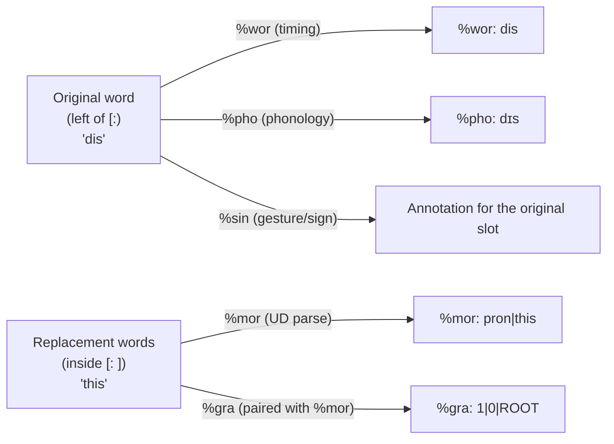

# Replacements

**Status:** Current
**Last modified:** {{git-dates:page}}

A **replacement** is a CHAT annotation `[: ...]` that pairs a single
spoken word on the main tier with one or more "intended" words. It
records both what the speaker actually said and what the analysis should
treat the utterance as containing.

```chat
*CHI:	wanna [: want to] go .
*CHI:	dis [: this] is fun .
*CHI:	rocking+house [: rocking+horse] [*] ?
```

This page describes Chatter's representation and processing rules. The CHAT
manual defines the notation; this implementation guide is not a separate
authority for transcription judgments. The central distinction is:

> **Replacements are word-level, not group-level. Each tier domain
> chooses *one* side of the pair: `%mor` analyzes the replacement
> (right side); `%wor`, `%pho`, `%sin` align to the original (left
> side). `%gra` follows `%mor`.**

## CHAT Syntax

### Word-Level Scope

A replacement attaches to a single `standalone_word` on the main tier
and contains one or more replacement words inside the brackets:

```chat
*CHI:	gonna [: going to] eat lunch .
*CHI:	dis [: this] toy .
*CHI:	rocking+house [: rocking+horse] [*] ?
```

The grammar rules are
`word_with_optional_annotations` and `replacement` in
[`grammar/grammar.js`](https://github.com/TalkBank/chatter/blob/main/grammar/grammar.js)
grep for the rule names rather than line numbers so this stays
accurate as the grammar evolves. Replacement words can be separated
by whitespace, so `[: going to]` is a single replacement of `gonna`
with two words.

### There Is No Group-Level Replacement

`<dat is> [: that is]` is **not** valid CHAT. A replacement does not
attach to a group; it attaches to a single word. The grammar enforces
this structurally; the model also stores `ReplacedWord.word: Word`, never
`Group`. To replace
words inside a group, attach the replacement to the inner word:

```chat
*CHI:	<dat [: that] is> [/] is broken .
```

This shape, replacement inside a group inside a retrace, is legal
because each annotation operates at its own scope.

### There Is No `[::]` Form

The current grammar has a single-colon replacement, not a separate `[::]`
construct. If legacy input contains the latter, retain the original and
investigate the diagnostic and transcription convention. Do not silently
reinterpret it as `[: ...]` or treat a recovery model as evidence of support.

## The Per-Domain Alignment Rule

This is the rule contributors most often get wrong. Different tier
domains align to different sides of a replacement pair:

| Tier | Side aligned to | Rationale |
|------|----------------|-----------|
| `%mor` | **replacement** (right) | Morphosyntactic analysis annotates the *target* form, not the error |
| `%gra` | **replacement** (right) | Grammatical relations align to `%mor`'s structure |
| `%wor` | **original** (left) | Word-level timing is for what was actually spoken |
| `%pho` | **original** (left) | Phonological transcription describes what was actually spoken |
| `%sin` | **original** (left) | Gesture/sign annotation aligns to the original slot |

The mnemonic: **the replacement encodes the intended form** (what the
speaker meant or what a corrected transcript would read). Tiers
analyzing intent (`%mor`/`%gra`) use the replacement; tiers
documenting realization (`%wor`/`%pho`/`%sin`) use the original.



For multi-word replacements like `gonna [: going to]`, the rule
generalizes consistently:

- `%wor` / `%pho` / `%sin` produce **one** entry, for `gonna`.
- `%mor` produces **two** entries, for `going` and `to`.
- Without clitics, those two MOR items contribute **two** `%gra` chunks;
  a terminator contributes its own additional chunk when present.

This example assumes ordinary eligible words outside an excluding annotation.
Choosing the original side does not override domain membership: omissions and
fragment-like originals with replacements are excluded from Pho/Sin alignment,
and Wor applies its separate `FilteredLexicalV1` policy. Mor-domain retraces
remain excluded. See the linked rules rather than applying a universal
one-original-versus-many-replacements count to every context.

The alignment-counting code that enforces this is in
[`alignment/helpers/count.rs`](https://github.com/TalkBank/chatter/blob/main/crates/talkbank-model/src/alignment/helpers/count.rs)
(the `walk_alignable_replaced_word` function), with eligibility predicates in
`alignment/helpers/rules.rs`. Wor has its own
[typed projection](../architecture/wor-timing.md#current-membership-policy).
The full table
of per-domain rules is in
[`spec/docs/ALIGNMENT_RULES.md`](https://github.com/TalkBank/chatter/blob/main/spec/docs/ALIGNMENT_RULES.md).

## Rust AST

A replacement is modeled as a first-class `UtteranceContent` variant,
not as a flag on `Word`:

```rust,ignore
// crates/talkbank-model/src/model/annotation/replacement.rs
pub struct ReplacedWord {
    pub word: Word,                       // left side: original spoken word
    pub replacement: Replacement,         // right side: 1+ intended words
    pub scoped_annotations: ReplacedWordAnnotations,
    pub span: Span,                       // source location, omitted from JSON
}
```

Two consequences of this shape:

1. **A replacement is a wrapper around a `Word`, not a kind of `Word`.**
   `ReplacedWord` lives as its own variant of `UtteranceContent`
   (and `BracketedItem`), holding an inner `word: Word` plus the
   replacement payload. Contrast with retraces: `Retrace` is *also*
   a variant of `UtteranceContent`/`BracketedItem`, but it wraps a
   *group of content* (a single word or a `<...>` group), not a
   single `Word`. Different mechanism, different scope, same
   top-level slot in the AST.
2. **The `walk_words()` content walker yields `WordItem::ReplacedWord`
   as a distinct leaf** (defined in
   `crates/talkbank-model/src/alignment/helpers/walk/mod.rs`).
   Domain-aware extraction code branches on this leaf type and
   chooses original or replacement per the table above.

## Validation

### Each Replacement Word Is Validated Like a Main-Tier Word

`ReplacementWords` is a checked, nonempty collection of `Word`, not an
unrestricted `Vec<Word>`. Its constructor and JSON deserializer reject an empty
collection. Each contained word still runs ordinary word validation in the
supplied context, followed by replacement-specific checks. Nonempty construction
does not certify the words, their language policy or the entire document.
For example, putting a token inside a replacement does not exempt it from
ordinary word checks:

```chat
*CHI:	dog [: C-3PO] .
```

The result depends on the effective word-validation context, not merely on the
presence of brackets. **The replacement does not provide an escape from
word-level validation.** The implementation is in
[`replacement.rs`](https://github.com/TalkBank/chatter/blob/main/crates/talkbank-model/src/model/annotation/replacement.rs).

This is critical for any code generating replacements programmatically:
do not assume `[: ...]` lets you smuggle arbitrary text past the word
validator. If your producer emits a replacement, both sides must be
CHAT-legal under the effective validation context. That includes applicable
language scope rather than just membership in the file's language header.

### Replacement-Specific Error Codes

Replacement admission and validation cover different boundaries:

| Code | Meaning |
|------|---------|
| `E208` (historical) | Empty replacement; the current primary parser instead reports E376/E342 for missing replacement material before model construction |
| `E387` | Replacement attached to a phonological fragment (`&+`) |
| `E388` | Replacement attached to a nonword (`&~`) |
| `E389` | Replacement attached to a filler (`&-`) |
| `E390` | Replacement contains an omission (`0prefix` form), disallowed inside replacements |
| `E391` | Replacement contains untranscribed material (`xxx`, `yyy`, `www`), disallowed inside replacements |

The principle: a replacement must be a **concrete intended form**. Empty,
omitted, or unintelligible content defeats that purpose. The
[E208 specification](https://github.com/TalkBank/chatter/blob/main/spec/errors/E208.md)
records the current parser and checked-construction boundary. Recovery diagnostics
need not match between backends; neither backend may admit an empty replacement.
Alignment behavior for a retained invalid model is not permission to publish it.

## Interactions with Other Annotations

### Replacements and Retraces Are Orthogonal

A retrace (`[/]`, `[//]`, `[///]`, `[/-]`) and a replacement
(`[:]`) are distinct annotations operating at different structural
levels:

- Retraces wrap **content** (a single word or a group). They are first-
  class `UtteranceContent` variants and represent post-hoc speaker
  correction.
- Replacements attach **inside** a `Word` slot via `ReplacedWord`. They
  are editorial metadata about an individual spoken word.

Both can coexist:

```chat
*CHI:	<dat [: that] is> [/] is broken .
```

A retrace cannot live *inside* a replacement (the grammar wraps
replacements around `standalone_word`, not arbitrary content).

### Replacements and Error Coding

Error codes follow the replacement and operate on the replaced word as
a unit:

```chat
*CHI:	rocking+house [: rocking+horse] [*] ?
```

Here `[*]` marks an error without specifying its subtype; the
`[: rocking+horse]` records the intended form. The two
annotations cooperate: the replacement encodes *what was meant*, the
error code classifies *how it deviates*. Implementation:
`scoped_annotations` field on `ReplacedWord`.

## Common Misconceptions

Keep these distinctions when building or consuming replacement-bearing CHAT.

1. **"`[: ...]` lets me put any text I want."** No. Each replacement
   word is validated; nonempty collection admission is only one invariant.
2. **"A different annotation can bypass a failed replacement."** No.
   `[% ...]` comments and `[= ...]` explanations have different meanings;
   they are not substitutes chosen merely to avoid word validation. Preserve
   source evidence, report the failure and apply only a reviewed transformation.
   Use a replacement only when the intended form is supported by the
   transcription judgment, not as an invented explanation of a tool failure.
3. **"`%mor` analyzes the original."** No. `%mor` analyzes the
   replacement. This is the correction's morphology, not the error's.
4. **"`%wor` count must equal `%mor` count."** No. For
   `gonna [: going to]`, `%wor` has 1 entry and `%mor` has 2. They
   align to different sides. The validator's per-domain rule respects
   this.
5. **"`<a b> [: c d]` is a group-level replacement."** No.
   Group-level replacements don't exist. Either replace inside
   (`<a [: c] b [: d]>`) or rephrase the transcription.

## Source Citations

| Concern | Source owner |
|---------|-----------|
| Grammar rule (`replacement`) | `grammar/grammar.js`, `replacement` |
| Word-with-replacement rule | `grammar/grammar.js`, `word_with_optional_annotations` |
| `ReplacedWord` struct | `crates/talkbank-model/src/model/annotation/replacement.rs` (search `pub struct ReplacedWord`) |
| Per-domain alignment | `crates/talkbank-model/src/alignment/helpers/count.rs` (`walk_alignable_replaced_word`); Wor projection described in the timing contract |
| Replacement validation | `crates/talkbank-model/src/model/annotation/replacement.rs` (search `impl ... Validate for ReplacementWords`) |
| Reference corpus example | `corpus/reference/annotation/errors-and-replacements.cha` |
| CHAT manual | <https://talkbank.org/0info/manuals/CHAT.html#Replacement_Scope> |

## See Also

- [Retraces and Repetitions](./retraces.md): the orthogonal post-hoc
  correction mechanism.
- [The %mor Tier](./mor-tier.md): UD-syntax morphosyntactic analysis
  that aligns to the replacement form.
- [Word Syntax](./word-syntax.md): the word grammar that replacement
  words must satisfy.
- [Dependent Tiers](./dependent-tiers.md): overview of `%mor`,
  `%wor`, etc., with their alignment relationships.
