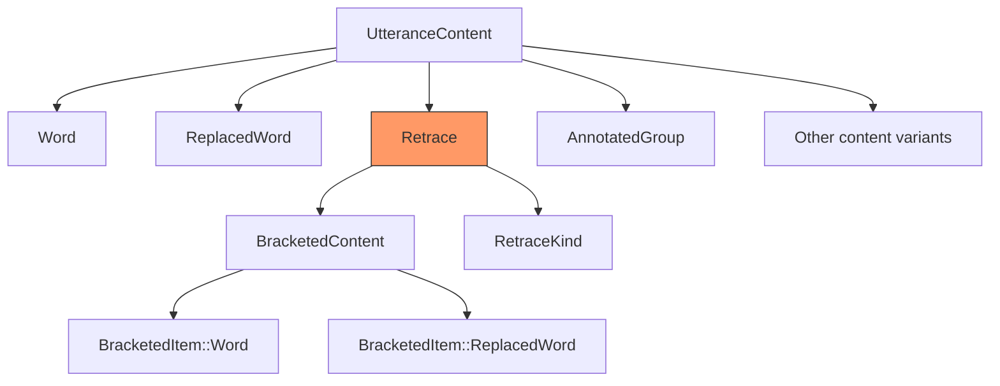
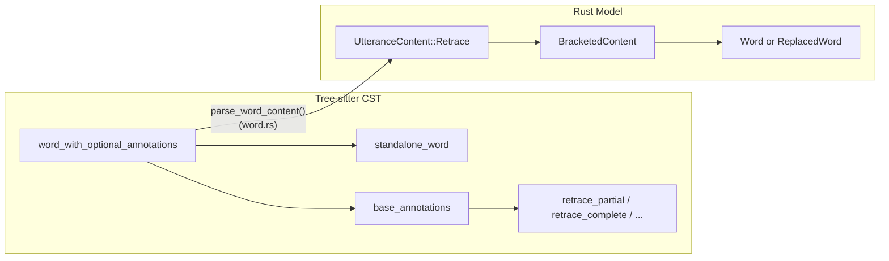
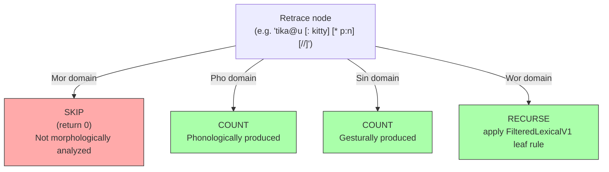

# Retraces and Repetitions

**Status:** Current
**Last updated:** {{git-dates:page}}

Retraces mark content that the speaker said but then corrected, repeated,
or abandoned. They are one of the most consequential constructs in CHAT
because they affect how every dependent tier aligns to the main tier.

## CHAT Syntax

A retrace has two parts: the **retraced content** (what the speaker said
first) and the **correction** (what follows). The retraced content is
marked with a trailing bracket code:

| Marker | Name | Meaning |
|--------|------|---------|
| `[/]` | Partial repetition | Speaker repeats the same words |
| `[//]` | Full correction | Speaker restarts with different words |
| `[///]` | Reformulation | Speaker reformulates the message |
| `[/-]` | Abandoned start | Speaker changes direction without retracing |

The [CHAT manual](https://talkbank.org/0info/manuals/CHAT.html) supplies these
surface meanings. Chatter's historical Rust variant names differ:
`Multiple` represents `[///]`, and `Reformulation` represents `[/-]`.
The variant name is not a linguistic classification.

### Single-Word Retraces

When only one word is retraced, no angle brackets are needed:

```chat
*CHI: I [/] I want that .
*CHI: ana [//] an .
*MOT: the book [/-] the magazine is here .
```

### Group Retraces

When multiple words are retraced, angle brackets delimit the scope:

```chat
*MOT: <the dog> [//] the cat ran .
*CHI: <I want> [/] I need cookie .
*CHI: <I want the> [///] give me that .
```

### Retraces with Replacements

A retraced word often has a replacement `[: target]` and/or error code
`[* code]`. This is common in aphasia and child language corpora where
the speaker produces an incorrect form:

```chat
*PAR: tika@u [: kitty] [* p:n] [//] kitty is nice .
%mor: noun|kitty aux|be-Fin-Ind-Pres-S3 adj|nice-S1 .

*PAR: lɛɾɪ@u [: later] [* p:n] [//] later in the day .
%mor: adv|late adp|in det|the-Def-Art noun|day .

*CHI: male [: female] [* s:r] [/] male [: female] [* s:r] .
%mor: adj|female-S1 .
```

In each case, the retraced word (before the `[//]` or `[/]`) is excluded
from %mor alignment. Only the correction (after the marker) is counted.

## Data Model

Retraces are a **first-class variant** of `UtteranceContent`:



The `Retrace` struct wraps the retraced content in a `BracketedContent`
container, which can hold any combination of words, replaced words, and
other content items:

The source definition is `model/content/retrace.rs` in `talkbank-model`.
Besides `content` and `kind`, `is_group` preserves angle-bracket spelling,
`span` locates the construct, and optional `marker_span` locates the marker
itself when the parser retained that evidence. Source-free values must not
invent marker offsets.

### Where the annotations live

There is deliberately no `annotations` field. A content item followed by a run
of scoped markers is a LEFT-ASSOCIATIVE CHAIN: each marker scopes over
everything to its left, so these two lines are different claims about the same
two words.

```text
dog [* p:w] [/] dog     the error is on the abandoned attempt
dog [/] [* p:w] dog     the error is on the retrace
```

Annotations written BEFORE the marker therefore annotate the retraced material
and live inside `content`; annotations written AFTER it annotate the retrace and
live on an `AnnotatedRetrace(Box<Annotated<Retrace>>)` wrapper, exactly parallel
to `Group` / `AnnotatedGroup`.

A single flat `annotations` field holding both would make the two
indistinguishable: `dog [* p:w] [/]` would be silently written back as
`dog [/] [* p:w]`, and a second adjacent marker would overwrite the first, so
`на [//] [/] на` would become `на [/] на`. Neither would be visible to
`validate`, to `--roundtrip` (which tests idempotence of `serialize(parse(x))`,
not fidelity to the input) or to `SemanticEq` (the two orderings would be the
same model).

### Why First-Class?

Representing retraces as annotations on words or groups would mean every
`match` on content had to inspect annotation lists to determine whether a word
was retraced, a class of bugs where retraced content is accidentally included
in alignment counting, word extraction, or retokenization.

Making `Retrace` a top-level `UtteranceContent` variant means:

1. **Exhaustive matches expose unhandled variants.** Catch-all arms can hide
   a newly added variant, so first-class representation alone is not proof
   that every consumer handles it correctly. Shared structural views and
   scoped wildcard-match lints help keep that handling explicit.
2. **Domain-aware gating is centralized.** The content walker checks the
   `Retrace` variant once, not at every annotation-inspection site.
3. **Alignment counting is simple.** The count function returns `0` for
   `Retrace` in Mor domain, no annotation inspection needed.

### Parser Conversion

The tree-sitter grammar parses retrace markers (`[/]`, `[//]`, etc.) as
annotations on `word_with_optional_annotations`. The Rust parser converts
them to structural `Retrace` nodes in `parse_word_content()`:



`parse_word_content()` first builds the word or replaced-word core, then calls
`fold_marker_chain` on the ordered markers. That fold preserves the distinction
between annotations before and after a retrace, including adjacent retraces.
`parse_group_content()` in `group/parser.rs` uses the same fold with a group
core. These are the primary parser's conversion owners, not a claim about
every backend's implementation.

## Alignment Behavior

Retraces interact differently with each dependent tier domain:



**Why %mor skips retraces:** The %mor tier represents the morphological
analysis of what the speaker *meant* to say. Retraced content is a false
start or error; it was produced phonologically but is not part of the
intended linguistic structure. The correction after the retrace marker
carries the morphological analysis.

**Why traversal enters retraces outside %mor:** Retraced material was
produced, so `%pho`, `%sin` and `%wor` can select positions within it.
Entering a container does not mean every leaf participates in every domain.
In particular, `%wor` selects only the current timing policy's eligible words.

For `%wor`, retrace ancestry does **not** change leaf-level membership:

- eligible regular words and fillers count both inside and outside retraces;
- phonological fragments (`&+`), nonwords (`&~`), untranscribed markers
  (`xxx`, `yyy`, `www`) and omissions are excluded in either location;
- overlap annotations do not change this leaf-level policy.

For example, the retraced `one` below remains eligible, but `&+ss` does not:

```chat
*CHI:	<one &+ss> [/] one play ground .
```

The selected lexical sequence is `one`, `one`, `play`, `ground`. This is
membership, not evidence of available or acoustically correct timings. A parsed
legacy `%wor` tier can use a different convention; do not delete its words or
declare the CHAT invalid just to force a count match. See
[`%wor` timing semantics](../architecture/wor-timing.md) for binding, lexical
corroboration and timing admission.

### Implementation

Both the counter and the walker ask one owner, `alignment/helpers/descent.rs`,
what a domain does with a retrace: `%mor` excludes it, every other domain
enters it. The counter takes a `PositionalDomain` and converts it for the
descent rule; the walker takes the `TierDomain` directly.

Counting and extraction: `walk_alignable_item()` in
`alignment/helpers/count.rs`, one walk whose sink either counts or collects:

```rust,ignore
UtteranceContent::Retrace(_) | UtteranceContent::AnnotatedRetrace(_) | /* other containers */ => {
    match descend(item.structure(), Some(domain.into())) {
        Descent::Into(entered) => walk_alignable_bracketed(entered.content(), domain, sink),
        Descent::Atomic(unit) => sink(AlignablePosition::Atomic(unit)),
        Descent::Excluded => {} // %mor: a retrace is not aligned
    }
}
```

Walking: `walk_words()` in `alignment/helpers/walk/mod.rs`:

```rust,ignore
UtteranceContent::Retrace(_) | UtteranceContent::AnnotatedRetrace(_) | /* other containers */ => {
    if let Some(into) = descend(item.structure(), domain).entered() {
        walk_bracketed_content(&into.content().content, domain, f);
    }
}
```

`%wor` generation and overlap counting still use dedicated recursive helpers,
but only for `%wor`-specific sequencing details like replacement handling, not
for retrace-sensitive membership.

## Validation

### The three retrace rules

`validation/retrace/` separates node visitation (`visit.rs`) from the
serialized-order leaf/checkpoint collection (`collection/`) needed to inspect
what follows a marker. Both use `ContentStructure`; the visitor reaches nested
retraces rather than treating an outer retrace as a leaf.

| Code | Rule | Example rejected |
|------|------|------------------|
| E370 | A marker must be FOLLOWED by the repeated or corrected material. | `<the> [/] .` |
| E377 | A marker's content may not be nothing but another marker. | `на [//] [/] на` |
| E378 | A marker's content must contain a word, at any depth. | `&=laughs [//] water` |

E377 and E378 are disjoint despite the neighbouring names. In `a [//] [/] a` the
inner retrace still holds a word, so E378 stays silent; in `<&=sigh> [/] &=sigh`
there is no second marker, so E377 stays silent. The repairs differ too: drop a
marker for E377, retrace the words rather than the vocalization for E378.

E378 tests for absent words, not for a present event: an event alongside
words does not by itself invalidate a retrace. Words can occur deeper inside
an annotated group or quotation (`<<the dog> [?]> [/] the dog`), so testing
only immediate children would incorrectly reject such content. Untranscribed
material counts as words on purpose: `xxx`, `yyy` and `www` lower as words, so
retracing speech nobody could make out stays valid.

**Which variants are containers is owned in one place for these rules**,
`model::content::structure::ContentStructure`. It has one owner because
two hand-written copies of that knowledge can disagree, as about `PhoGroup` and
`SinGroup`, which silently stops E377 firing inside `‹...›` with no test able
to see it.

Alignment walkers also use `ContentStructure`, through the domain policy in
`alignment/helpers/descent.rs`. Structural classification answers what an item
contains; domain policy separately decides whether to enter it, count it as an
atomic position, or exclude it.

### Alignment Validation (E705)

Correctly represented retraces are excluded from the `%mor` count. This
prevents retraced words from causing a false E705 mismatch; it does not
guarantee that the remaining main-tier and `%mor` positions agree.

## Regression Tests

Source diagnostic cases live in
`crates/talkbank-parser-tests/tests/integration/retrace_diagnostics_from_source.rs`;
the reference example is `corpus/reference/annotation/retrace.cha`.
The error specifications for E370, E377 and E378 own the diagnostic contracts.
These are evidence entry points, not a claim of complete retrace coverage.

## See Also

- [Alignment Architecture](../architecture/alignment.md): full alignment system docs
- [The %mor Tier](mor-tier.md): morphological tier format and alignment rules
- [CHAT Manual: Retracing](https://talkbank.org/0info/manuals/CHAT.html#Retracing_Scope)
