# CLI Reference

**Status:** Current
**Last modified:** {{git-dates:page}}

The `chatter` CLI is the primary command-line surface for the TalkBank CHAT toolchain.

CLI-owned handlers dispatch commands and call shared parser, model and
transform libraries. The following overview groups user-facing commands;
its library labels describe implementation roles, not handler ownership.

```mermaid
flowchart TD
    chatter(["chatter"])

    chatter --> validate["validate\n(chatter)"]
    chatter --> normalize["normalize\n(chatter)"]
    chatter --> tojson["to-json\n(talkbank-transform)"]
    chatter --> fromjson["from-json\n(talkbank-transform)"]
    chatter --> showalign["show-alignment\n(chatter)"]
    chatter --> watch["watch\n(chatter)"]
    chatter --> fix["fix\n(talkbank-transform splice)"]
    chatter --> clean["clean\n(chatter)"]
    chatter --> newfile["new-file\n(chatter)"]
    chatter --> cache["cache\n(stats, clear)"]
    chatter --> schema["schema\n(JSON Schema output)"]
    chatter --> debug["debug\n(overlap-audit, linker-audit,\nfind, sanitize, fix-s)"]
    chatter --> update["update\n(self-update, experimental)"]

    chatter --> speakerid["speaker-id\n(experimental)"]
    chatter --> rediarize["rediarize\n(experimental)"]
    chatter --> adjudicate["adjudicate\n(experimental)"]
    chatter --> sanityscan["sanity-scan\n(experimental)"]
```



## Top-Level Commands

```bash
chatter validate PATH...
chatter normalize INPUT
chatter to-json INPUT
chatter from-json INPUT
chatter show-alignment INPUT
chatter watch PATH
chatter fix PATH...                # preview; add --apply only after review
chatter clean PATH
chatter new-file
chatter cache stats
chatter cache clear --prefix PATH
chatter schema
chatter debug ...
chatter update                     # experimental: self-update to the latest release
chatter speaker-id INPUT           # experimental
chatter rediarize INPUT --turns T  # experimental
chatter adjudicate ...             # experimental
chatter sanity-scan ...            # experimental
```

Use `chatter --help` or `chatter <command> --help` for the exact live surface.

## `validate`

Validate CHAT file(s) or directory tree(s). Accepts multiple paths.

```text
Usage: chatter validate [OPTIONS] <PATH>...
```

```bash
chatter validate file.cha                         # single file
chatter validate file1.cha file2.cha file3.cha    # multiple files
chatter validate corpus/                          # directory (recursive, parallel)
chatter validate file.cha corpus/ other.cha       # mix of files and directories
chatter validate corpus/ -f json                  # structured JSON output
chatter validate corpus/ --force                  # clear selected cache entries and revalidate
chatter validate corpus/ --audit out.jsonl         # bulk audit to JSONL file
chatter validate corpus/ --suppress xphon         # suppress named error group
chatter validate corpus/ --suppress E726,E727     # suppress specific error codes
chatter validate corpus/ -j 8                     # use 8 parallel workers
chatter validate corpus/ --max-errors 50          # stop after 50 errors
```

Options:

| Flag | Description |
|------|-------------|
| `-f, --format text\|json` | Output format (default: text) |
| `--list-checks` | Print every validation check with Active/Opt-in/Planned status, then exit. It reads no file, so a `<PATH>` beside it is a usage error |
| `--skip-alignment` | Skip dependent-tier alignment checks |
| `--force` | Clear cached rows for the selected files, then validate and store fresh results; not a no-cache mode |
| `-j, --jobs N` | Parallel workers for directory mode (default: CPU count). `N` must be at least 1; `--jobs 0` is a usage error (exit 2) |
| `--quiet` | Suppress success messages while retaining problems (text output only: with `--format json` it is a usage error) |
| `--max-errors N` | Stop once N errors (never warnings) have been found across all files. Files already being validated finish; if any were left, the run says `Stopped after reaching --max-errors N; M file(s) were not validated.` (stderr in text mode, a `stop` record in JSON mode) and exits 1. `N` must be at least 1; `--max-errors 0` is a usage error (exit 2) |
| `--roundtrip` | Run the optional parse/serialization roundtrip check (developer tool); not a source-byte preservation guarantee |
| `--parser tree-sitter\|re2c` | Parser backend (default: tree-sitter). re2c is an independent experimental backend, not an interchangeable production validity authority; see below |
| `--strict-linkers` | Enable the opt-in cross-utterance checks of quotations (the `+"/.` and `+".` terminators and the `+"` linker) and of the completion linkers `+,` and `++`; off by default. `--list-checks` marks each code this turns on as `[Opt-in]` |
| `--suppress xphon` | Silence the Phon `%x` dependent-tier checks (E725-E728, E735-E746), which run by default |
| `--audit FILE` | Stream errors to JSONL file (bulk audit mode). Its own output: a usage error with `--format` or `--quiet`. A file that cannot be written whole fails the run. An audit only reads an existing cache (no create, migrate, clear, prune or write), so `--force` with it is a usage error too |
| `--suppress CODES` | Suppress error codes or groups (comma-separated). A value that names no known code or group is a usage error (exit 2) |

Every path argument is expanded the same way: a file is validated as given,
and a directory contributes the `.cha` files under it (links followed, each
directory once). If an argument or any entry under a directory cannot be
read, `validate` reports it as a read error and processes the other discovered
files. The run exits 1 even if every readable file passes.
If the validation cache fails during a run (for example, a locked
database), the files are validated without it and the run says so
(`Warning: N cache read(s) or write(s) failed` on stderr in text mode,
`cache_errors` in the JSON summary).

> **Use the default tree-sitter backend for production validity decisions.**
> re2c supports independent parser comparison, but finite passing comparisons
> do not prove complete error detection. Diagnostic codes, positions and
> recovery output need not match between backends. A disagreement requires
> investigation against the specification, not an assumption that either
> parser is an oracle. See the authoritative
> [backend policy](../../architecture/parser-backends.md#backend-compatibility-mandate).

**Suppress groups:** `xphon` expands to the whole Phon `%x`
dependent-tier validation surface (%xmodsyl/%xphosyl/%xphoaln/%xphoint,
codes E725-E728 and E735-E746). These checks **run by default**; pass
`--suppress xphon` to silence the group. (`--check-xphon` is a deprecated
no-op, accepted so existing scripts do not break.) The
`--suppress` flag can mix groups and codes: `--suppress xphon,E316`.

**Suppression does not cost you the cache.** It changes what is printed, not
what is validated, so runs that differ only in `--suppress` share cached
results: `chatter validate corpus/` followed by `chatter validate corpus/
--suppress xphon` reuses the first run's work. `--strict-linkers` is the other
kind of flag: it turns extra checks on and selects a different cache identity.
Only a verdict compatible with those checks can be reused.

Suppression also changes the displayed file status and error-limit accounting:
a file whose only errors are suppressed can contribute a passing status and
exit 0. That is not proof that the hidden rules passed. The stored cache verdict
still reflects the complete diagnostic set, so a later unsuppressed run
recomputes and displays those findings. Internal tool failures are not made
successful by diagnostic suppression.

## `normalize`

Serialize a CHAT file into canonical formatting.

```bash
chatter normalize input.cha
chatter normalize input.cha -o normalized.cha
chatter normalize input.cha --validate
chatter normalize input.cha --validate --skip-alignment
```

Flags:

- `-o, --output <PATH>`: write to a file instead of stdout.
- `--validate`: validate (including alignment by default) before
  writing the normalized output.
- `--skip-alignment`: with `--validate`, skip the dependent-tier alignment
  checks (the rest is still validated). It requires `--validate`; alone it
  is a usage error (exit 2).

`normalize` writes to stdout unless you pass `-o/--output`. There is no `--in-place` flag.

Use a new output path and retain the original. An existing destination is
currently truncated before its bytes are written: a write failure or interruption
can leave it partial, including when input and output name the same file.
The rewrite content guard does not make disk publication atomic. Compare and
validate the separate output before choosing to replace your original.

## JSON Conversion

```bash
# Single file
chatter to-json input.cha                          # pretty-printed JSON to stdout
chatter to-json input.cha --compact                # minified JSON to stdout
chatter to-json input.cha -o output.json           # JSON to file

# Directory (recursive, preserves structure)
chatter to-json corpus/ --output-dir json/          # incremental by default (mtime check)
chatter to-json corpus/ --output-dir json/ --compact # minified output (saves disk)
chatter to-json corpus/ --output-dir json/ --force   # full rebuild
chatter to-json corpus/ --output-dir json/ --prune   # remove orphaned .json files
chatter to-json corpus/ --output-dir json/ --jobs 4  # parallel workers

# Reverse and schema
chatter from-json input.json -o output.cha
chatter schema
chatter schema --url
```

**Single-file mode:** `to-json` validates by default. Use `--skip-validation`,
`--skip-alignment`, or `--skip-schema-validation` to bypass checks.
`--skip-validation` already skips alignment, so passing it with
`--skip-alignment` is a usage error (exit 2).

**Failures** are reported the same way in both modes: a line
`ERROR: <path>: <failure>`, then the rendered diagnostics of a parse failure,
a validation failure, an incomplete validation or an internal failure, and
the command exits 1.

**Directory mode:** Walks recursively, converting each `.cha` to `.json` under `--output-dir`
with the same relative path. **Incremental by default**: skips files whose JSON is
already newer than the source. Use `--force` to rebuild all. Use `--prune` to remove
`.json` files with no matching `.cha` (handles renames/deletions). `--prune` never
follows a symbolic link encountered in the output tree, including a link at
`--output-dir` itself: pruning leaves that link and its target alone. Conversion
through an explicitly selected linked output root remains supported; this
restriction applies to pruning, not conversion writes. The walk does not inspect
symlinks in the root's ancestors and is not a defense against concurrent path
replacement. Use a dedicated output tree whose paths cannot change during the run.
Use `--jobs N` for
parallel conversion (defaults to number of CPUs; `N` must be at least 1, and
`--jobs 0` is a usage error). If any directory or entry under the input cannot
be read, `to-json` reports each one and exits 1 before converting anything, as
`fix` and the `debug` commands do with their path arguments. (`validate`
instead validates the rest and reports each unreadable path as a read error
in its results, which fails the run.) An input directory with no `.cha` file
(an empty tree, or a mount point with nothing mounted) is refused the same
way, `ERROR: no .cha files found in DIR`, exit 1, before anything is
converted or pruned: `--prune` over it would delete every `.json` under
`--output-dir`.

**Each mode takes only its own options.** `--output-dir`, `--force`,
`--prune` and `--jobs` apply only to a directory input, and `-o/--output`
only to a file; giving one for the other kind of input is a usage error
(exit 2), as is a directory input without `--output-dir`.

## Editing and Inspection Commands

### `show-alignment`

Print the dependent-tier alignment for a CHAT file (debugging aid).

```bash
chatter show-alignment file.cha
chatter show-alignment file.cha -t mor          # one tier type
chatter show-alignment file.cha -t gra -c       # compact one-line-per-alignment output
```

Flags: `-t/--tier <mor|gra|pho|sin>` (omit to show all available
tiers); `-c/--compact` (one line per alignment).

### `watch`

Watch a CHAT file or directory and re-validate on every save.

```bash
chatter watch file.cha
chatter watch corpus/
chatter watch corpus/ --skip-alignment --clear
```

Watch mode uses default validation rules and the shared cache, and a file that
passes says so. A file argument is validated initially; a directory argument
does not trigger an initial recursive sweep. Run `validate` first if you need
that baseline. Subsequent create/modify events for CHAT files are debounced
before validation; deletion events are not validation attempts. This is an
interactive watcher, not a guarantee that every filesystem change is observed.
Flags: `--skip-alignment`; `-c/--clear` (clear the terminal between runs).

### `fix`

Apply catalog fixes to CHAT file(s) at exact byte spans. Every file is
parsed and validated, each diagnostic is resolved against a per-code fix
catalog, and the resulting edits are admitted only into utterances that
parsed clean. Recovery elsewhere can remain untouched; it does not authorize
rewriting the damaged region or bypassing selection and changed-output checks.

```bash
chatter fix file.cha                      # report only, writes nothing
chatter fix corpus/ --apply               # write the mechanical fixes
chatter fix file.cha --apply --code E259  # opt a semantic fix into writing
```

Every catalog entry carries a batch-safety tier, and this command enforces
it rather than trusting the caller:

- **Mechanical** (one right answer, no semantic judgment): written by a
  bare `--apply`.
- **Semantic** (deterministic, but changes meaning enough to need a human
  naming it): written only when its code is named with `--code`.
- **Ambiguous** (several valid answers, no evidence in the file picks
  one): never written by this command, regardless of `--code`; only
  reported.

A bare `fix` reports what it would do and writes nothing; `--apply` writes.
A bare `fix` is the dry run, so there is no `--dry-run` flag: passing one is
an unknown-argument usage error (exit 2). A file that cannot be read, or a
fix that `--apply` cannot write, is reported on stderr, is not counted as
applied, and makes `fix` exit 1.

Flags: `--apply` (write; without it, `fix` only reports what it would do);
`--code <CODE>` (repeatable;
narrows the diagnostics considered to exactly the named codes, and is how
a semantic-tier code opts into being written; an unknown code is a usage
error, exit 2); `--skip-alignment`. An argument list that names no
transcript, or a path that cannot be read, stops `fix` and the `debug`
tools before anything is processed (exit 1).

**Missing facts are not guessed.** E308, E504 and E507 do not offer participant,
role or language placeholders, even with `--code`. Supply the actual facts;
naming a diagnostic does not authorize inventing them.

E604 removal selects the complete typed `%gra` tier in its owning utterance,
including continuation lines. Other dependent tiers may intervene and remain
unchanged. This is a semantic deletion requiring `--code E604`; multiple target
tiers refuse selection rather than choosing one arbitrarily.

**Header admission is narrow.** General header edits have no enclosing
utterance and are reported as skipped. W109 has a separate capability admitting
only a clean, typed media-filename token; it cannot rewrite other header data
or rename the transcript. Recovery-aware utterance fixes retain their own
admission and changed-output verification.

### `clean`

Show the cleaned text for each word (a debugging aid for the
text-normalization pipeline).

```bash
chatter clean file.cha
chatter clean file.cha --diff-only       # only words where raw differs from cleaned
chatter clean file.cha --format json
```

Flags: `--diff-only`; `--format text|json`.

### `new-file`

Create a new minimal valid CHAT file from defaults.

```bash
chatter new-file
chatter new-file -o starter.cha --speaker CHI --language eng
chatter new-file -o adult.cha -s MOT -l eng -r Mother
chatter new-file -c brown -u "hello world ."
```

Flags:

- `-o, --output <PATH>`: stdout if omitted
- `-s, --speaker <CODE>`: default `CHI`
- `-l, --language <ISO 639-3>`: default `eng`
- `-r, --role <ROLE>`: default `Target_Child`
- `-c, --corpus <CORPUS>`: corpus identifier in the `@ID` header (default `corpus`)
- `-u, --utterance <TEXT>`: optional initial main-tier utterance content

The requested model is validated before writing. Use a new output path:
`-o` currently writes directly and can overwrite an existing file; validation
does not make that disk write atomic.

## Cache Commands

```bash
chatter cache stats
chatter cache stats --format json
chatter cache clear --prefix /path/to/corpus
chatter cache clear --all --dry-run
```

The validation cache lives under the platform cache directory and stores per-file validation results. `validate --force` refreshes cache state for the specified path.

`cache clear` needs exactly one of `--all` and `--prefix PATH` (otherwise it is
a usage error, exit 2). `--prefix` selects the entries for that path and
everything under it, by whole path components; a relative prefix is taken
from the current directory, as the cache stores absolute paths.
`--dry-run` says what the clear would do and writes nothing: how many entries
it would clear, or, for a cache an older build left, that it would first
migrate the database to this build's schema (a migration can remove
duplicate entries, so the count is known only afterwards; the clear itself
migrates, then clears). With no cache database, both say there is none,
create nothing and exit 0. `cache stats` only reads, too: with no cache it
says `No cache database at PATH` and exits 0, and it reports an older
schema without migrating it.
`validate --force` clears exactly the rows of the files it validates,
however their paths were typed (`a.cha`, `./a.cha` or an absolute path).

### What the cache does and does not speed up

**Only diagnostic-free results can skip reparsing.** The worker still reads
the file and hashes those bytes. A reusable verdict must match the resolved
file location, content, parser identity, rule selection and alignment coverage.
Warnings-only files and files with suppressed diagnostics are reparsed too:
the cache stores verdicts, not the diagnostic messages needed for presentation.
Requested roundtrip checking also needs a compatible roundtrip verdict before
processing can be skipped.

Performance depends on file I/O, cache compatibility and how many inputs need
fresh processing; there is no fixed corpus-wide timing guarantee. Narrow the
target to the files you are working on when that matches your task.

- **Editing a file** changes its content hash. Reverting does not guarantee
  that an earlier cached row is still available.
- **Changing parser/rule identity or alignment coverage** prevents reuse of an
  incompatible verdict. Writable cache opens also perform age and generation
  cleanup; downgrading does not guarantee a cache hit.

See [Validation Cache](../../architecture/parser-and-grammar/validation-cache.md)
for key identity and retention. A clean result is reusable evidence under those
conditions, not permanent admission of a path.

`--suppress` does not reset anything: it changes what is printed, not what is
checked, so runs differing only in `--suppress` share the same cached results.

## `debug`

Developer / debugging subcommands for CHAT analysis. Not intended
for routine end-user workflows; surface and behavior may change
between releases. Run `chatter debug --help` for the live list. Current
subcommands include:

- `overlap-audit`: analyze CA overlap markers (⌈⌉⌊⌋): pairing,
  temporal heuristics and orphans in recovered models, not checked input
  validity. Read the [audit limitations](../../architecture/alignment.md#overlap-validation)
  before selecting report output; existing destinations are refused and failed
  runs can retain partial reports.
- `linker-audit`: audit linker / special-terminator usage across a
  corpus (cross-utterance pairing for `+<`, `++`, `+^`, `+"`, `+,`,
  `+≋`, `+≈`, plus `+...`, `+/.`, `+//.`, `+"/.` etc.). Its
  `--anomalies` JSONL export requires a new destination and reports success
  only after flushing. I/O failures exit unsuccessfully and can leave a partial
  report. It analyzes recovered models, not checked input; suggested fixes are
  review candidates, not validation rulings or permission to alter transcripts.
- `find`: filter CHAT files by `@Languages` and body content
  (token / substring counts) across a corpus tree; emits paths,
  JSONL, or CSV.
- `sanitize`: strip contributor lexical content while preserving
  structure, for protected-corpus debugging. See the
  [Sanitize](sanitize.md) user-guide page for the full workflow.
- `fix-s`: normalize whole-utterance same-language `@s` runs into a
  `[- lang]` precode, clear the per-word `@s` markers (including those
  on fillers and nonwords), and append any missing explicit `@s:LANG`
  codes to `@Languages`. Trigger conditions and safety rules:

  - Every word-bearing item in a nonempty utterance, including fillers,
    nonwords and retraced material, must carry its own language marker, and
    every marker must resolve to the same single target language. Bare `@s`
    can qualify when its context resolves unambiguously; an explicit code is
    not required. Missing, ambiguous or differing resolutions refuse the
    conversion, as does any governing scoped `[@s]` annotation, even if its
    code happens to agree. A one-word utterance can qualify too.
  - **Bare `@s` shortcuts on fillers must be cleared** when the rewrite
    fires. A bare `@s` resolves relative to the surrounding tier
    language, so adding a `[- LANG]` precode without clearing the
    shortcut would *flip* the filler's language to the precode target.
    `fix-s` clears the shortcut to keep the original meaning intact.
  - The pre-validation rule that catches the unrewritten pattern is
    E255 (whole-utterance same-language `@s` run); `fix-s` uses that same
    predicate. Independently, it appends missing explicit language declarations
    from word markers and scoped annotations, including retraced material.
    That header update does not mean a whole-utterance conversion occurred;
    explicit word-level `@s:CODE` does not itself require header declaration.
  - True no-op on already-correct files: a file is rewritten only when
    a `[- lang]` conversion or `@Languages` repair can be proved
    necessary.
- `join-retrace`: auto-repair dangling-retrace (E370) utterances. An
  utterance whose last main-tier content is a retrace marker with nothing
  after it is joined with the next same-speaker utterance. The `--scope`
  flag (value-enum, default `repetition`) selects which retrace kinds
  qualify:

  - **`--scope repetition` (default, Wave 1):** only `[/]`
    partial-repetition retraces qualify, and only when the successor's
    leading words repeat the retraced material. This is the conservative,
    OBVIOUS-only repair suitable for most automated use.
  - **`--scope corrections` (Wave 3a, opt-in):** also joins correction
    retraces: `[//]` (Full), `[///]` (Multiple), and `[/-]`
    (Reformulation). Corrections replace rather than repeat the retraced
    material, so the leading-words prefix check is skipped; same-speaker
    presence is still subject to the shared gates below. Use `--dry-run` first to review every
    proposed correction-join before writing.
  - **`--scope all` (Wave 3b, broadest, opt-in):** joins ANY dangling
    retrace kind, including `[/]` Partial where the successor does NOT
    repeat the retraced material. This covers genuine child-language
    disfluencies: false starts, partial words, disfluent repetitions,
    expansions, and fillers where the transcriber correctly coded a `[/]`
    but the successor cannot repeat the abandoned material. Same-speaker
    presence is still subject to the shared gates below. Always use `--dry-run` first when running
    this scope on new data.

  Shared behavior for all joined pairs:

  - Only adjacent utterance lines can join; intervening headers are barriers.
    The successor must have the same speaker and no leading linker or
    utterance-scoped language precode. Those attributes cannot safely move
    into the middle of the joined utterance.
  - The join produces one utterance: the first utterance's content
    (keeping the trailing retrace marker) followed by the successor's
    content, terminated by the successor's terminator. Main-tier time
    bullets use the first start and successor end when both exist; a sole
    bullet is retained. This is not an acoustic timing check. Successor
    postcodes are appended to the first utterance's postcodes.
  - **Dependent tiers are dropped.** If either side carried `%mor`,
    `%gra`, or any other dependent tier, the joined utterance drops all
    of them (a naive `%gra` merge would yield two ROOT relations, which
    `chatter validate` rejects as E723). Such joins are reported as
    "needs re-morphotag" so the file can be re-run through morphotagging
    afterwards. Revalidate the result; removing dependent tiers does not
    certify every remaining main-tier or file-level constraint.
  - `--dry-run` reports what would be joined without modifying files.

## Speaker and Review Commands (experimental)

These commands inspect, review, and relabel CHAT transcripts of the
same recording, in the tradition of CLAN's reliability and comparison
tools (`rely`, `trnfix`). They are **experimental and in active
development**: flags and behavior may change, and several modes are not
yet complete. Work on copies and validate the output.

| Command | What it does |
|---------|--------------|
| `speaker-id` | Assign CHAT-conformant speaker codes to an anonymously-labeled file, from an explicit mapping or by text similarity against a reference transcript. |
| `rediarize` | Re-attribute utterance speakers from an external diarizer's timestamped turns (JSON), keeping the words: repairs transcripts whose ASR under-counted or mixed speakers. |
| `adjudicate` | Resolve pending decisions (currently speaker-id) interactively or from a scripted decision file, writing results to an override file. |
| `sanity-scan` | Post-merge QA: flag sessions whose automatic decisions look suspicious by an out-of-band heuristic, for operator review via `adjudicate`. |

Full guides: [Speaker ID](speaker-id.md), [Rediarize](rediarize.md), and
[Review Tools](merge-workflow.md). The holistic mode of `speaker-id` can call
an LLM provider when configured; deterministic modes need no network access.
There are no `merge`, `pipeline` or `batch` commands ([why](merge.md)),
and no drop-in CLI for fuzzy event matching.

## Exit Codes

| Code | Meaning |
| --- | --- |
| `0` | Command completed under its selected policy; not a universal CHAT-validity certificate |
| `1` | Failure: validation errors found, parse errors, or the command failed |
| `2` | Clap usage error, or a command-specific precondition refusal in the experimental review tools |
| `3` | Internal output-encoding/materialization failure where the command uses that classification |
| `4` | Review needed: low-confidence speaker identification or sessions flagged by `sanity-scan` |

`chatter validate` exits 0 only when the run covered every file it was
given and none failed under its selected checks and suppression policy, was
unreadable or had a tool failure (warnings do not fail a run). Suppressed errors
can therefore coexist with exit 0, as described above. It exits 1 for a failed
file, for a run that stopped or lost
files, and for an input that named no transcript, on every surface: text,
JSON, an audit file and the TUI alike (a TUI closed before its run ended
exits 1). This makes it safe to use in scripts and CI pipelines:

```bash
chatter validate corpus/ --quiet --tui-mode disable || echo "Validation failed"
```

Use `--quiet` to print only problems while still relying on the exit code.
Use `--format json` for machine-readable structured output (JSON objects go
to stdout; the exit code is the same).

A consumer that stops reading early (`chatter ... | head`) closes standard
output; every command then stops and exits 1, whatever it was printing,
since the output it promised is incomplete.

The output flags are decided together, once, into one surface: plain text,
quiet text, JSON, an audit file, or the interactive TUI. The TUI is chosen
automatically only for plain text with stdout a terminal (`--tui-mode auto`,
the default); `--format json`, `--quiet` and `--audit` never open it, and
`--tui-mode force` beside any of them is a usage error (exit 2), as are
`--audit` with `--format` or `--quiet`, and `--format json` with `--quiet`.
`--max-errors` applies to every surface, the TUI included.

## Output Contracts

- Text output is intended for humans.
- JSON output is intended for automation and downstream tools.
- Error codes and the JSON Schema are documented public contracts; see the Integrating section of this book.
