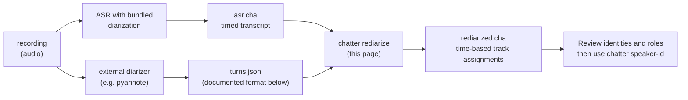

# Rediarize (`chatter rediarize`)

**Status:** Draft
**Last updated:** {{git-dates:page}}

`chatter rediarize` re-attributes utterance speakers in a CHAT file
from an external diarization. Given a transcript whose utterances
carry media time bullets and a JSON file of timestamped speaker turns
produced by a dedicated diarizer (for example pyannote), it reassigns
each utterance's main-tier speaker to the diarization track that
covers the utterance's time span the most. It clones utterance content while
changing the main-tier speaker, then serializes the resulting model. This is
not a source-byte-preserving edit API.

Use it when you have independently reviewed replacement speaker turns for an
existing timed transcript. Neither transcription accuracy nor diarizer accuracy
is established by this command. A new diarizer can also miscount speakers or
misplace their boundaries; the transform applies its supplied evidence rather
than listening to the recording.

The command is **structural and audio-free**: it never touches the
recording. The diarizer runs elsewhere (any tool, any model) and
hands its result across a documented JSON boundary.

## Pipeline position



`rediarize` selects an anonymous track for each overlapping utterance; it does
not establish who that track is. Review identity and role evidence separately;
[`chatter speaker-id`](speaker-id.md) documents the available mapping and
review workflows, not a guarantee of correct real-world identity.

## Usage

```bash
chatter rediarize INPUT.cha --turns TURNS.json -o OUTPUT.cha
```

Omitting `-o` prints the rewritten CHAT to stdout.

A summary is reported on stderr after the rewrite (stderr so that a
stdout CHAT stream stays clean when `-o` is omitted):

```text
rediarize: 214 reassigned, 671 unchanged, 7 flagged
```

Flagged utterances (see below) are listed individually with their
utterance index, kept speaker, and reason.

`--contested-at SHARE` additionally reports utterances whose time is
split between tracks; see [Contested utterances](#contested-utterances-contested-at).

## Machine-readable summary (`--summary-json`)

Batch drivers looping `rediarize` over a corpus should not scrape the
stderr text. `--summary-json PATH` additionally writes the outcome as
JSON:

```bash
chatter rediarize INPUT.cha --turns TURNS.json \
    -o OUTPUT.cha --summary-json SUMMARY.json
```

```json
{
  "source": "pyannote/speaker-diarization-community-1",
  "reassigned": 747,
  "unchanged": 145,
  "flagged": [
    {"utterance_index": 12, "kept_speaker": "PAR1",
     "reason": "no_overlapping_turn"}
  ],
  "contested": [
    {"utterance_index": 41, "assigned": "PAR2",
     "ownership": {"shares": [["PAR2", 600], ["PAR1", 400]],
                   "total_ms": 1000}}
  ]
}
```

- `source`: the turns file's provenance, passed through (`null` if the
  turns file carried none).
- `reassigned` / `unchanged`: utterance counts. `unchanged` includes
  flagged utterances (they kept their speaker), so the file's total
  total utterance count, including utterances without bullets, is
  `reassigned + unchanged`.
- `flagged`: every declined reattribution, **never truncated** (the
  stderr listing caps at 20 detail lines; this list is complete).
  `utterance_index` is the 0-based position among main-tier lines;
  `reason` is `"no_bullet"` or `"no_overlapping_turn"`.

- `contested`: assignments meeting the supplied runner-up threshold, empty
  unless `--contested-at` was given. These select `assigned` even when it is
  already the utterance's speaker, so they may count as `unchanged`; they are
  not in `flagged`, which means no assignment was available.
  `ownership.shares` is every overlapping track with its
  union-held milliseconds, descending; overlapping turns for the SAME
  track count their shared interval once. `ownership.total_ms` is the sum
  of those per-track values and is the denominator. Simultaneous DIFFERENT
  tracks each retain the shared interval, so `total_ms` can exceed the
  utterance bullet's duration. At the integer limit the sum saturates at
  `u64::MAX`; it is not an arbitrary-precision duration. The whole distribution is emitted rather
  than a winner and a runner-up, because that narrower shape cannot tell a
  55/45 split from 55/23/22 and the difference is the point.

Field names and the `reason` strings are a stable output contract.
The summary is attempted after the CHAT output. These are separate writes,
not a transaction; a later summary failure does not roll back the CHAT write.

## Contested utterances (`--contested-at`)

An utterance's bullet can overlap turns from more than one track. The
tool selects the largest union-held duration. This policy can select a track
holding 34% of the total; it does not require a majority or establish confidence.
Equal durations are ordered by track-code text, with the lexically first code
winning. A tie does not produce a declined-assignment flag.

```bash
chatter rediarize INPUT.cha --turns TURNS.json --contested-at 0.25
```

Reports an utterance as contested when the RUNNER-UP track holds at
least that share of the total track-held time. Two rivals at 20% each
is a different situation from one at 40%, and this is the latter
question. Same-track duplicate coverage never inflates the denominator;
cross-track overlap remains evidence for both simultaneous speakers.

The comparison is inclusive. A threshold of zero therefore also reports a
single-track assignment, whose runner-up share is zero. Contested status is a
reporting predicate, not a measurement that multiple real speakers were audible.

**There is no default, deliberately.** Omit the flag and nothing is
reported as contested. What share makes an utterance genuinely mixed
has not been measured against human listening, so shipping a number
here would hand every user a constant wearing this tool's authority.
Supply one you can defend, or none.

The flag changes **reporting only**: placement is byte-identical with
and without it. A value outside `0.0` to `1.0`, or `NaN`, fails the
command before any file is read, rather than silently meaning "nothing
is ever contested".

Known limitation: per-track union-held totals cannot distinguish a speaker
change INSIDE an utterance (one track holds the first half, the other the
second) from crosstalk (both across the whole), and those want opposite
remedies. Contested says ownership is divided, not how it is arranged on
the timeline.

## The turns JSON format

The `--turns` file is the corpus-agnostic seam between the diarizer
and chatter. Producing it from any given diarizer's native output is
the caller's concern; the format is:

```json
{
  "source": "pyannote/speaker-diarization-community-1",
  "turns": [
    {"track": "PAR0", "start_ms": 12063, "end_ms": 17024},
    {"track": "PAR1", "start_ms": 13379, "end_ms": 14375}
  ]
}
```

- `source` (optional): free-form provenance, typically the diarizer
  model name. Not interpreted, but useful in audit trails.
- `turns` (required): the timestamped segments. Each has:
  - `track`: the anonymous CHAT speaker code this segment belongs to
    (`PAR0`, `PAR1`, ...). The producer chooses the codes; a
    deterministic mapping from diarizer-native labels (for example
    pyannote's `SPEAKER_00`) is recommended.
  - `start_ms` / `end_ms`: the segment's media time span in integer
    milliseconds, half-open `[start_ms, end_ms)`, with
    `end_ms >= start_ms`.

The JSON reader accepts track strings as supplied; it does not check that each
is a syntactically valid CHAT speaker code. Supply valid codes and validate the
output. Negative or noninteger timestamps fail JSON admission. Zero-duration
turns are accepted but contribute no positive overlap.

Turns MAY overlap each other (diarizers that permit overlapping speech
produce such turns). Overlap between turns for the same track is unioned;
overlap between different tracks is retained for each track as crosstalk
evidence. Input order is immaterial: chatter admits the turns to a typed,
start-ordered timeline before attribution. Unknown fields anywhere in the
file are rejected, so a misspelled field fails loudly instead of being
silently ignored.

## Behavior contract

The Rust `rediarize` API requires an error sink. After reconciling headers it
uses the canonical participant join, reporting inconsistencies before exposing
the resulting participant map. The returned mutable model is not a full
validation certificate. The content-level wrapper refuses to serialize when
that join reports errors; it does not silently discard them. It does not run a
full validation pass on the rewritten model before serializing it.

- Every utterance with a time bullet is assigned to the track with the
  greatest union of millisecond coverage against the bullet's span.
  An utterance already on its max-overlap track counts as
  `unchanged`.
- An utterance with **no bullet**, or whose bullet **overlaps no
  turn at all**, keeps its existing speaker and is **flagged** in
  the summary. Equal-overlap ties instead select a winner as described above.
- Existing `@Participants` lists retain used tracks and add missing entries
  from the first participant template, including its name and role. Missing
  `@ID` rows are cloned independently from the first ID template, changing only
  its speaker code. These inherited fields are placeholders to review, not
  facts inferred about the new track. Without the corresponding template this
  function cannot synthesize those declarations. Unused declarations are dropped.
- Header-only transcripts preserve their declarations: no utterances means
  there is no attribution evidence for pruning participants.
- Utterance content, dependent tiers and other headers are cloned in the model.
  Speaker references outside the main-tier code and participant/ID declarations
  are not generally renamed. Retained references can therefore become
  inconsistent and require review; participant-join errors refuse CLI output.

## Exit codes

| Code | Meaning |
|------|---------|
| 0 | Rewrite completed and output written. Flagged utterances do not fail the command; check the summary. |
| 1 | Input/admission failure (including unreadable input, malformed JSON or invalid threshold), or CHAT/summary output failure. |
| 2 | Precondition violation: the turns JSON parsed but is semantically defective (for example a turn with `end_ms < start_ms`). |

Input and transformation failures occur before output writing. Once writing
begins, a nonzero exit can leave a complete CHAT output and a missing or partial
summary, or a partial CHAT destination. Existing destinations are written with
replacement/truncation semantics; this is not atomic publication.

### Safe destinations and recovery

Use distinct new destinations for CHAT and summary, separate from both input
files. The command does not check path aliases: pointing the summary at the
CHAT output can replace the transcript with JSON, and an output path can
overwrite an input. Different spellings do not prove different files when
symlinks or hard links are involved. Avoid in-place use and preserve originals.

After an output failure, inspect both destinations before retrying. Do not infer
that neither changed from the exit code, or use an existing summary as proof
that the latest attempt succeeded. Preserve any partial result needed for
diagnosis and choose fresh distinct destinations for the retry. Validate the
resulting CHAT separately; successful writing is not acoustic verification of
the supplied diarization or proof of a correct speaker assignment.

## Worked example

A recording of one child and two parents, transcribed by an ASR
whose bundled diarization auto-detected two speakers (the two adults
were merged into one track). A dedicated diarizer found three voices
and produced `turns.json` with `PAR0`/`PAR1`/`PAR2`. Then:

```bash
chatter rediarize session.cha --turns turns.json -o session-3spk.cha
chatter validate session-3spk.cha
```

assigns each overlapping utterance as a whole to one supplied track; it does
not split an utterance at a speaker-change boundary. `PAR2` is declared only
if the resulting transcript uses it and suitable header templates exist.
Review copied names, roles and ID fields, validate the output, and compare
contested assignments against the recording before applying an identity mapping.
