# Sanitize (`chatter debug sanitize`)

**Status:** Current
**Last updated:** {{git-dates:page}}

`chatter debug sanitize` strips contributor lexical content from a CHAT
file while preserving structure (timing bullets, `%wor` per-word bullets,
speaker codes, dependent-tier scaffolding, structural counts, POS tags,
language markers). It replaces supported lexical fields, but is **not a
complete de-identification guarantee**. Preserved identifiers, dates, gem labels,
display metadata and unknown recovery headers can retain identifying text. Review output under the
applicable data-sharing rules before disclosing it.

The command prepares a lexical-redaction candidate for debugging. It does not
authorize disclosure to a person, issue tracker or external service. Retained
fields and diagnostic output can still contain identifying or source text.

## When to use it

Run `chatter debug sanitize` as one preparation step before manual privacy
review. Do not send its output to another tool or person merely because the
command succeeded; unsupported fields and intentionally preserved metadata can
still identify participants.

When asking for a debugging example, request a locally sanitized and manually
reviewed copy under the applicable sharing rules, not an unreviewed transcript
or an automatic upload of the command's output.

## Usage

```bash
# Write sanitized output to stdout
chatter debug sanitize input.cha

# Write sanitized output to a file
chatter debug sanitize input.cha --output sanitized.cha
```

Choose an access-controlled destination with suitable retention. The command
does not configure a scratch directory or make output safe to share by choosing
a filename. Preserve the original separately.

### Input and output boundaries

If parsing builds a model with diagnostics, the CLI prints those diagnostics
to stderr and sanitizes the recovered model. Only an unbuildable parse aborts
at that boundary. There is no full CHAT validation pass before or after the
redaction. Parse diagnostics can contain original text and paths: do not share
stderr merely because stdout or the output file has been reviewed.

For `--output`, the CLI retains the opened source and destination handles and
refuses matching file identities, including hard-link and symbolic-link aliases.
It writes through that same admitted destination handle rather than reopening
the path after checking it. Identity/open errors refuse the write.

Distinct existing regular files are still truncated and replaced, and a later
I/O error can leave partial output. This is not atomic publication or a rollback
guarantee; opening a new destination can leave an empty file on a later failure.
Use a new destination, inspect any failed result before retrying, and keep the
input unchanged. Shell redirection such as `> input.cha` is unsafe: the shell
can truncate the input before Chatter starts, outside this identity check.

## What is preserved in the model

Serialization produces a new CHAT document. Preserving typed values is not a
promise of byte-identical whitespace, line endings or original offsets.

- Timing bullets `•start_end•` on the main tier.
- `%wor` per-word bullets (`•start_end•` after each word); the words
  beside them become the main tier's placeholders, below.
- Speaker codes (`*PAR`, `*INV`, `*CHI`, …).
- Utterance count and main-tier word structure; phonological tiers listed below
  are deliberately dropped, so dependent-tier count is not preserved.
- Structural markers: compound `+`, clitic `~`, CA elements, overlap
  points, lengthening, stress markers, syllable pause, underline
  begin/end, proper-noun `@n` markers.
- Language markers (`@s:LANG`), form types (`@a`, `@b`), POS tags
  (`$adj`, `$n`).
- Headers: `@Languages`, `@Birth`, `@Date`, `@Media`, `@PID`, `@L1Of`,
  `@Begin`/`@End`/`@UTF8`.
- `%mor` POS categories and morphological features (e.g., `n|`, `-Past`).
- `%gra` (numeric grammatical relations) and `%tim` (timing).
- Untranscribed tokens `xxx` / `yyy` / `www`, replacing them changes
  semantic meaning, so they pass through unchanged.

## What is replaced or redacted

| Source | Replacement |
|---|---|
| `WordContent::Text` | `wN` placeholder, indexed by document position |
| `WordContent::Phonetic` (`@u`) | `wN` placeholder; phonetic speech can contain names |
| `Shortening` text | `(x)` |
| `%mor` lemmas (`MorWord.lemma`) | `lemmaN`; POS + features preserved |
| `%wor` words | judged as timing recovery judges the tier, before the main tier is rewritten (count match, then word-by-word corroboration): a corroborating tier has each word become its paired main-tier word's display text, now that word's placeholder (`wN`, the same `N`; `w1w1` for a compound), so it still corroborates the main tier; a drifted or uncorroborated tier takes fresh placeholders rather than a manufactured agreement. Bullets preserved |
| `%pho` / `%mod` / `%modsyl` / `%phosyl` / `%phoaln` / `%sin` / `%xphoint` | tier dropped |
| Free-text dependent tiers (`%com` `%add` `%exp` `%sit` `%spa` `%int` `%gpx` `%act` `%cod` `%eng` `%gls` `%ort` `%flo` `%def` `%coh` `%fac` `%par` `%alt` `%err`) | `[redacted]` |
| `@Comment`, `@Transcriber`, `@Birthplace`, `@Activities`, `@Situation`, `@RoomLayout`, `@Location`, `@TapeLocation`, `@Warning`, `@Bck` | `[redacted]`; header identity and any speaker reference are retained |
| User-defined and unsupported dependent-tier bodies | Existing body replaced by `[redacted]`; absent body stays absent |
| `@Participants` participant-name field | dropped; speaker code and role retained, no replacement name inferred |
| `@ID` `custom_field` and `education` | cleared |
| `Event` event_type (`&=imitates:Mary` → `&=redacted`) | `redacted` |
| `Freecode` text (`[^ aside]` → `[^ redacted]`) | `redacted` |
| `OtherSpokenEvent` text | `redacted` |

Inline replacements use a delimiter-free token. The brackets in the free-text
marker `[redacted]` would introduce invalid nested CHAT syntax in these fields.
Header handling matches the complete typed header enum without a preservation
catch-all, so a new variant requires an explicit policy decision. The canonical
reference corpus witnesses all nine free-text payload types alongside comments,
and checks that header kind, speaker references and preserved metadata survive.

## Determinism + Idempotence

Placeholder generation uses one monotonic counter in deterministic document
traversal order. Two consequences:

- **Deterministic**: sanitizing the same input twice produces
  byte-identical output.
- **Idempotent**: sanitizing a sanitized file produces the same file
  again, no double-replacement, no shifting placeholder numbers.

## Pipeline

```mermaid
flowchart LR
    Input["Source .cha\n(protected corpus)"] --> Parser["TreeSitterParser\n(talkbank-parser)"]
    Parser --> Model["ChatFile model\n(talkbank-model)"]
    Model --> Sanitize["sanitize()\n(talkbank-transform::redact)"]
    Sanitize --> Walker["Typed content walker\n+ headers and dependent tiers"]
    Walker --> WordMutation["Typed Word replacement\n+ derived-text refresh"]
    WordMutation --> Mutated["Mutated ChatFile\n(placeholders + redactions)"]
    Mutated --> Writer["WriteChat\n(fresh serialization)"]
    Writer --> Output["Sanitized .cha\n(scratch path)"]
```



The walker step replaces lexical segments in the typed word-content sequence,
mutates `MorWord.lemma` fields, redacts free-text
header / dep-tier / scoped-annotation strings, and drops phonological
tiers. `WriteChat` then serializes the retained model values. A recovered input
model is not proof that all original source structure survived parsing.

Word replacement uses the model's mutation methods rather than independent
edits to cached strings. `SanitizedDocument` keeps its inner model private and
exposes CHAT writing; it is not a general validated-model or JSON-export
capability. Sanitization changes text lengths, so original source spans must
not be reused as positions in the new output.

## Out of v1 scope

The current strict policy does not perform the following operations; this list
is not a promise of a later version:

- Speaker-code anonymization (graph rewrite across `@Participants`,
  `@ID`, `*SPK:`, `@Birth`, `@L1Of`).
- `@Birth` / `@Date` fuzzing (exact birth dates can be identifying).
- `@Media` filename redaction.
- Audio-side sanitization. (Audio bytes are *never* touched by the
  sanitizer; the audio stays at its original path.)
- "Unsanitize" or round-trip mapping. Explicitly **not** built, the
  sanitizer is one-way, the mapping table that would reverse it is the
  exact artifact we don't want to exist.

## Implementation

Library module: `talkbank_transform::redact`. CLI surface: `chatter debug sanitize`.
The strict policy is the only public preset in v1; future variants can
grow on `SanitizationPolicy`.
