# Sanitize (`chatter experimental transform redact`)

**Status:** Current
**Last updated:** {{git-dates:page}}

`chatter experimental transform redact` strips contributor lexical content from a CHAT
file while preserving structure (timing bullets, `%wor` per-word bullets,
speaker codes, dependent-tier scaffolding, structural counts, POS tags,
language markers). It replaces supported lexical fields, but is **not a
complete de-identification guarantee**. Preserved identifiers, dates, gem labels,
display metadata and unknown recovery headers can retain identifying text. Review output under the
applicable data-sharing rules before disclosing it.

The command prepares a lexical-redaction candidate for debugging. It does not
authorize disclosure to a person, issue tracker or external service. Retained
fields and diagnostic output can still contain identifying or source text.

## When to use it

Run `chatter experimental transform redact` as one preparation step before manual privacy
review. Do not send its output to another tool or person merely because the
command succeeded; unsupported fields and intentionally preserved metadata can
still identify participants.

When asking for a debugging example, request a locally sanitized and manually
reviewed copy under the applicable sharing rules, not an unreviewed transcript
or an automatic upload of the command's output.

## Usage

```bash
# Write sanitized output to stdout
chatter experimental transform redact input.cha

# Write sanitized output to a file
chatter experimental transform redact input.cha --output sanitized.cha
```

Choose an access-controlled destination with suitable retention. The command
does not configure a scratch directory or make output safe to share by choosing
a filename. Preserve the original separately.

### Practice with a public reference

Install Chatter and open Bash at the root of its source checkout. This exercise
uses the public basic-conversation reference, not research data. Create a fresh
practice directory and keep an untouched copy for comparison:

```bash
practice_dir=$(mktemp -d)
cp corpus/reference/core/basic-conversation.cha "$practice_dir/original.cha"
cp "$practice_dir/original.cha" "$practice_dir/input.cha"
```

First, deliberately request the input itself as the destination. Capture the
expected failure without losing its diagnostic, including in a `set -e` shell:

```bash
if chatter experimental transform redact "$practice_dir/input.cha" \
    --output "$practice_dir/input.cha" \
    > "$practice_dir/refused.stdout" 2> "$practice_dir/refused.stderr"; then
  sanitize_status=0
else
  sanitize_status=$?
fi
printf 'Sanitize exit: %s\n' "$sanitize_status"
cat "$practice_dir/refused.stderr" >&2
cmp "$practice_dir/original.cha" "$practice_dir/input.cha"
```

Expect exit `1` and a message refusing to overwrite the input. `cmp` should
exit `0` without output: the practice input is unchanged. Recover by selecting
a separate destination; do not redirect stdout onto the input to evade refusal.

```bash
chatter experimental transform redact "$practice_dir/input.cha" \
  --output "$practice_dir/sanitized.cha" \
  > "$practice_dir/sanitize.stdout" 2> "$practice_dir/sanitize.stderr"
cat "$practice_dir/sanitized.cha"
cmp "$practice_dir/original.cha" "$practice_dir/input.cha"
```

Expect exit `0`, an unchanged input, and a new transcript. Its first turn is
`*CHI:` followed by `worda wordb wordc wordd .`; both comments become `[redacted]`.
Speaker codes `CHI` and `MOT`, the participant roles, and the child's age and
sex in `@ID` remain. Inspect those retained fields alongside the redacted words:
successful lexical replacement does not make retained metadata anonymous.

Validate the new file separately, using a practice-only cache. Capture its
status rather than assuming that successful redaction proves validity.

```bash
if TALKBANK_CHAT_CACHE_DIR="$practice_dir/cache" \
    chatter validate "$practice_dir/sanitized.cha" --format json \
    > "$practice_dir/validation.jsonl" 2> "$practice_dir/validation.stderr"; then
  validation_status=0
else
  validation_status=$?
fi
printf 'Validation exit: %s\n' "$validation_status"
cat "$practice_dir/validation.jsonl"
cat "$practice_dir/sanitize.stderr" >&2
cat "$practice_dir/validation.stderr" >&2
printf 'Practice files and reports: %s\n' "$practice_dir"
```

For this reference, expect validation exit `0`, one `file` record with
`status: "valid"`, and a final summary with `outcome: "complete"`,
`valid: 1` and `invalid: 0`. Alphabetic placeholders avoid the E220 errors
that the former numeric `w1`, `w2`, … scheme introduced in English words.
This reference result does not promise that every sanitized transcript is
valid or validation-equivalent to its source. Redaction deliberately removes
some information, and retained source defects can still require attention.

Validation checks CHAT structure, not privacy. Retain command statuses and
stderr when diagnosing other failures, preserve the original, and follow the
input/output boundaries below before retrying. Review any candidate and its
logs separately before sharing either.

For a transcript with `@Media`, keep its basename in a separate destination
directory when you want filename/media validation to remain unchanged. The
sanitizer preserves the media name: renaming `session.cha` to
`session-sanitized.cha` can therefore introduce E531 even when word validation
passes. A different directory also keeps the original and candidate separate.

### Input and output boundaries

The CLI reports parse diagnostics on stderr and checks the unedited model
before redaction. Every nonblank source line must have an ordered, non-reused
counterpart in that model's serialization, ignoring whitespace. Missing or
reordered content refuses sanitization, even when parsing built a partial model.
This check runs before intentional redaction; it does not compare the redacted
words with the original words or certify semantic equivalence.

Internal parser failures and unbuildable parses abort. Sanitization also refuses
unparsed participant and ID headers, MOR and GRA because their lexical field boundaries
are unknown. These refusals exit with status 1 before opening an output file or
writing a result to stdout. An existing output remains unchanged, and a new
output is not created.

Repair the reported syntax in a separate working copy, preserving the original,
then retry the command. For generated MOR/GRA, regeneration from an admitted
source is another option. Do not replace rejected fields with guessed values to
force sanitization through. There is no full CHAT validation pass before or after
redaction. Parse diagnostics can contain original text and paths: do not share
stderr merely because stdout or the output file has been reviewed.

For `--output`, the CLI retains the opened source and destination handles and
refuses matching file identities, including hard-link and symbolic-link aliases.
It writes through that same admitted destination handle rather than reopening
the path after checking it. Identity/open errors refuse the write.

Distinct existing regular files are still truncated and replaced, and a later
I/O error can leave partial output. This is not atomic publication or a rollback
guarantee; opening a new destination can leave an empty file on a later failure.
Use a new destination, inspect any failed result before retrying, and keep the
input unchanged. Shell redirection such as `> input.cha` is unsafe: the shell
can truncate the input before Chatter starts, outside this identity check.

## What is preserved in the model

Serialization produces a new CHAT document. Preserving typed values is not a
promise of byte-identical whitespace, line endings or original offsets.

- Timing bullets `•start_end•` on the main tier.
- `%wor` per-word bullets (`•start_end•` after each word); the words
  beside them become the main tier's placeholders, below.
- Speaker codes (`*PAR`, `*INV`, `*CHI`, …).
- Utterance count and main-tier word structure; phonological tiers listed below
  are deliberately dropped, so dependent-tier count is not preserved.
- Structural markers: compound `+`, clitic `~`, CA elements, overlap
  points, lengthening, stress markers, syllable pause, underline
  begin/end, proper-noun `@n` markers.
- Language markers (`@s:LANG`), form types (`@a`, `@b`), POS tags
  (`$adj`, `$n`).
- Headers: `@Languages`, `@Birth`, `@Date`, `@Media`, `@PID`, `@L1Of`,
  `@Begin`/`@End`/`@UTF8`.
- `%mor` POS categories and morphological features (e.g., `n|`, `-Past`).
- `%gra` (numeric grammatical relations) and `%tim` (timing).
- Untranscribed tokens `xxx` / `yyy` / `www`, replacing them changes
  semantic meaning, so they pass through unchanged.

## What is replaced or redacted

| Source | Replacement |
|---|---|
| `WordContent::Text` | `worda`, `wordb`, … placeholder, indexed by document position; adjacent text segments form one replacement run |
| `WordContent::Phonetic` (`@u`) | alphabetic word placeholder per contiguous phonetic run; phonetic speech can contain names |
| `Shortening` text | `(x)` |
| `%mor` lemmas (`MorWord.lemma`) | `lemma` plus an alphabetic index; POS + features preserved |
| `%wor` words | judged as timing recovery judges the tier, before the main tier is rewritten (count match, then word-by-word corroboration): a corroborating tier has each word become its paired main-tier word's display text, now that word's placeholder (`worda`, for example; `wordaworda` for a compound), so it still corroborates the main tier; a drifted or uncorroborated tier takes fresh placeholders rather than a manufactured agreement. Bullets preserved |
| `%pho` / `%mod` / `%modsyl` / `%phosyl` / `%phoaln` / `%sin` / `%xphoint` | tier dropped, including explicit raw recovery variants |
| Rejected `%wor` | raw tier dropped; no timing or word correspondence is inferred |
| Rejected `@Participants`, `%mor`, `%gra` | operation refused; no output published |
| Free-text dependent tiers (`%com` `%add` `%exp` `%sit` `%spa` `%int` `%gpx` `%act` `%cod` `%eng` `%gls` `%ort` `%flo` `%def` `%coh` `%fac` `%par` `%alt` `%err`) | `[redacted]` |
| `@Comment`, `@Transcriber`, `@Birthplace`, `@Activities`, `@Situation`, `@RoomLayout`, `@Location`, `@TapeLocation`, `@Warning`, `@Bck` | `[redacted]`; header identity and any speaker reference are retained |
| User-defined and unsupported dependent-tier bodies | Existing body replaced by `[redacted]`; absent body stays absent |
| `@Participants` participant-name field | dropped; speaker code and role retained, no replacement name inferred |
| `@ID` `custom_field` and `education` | cleared |
| `Event` event_type (`&=imitates:Mary` → `&=redacted`) | `redacted` |
| `Freecode` text (`[^ aside]` → `[^ redacted]`) | `redacted` |
| `OtherSpokenEvent` text | `redacted` |

Inline replacements use a delimiter-free token. The brackets in the free-text
marker `[redacted]` would introduce invalid nested CHAT syntax in these fields.
Header handling matches the complete typed header enum without a preservation
catch-all, so a new variant requires an explicit policy decision. The canonical
reference corpus witnesses all nine free-text payload types alongside comments,
and checks that header kind, speaker references and preserved metadata survive.

## Determinism + Idempotence

Placeholder generation uses one alphabetic sequence in deterministic document
traversal order: `a` through `z`, then `aa` through `az`, `ba`, and so on.
Words use the prefix `word`; MOR lemmas use `lemma`. Both share the sequence,
so a lemma's suffix need not match its corresponding main-tier word.
The sequence grows without a fixed-width integer counter. Two consequences:

- **Deterministic**: sanitizing the same input twice produces
  byte-identical output.
- **Idempotent**: sanitizing a sanitized file produces the same file
  again, no double-replacement, no shifting placeholder numbers.

## Pipeline

```mermaid
flowchart LR
    Input["Source .cha\n(protected corpus)"] --> Parser["TreeSitterParser\n(talkbank-parser)"]
    Parser --> Model["ChatFile model\n(talkbank-model)"]
    Model --> Sanitize["sanitize()\n(talkbank-transform::redact)"]
    Sanitize --> Walker["Typed content walker\n+ headers and dependent tiers"]
    Walker --> WordMutation["Typed Word replacement\n+ derived-text refresh"]
    WordMutation --> Mutated["Mutated ChatFile\n(placeholders + redactions)"]
    Mutated --> Writer["WriteChat\n(fresh serialization)"]
    Writer --> Output["Sanitized .cha\n(scratch path)"]
```



The walker step replaces lexical segments in the typed word-content sequence,
mutates `MorWord.lemma` fields, redacts free-text
header / dep-tier / scoped-annotation strings, and drops phonological
tiers. `WriteChat` then serializes the retained model values. A recovered input
model is not proof that all original source structure survived parsing.

Word replacement uses the model's mutation methods rather than independent
edits to cached strings. `SanitizedDocument` keeps its inner model private and
exposes CHAT writing; it is not a general validated-model or JSON-export
capability. Sanitization changes text lengths, so original source spans must
not be reused as positions in the new output.

## Out of v1 scope

The current strict policy does not perform the following operations; this list
is not a promise of a later version:

- Speaker-code anonymization (graph rewrite across `@Participants`,
  `@ID`, `*SPK:`, `@Birth`, `@L1Of`).
- `@Birth` / `@Date` fuzzing (exact birth dates can be identifying).
- `@Media` filename redaction.
- Audio-side sanitization. (Audio bytes are *never* touched by the
  sanitizer; the audio stays at its original path.)
- "Unsanitize" or round-trip mapping. Explicitly **not** built, the
  sanitizer is one-way, the mapping table that would reverse it is the
  exact artifact we don't want to exist.

## Implementation

Library module: `talkbank_transform::redact`. CLI surface: `chatter experimental transform redact`.
The strict policy is the only public preset in v1; future variants can
grow on `SanitizationPolicy`.
