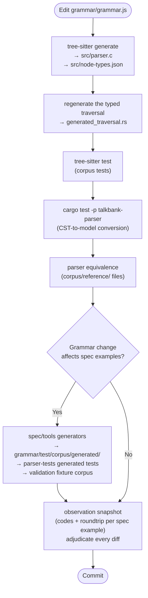

# Grammar Workflow

**Status:** Current
**Last modified:** {{git-dates:page}}

The tree-sitter grammar at `grammar/grammar.js` is the formal definition of the CHAT format. Changes require careful validation.

The following diagram shows the complete regeneration pipeline. Every
step must pass before committing a grammar change.



## Step-by-Step Procedure

### 1. Edit the Grammar

Modify `grammar.js` in the `grammar/` directory. Key design principles:

- Explicit whitespace (no `extras`)
- Precedence annotations to resolve ambiguities
- Named rules for all semantically meaningful nodes

### 2. Generate the Parser

```bash
cd grammar
tree-sitter generate
```

This produces `src/parser.c` and `src/node-types.json`. Never edit these files by hand.

`tree-sitter test` does NOT detect a stale `parser.c`, so nothing downstream
can be trusted until this has run.

### 3. Regenerate the Typed Traversal

`crates/talkbank-parser/src/generated_traversal.rs` is the single generated
visitor the whole production parser dispatches through, produced from the
grammar's JSON by `tree-sitter-grammar-utils`. A grammar change that alters
node types or their positions makes it stale. A TSGU update also requires
regeneration and consumer integration, even when both grammar JSON hashes are
unchanged. Grammar-hash checks alone do not prove generator currency. Do not
declare an update complete while retaining an older traversal to avoid its
API migration; the generated source identity must name the reviewed generator.

The generator source is not yet publicly available. Ordinary builds consume
the committed traversal and metadata bridge without a generator checkout, but
the public Chatter checkout alone cannot reproduce these two generated files.
Grammar contributors currently need a maintainer-provided generator checkout.
`tsgu-revision` pins the full reviewed generator commit. The committed traversal's
header records its producer identity; its package version alone is insufficient.
Public source availability and a verified independent regeneration remain
prerequisites for a self-contained public grammar-development workflow.

From the Chatter checkout, use its owning recipe:

```sh
TSGU_DIR=/path/to/tree-sitter-grammar-utils just traversal-gen
just conformance-gen
```

`TSGU_DIR` selects the generator checkout; the recipe defaults to the `tsgu`
directory in the user's home directory. The recipe requires Python 3.11 or later.
It refuses a non-root, dirty or wrong-revision generator checkout, builds its
`generate_typed_traversal` example with `cargo build --locked`, and reads edition
and toolchain from Chatter's own manifests rather than a copied command. Cargo
and the native Rust compiler/linker must be available, with the dependencies in
the generator's committed lockfile obtainable from the registry or a local cache.
The output header records the generator's version and source identity.
The recipe uses the executable reported by Cargo, so `CARGO_TARGET_DIR` and
Cargo target-directory configuration do not cause it to run an old binary from
an assumed location. Relative Cargo overrides resolve in the generator checkout.
The same recipe emits `grammar/bindings/rust/tsgu_language_metadata.c` through
the generator's `--metadata-bridge` mode. This companion is generated, not
hand-maintained: the grammar build compiles it against its own `parser.h` and
namespaces its export. It supplies actual ABI-15 symbol/alias metadata for
source-bound nonmissing admission; it does not parse CHAT or C source text.
The generator runs `rustfmt` on its output, so Chatter's selected toolchain needs
that component and no separate `cargo fmt` step is needed. Both child commands
must succeed before either committed output is replaced; identical bytes retain
their modification times. This is failure-safe generation staging, not a
cross-file filesystem transaction or a hermetic build. Never hand-edit the files;
if the output is wrong, fix the generator as a general change and regenerate.

For a bootstrap drill, select an empty build directory explicitly, for example
`CARGO_TARGET_DIR=/path/to/new-generator-build TSGU_DIR=/path/to/tree-sitter-grammar-utils just traversal-gen`.
Compare both output hashes and inspect `git diff`. Cached registry dependencies
are allowed for this local drill; reproducing bytes without an existing build
directory does not establish clean-machine or independent public-source access.

Generated lint findings belong in the generator, not hand-edited output. Run
its generated-code Clippy probe and reconstruction regressions before consuming
a changed generator. Kind-admitted extraction uses `Result`'s must-use contract;
broad extraction is total and source projections have explicit must-use
annotations. Admission remains sealed
against caller-supplied projections, with a narrowly documented private-bound
allowance rather than a public escape hatch.
The audited compiled-metadata FFI boundary and grammar-specific admission
scaffolding also carry narrowly justified warning allowances in the generator's
runtime source. Keep those allowances at their owner; do not suppress warnings
across handwritten parser consumers or remove source/language admission checks.
Borrowed uninhabited recovery arms do not dereference their payloads: they fail
explicitly if reached, without fabricating a recoverable CHAT state. Source-bound
accessors may be constant functions, but that does not establish new admission.

For a generator API change, first implement and verify the change in TSGU,
then commit that reviewed generator change locally so regeneration has clean
source identity. Update Chatter's `tsgu-revision` to that full commit explicitly;
the recipe never fetches, resets or silently selects a newer generator. Regenerate
Chatter, migrate the handwritten consumers of the
changed API, and exercise the affected spec/reference workflows. A local
generator commit is not publication. Grammar changes additionally require
`tree-sitter generate` before traversal regeneration; a generator-only change
does not require changing the grammar.

The generated module owns both CST shape and source-binding capabilities.
`ParsedSource` owns the tree/input association; its `bind_typed` transition
produces `SourceBound<T>` for supported generated wrappers. Consumers obtain
the node and its source from that binding, not separately supplied values.
Raw-node admission checks tree membership and canonical coordinates, because
independently editing a node copy can leave membership intact while shifting
its ranges. See [Parsing](../architecture/parsing.md) for the current migration
boundary and recovery policies. Binding proves source identity, not syntactic
completeness or semantic validity; do not remove recovery states merely because
the finite corpus has not reached them.

The generated source-bound extraction path:
`bound.extract()` returns `SourceChildren` directly; the immutable carrier's generated
`field_<minted_name>()` accessors retain source identity in `SourceField`.
Structural projections (`slot`, `iter`, `optional`, and `view`) preserve that
association through positional slots, sequence groups, choices, extras, and
recovery payloads. `SourceSlotView` retains every recovery state and preserves
uninhabited payloads; a leaf's `read()` admits its range without another root
membership search. Choice views preserve the already reconstructed variant.
`SourceSlice::extract_header()` retains association through supertype dispatch,
including Missing, Error, and Unexpected outcomes.

Lookahead and construction share the generator's typed decision functions.
Lookahead memoizes answers; construction advances one cursor and consumes typed
choice selections. There is no separately interpreted plan arena or
`ReconstructionFault`: broad extraction is total by construction, with recovery
retained in the carrier, not converted into an extraction failure.

Concrete free extractors return their carriers directly; broad ERROR-root
recovery returns `Option<_>`, where `None` means the node is not an eligible
recovery root. Kind-admitted extraction remains fallible with `AdmittedRefusal`
(`ForeignLanguage` or `ContradictedKindProof`); admitted ERROR-root recovery
returns `Result<Option<_>, AdmittedRefusal>`. Compiled-grammar and source-range
admission also retain their real errors. Chatter combines those three admission
boundaries in `CstFailure`, reports E001 internal failure once at the owning
boundary, and never turns them into a CHAT-invalidity verdict. The conformance
inventory admits only total broad extractors before generating dispatch arms.

Source-range admission reports E001 when a node range is outside its source or
bisects UTF-8. Those failures describe a broken API association, not malformed
CHAT. A successful range check alone proves readability, not source identity;
new callers must retain the source-bound API. The canonical word and inline CA
decoders now consume the producing bound token, with no independently supplied
node/source pair or transitional raw text decoder. Do not treat equal-width
foreign text as an admitted pairing.
Nonwords and ordered scoped annotations retain the same source capability
through word, event/action, group and quotation callers. First and repeated
annotation choices lower exhaustively into bound alternatives; token policy
reads their admitted spelling, and retrace labels use the marker's own range.
The former raw-choice `From` conversions are replaced by source-bound view
conversions: admit the selected choice, then use `.view().into()`.
Code-switch language selection uses generated associated fields, not raw child
lookup. Only actual optional absence produces the shortcut; recovered explicit
language content cannot be silently replaced by it. Kind/source admission does
not replace lexical policy or the whole-tree recovery backstop.
Likewise, a present CA token with empty text or a symbol outside its shared
generated registry is a producer/source-association failure. Actual MISSING
tokens retain their existing recovery handling.

Document-root classification retains associated carriers for both complete
documents and reconstructed ERROR roots. The latter uses
`SourceSlice::extract_full_document_from_error_recovery()`. Line and header
dispatch preserve association from those carriers; wrapped-header fragments
enter the same dispatcher with their already admitted source slice.
Participant lowering accepts a `SourceBound<ParticipantsHeaderNode>` and carries
association through its contents, repeated groups, speaker, name, and role.
Its text reads accept no separately supplied source string.

Calling the free `extract_participant(bound.node())` returns a total ordinary
carrier. Other header families retain their transitional lowering APIs behind
the associated dispatcher; their checked decoding remains necessary until they
also migrate. Do not infer that every parser region is source-bound.
Do not replace it with raw kind-based child walks or repeated `bind_typed`
membership searches in an inner loop. Canonical descent avoids those searches,
but still reports invalid UTF-8 ranges from the runtime: source identity alone
does not prove every descendant's range is readable. Keep that refusal at the
admission boundary and retain all genuine recovery states. A bound root whose
children are immediately separated from their source is not a completed
consumer migration.

**The staleness guard proves less than it looks.**
`generated_traversal_is_current` recomputes the digests of `grammar.json` and
`node-types.json`, so it catches a forgotten regeneration after a GRAMMAR
change. Its inputs are those two files, so it cannot see the generator at all:
a module emitted by an older backend passes indefinitely, and the guard is not
wrong to pass it. It is answering a different question from the one its name
invites you to ask.

Which generator wrote the file is answered by the file, in its own header
comment. A bare semver does not identify a build, which is why the generator
stamps its source commit beside the version. When the question is which backend
produced the module, read that header rather than trusting a green suite.

After traversal regeneration, run `just conformance-gen`. It derives the test
inventory from the current traversal source. Its generator-only build omits
the default `conformance` feature so an outdated generated consumer cannot
prevent its own regeneration. Normal test builds keep that feature enabled;
the integration tests still require conformance support.

### 4. Run Grammar Tests

```bash
tree-sitter test
```

Every test under `grammar/test/corpus/` must pass. Tests live there
and are partially auto-generated from specs (primarily via
`just spec-gen`).

### 5. Run Parser Tests

```bash
cargo test -p talkbank-parser
```

This verifies the Rust parser wrapper handles all CST nodes correctly.

### 6. Run Parser Equivalence

```bash
cargo test -p talkbank-parser-re2c --test integration equivalence_reference_corpus
```

Every file in the reference corpus must parse correctly. Each `.cha` file is its own test, so failures are reported per file.

### 7. Regenerate Spec Tests

If the grammar change affects any spec examples:

```bash
just spec-gen

just spec-gen      # every artifact derived from spec/
just spec-check    # or: is the committed copy current?
```

This regenerates tree-sitter corpus tests and other generated outputs that
still depend on the spec pipeline.

Do this when the grammar change actually affects generated artifacts.

### 8. Adjudicate the observation snapshot

`just regen` rewrites `spec/observations/example-diagnostics.json`, which
records for every spec example the codes each stage emitted and whether the
parsed model serializes back byte-exact. Its currency test keeps it honest,
but the test is satisfied by any regenerated file, so the gate here is human:
read the diff. Every changed entry is either INTENDED (the behaviour change
was the point; commit the regenerated snapshot in the same change) or
UNINTENDED (a regression; fix the code, never the snapshot). A construct the
suite does not exercise is a missing spec example, and adding one is part of
the change, not a follow-up.

## The reference corpus is a regression signal, NOT a validity authority

`corpus/reference/` must stay green, but it is not "the ultimate arbiter of
correctness", and a single failure is not a reason to revert immediately:
acting on that would entrench bad data.

The corpus is SYNTHESIZED. When a change makes it reject a file, adjudicate the
FILE against the real authorities (`spec/`, the grammar, and real corpus data)
and fix the data, or move it to `spec/errors/` if the construct is genuinely
invalid. Weakening the parser to keep a reference file green is the one
response that is always wrong. The roundtrip gate stays green either way.

## Common Patterns

### Adding a New Token

1. Define the token in `grammar.js`
2. Add handling in the Rust tier parser (match on the new node kind)
3. Add a spec construct example
4. Run the relevant generation and verification steps

For small, isolated syntax additions, the grammar workflow should stay local:

- one grammar change
- one grammar corpus example
- one full-file fixture if needed

### Changing a Rule

1. Modify the rule in `grammar.js`
2. `tree-sitter generate && tree-sitter test`
3. Update Rust parser if CST node structure changed
4. Update spec examples if the expected CST changed
5. Run the current local verification sweep from `contributing/dev-checks.md`
