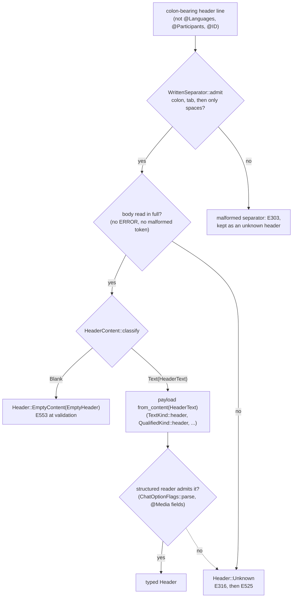

# Migrating to Chatter 0.34

**Last modified:** {{git-dates:page}}

This guide covers changes from 0.33.0 to 0.34.0. Check the
[release page](https://github.com/TalkBank/chatter/releases) for published
artifacts. If upgrading from an earlier version, apply the
[0.33 migration guide](migration-0.33.md) first. Pin one exact tag or commit
across the CHAT library crates and rebuild dependent applications.

The release has one theme: a header's content is decided once. A
colon-bearing header with nothing after its colon is one model state that
validation refuses; a header whose body cannot be read in full is kept as
`Header::Unknown`; every other header is built from text proven nonblank. The
flowchart shows the decision a colon-bearing header line passes through in
either parser, and the model state each outcome produces.



## Diagnostics a validator will notice

| Input | 0.33 | 0.34 |
| --- | --- | --- |
| Colon-bearing header with nothing (or only whitespace) after its colon | a header-specific code (E516 for `@Date`; E533 for `@Options` under tree-sitter), grammar recovery (E342, E316) from tree-sitter only, E525, or nothing, depending on the header and parser | E553 under both parsers |
| `@Time Duration`, `@Time Start` written empty | accepted | E553 |
| `@PID`, `@Font`, `@Window`, `@Color words` written empty | accepted by re2c; E525 or E316 under tree-sitter | E553 |
| `@Birth of CHI:` with no date | accepted | E553 |
| `@G:` with a tab and no label | E316 (and E525 under re2c) | E553; the bare `@Bg`, `@Eg` and `@G` with no colon remain legal |
| `@Birth of` with a malformed date | E545, message naming `@Date` | E545, message naming `@Birth of` |
| Header body with an ERROR in or beside it under tree-sitter (`@Page:` with `1x`, `@Types:` with `long, toy play, TD`, a `@Media` body with an extra comma) | E316, header built from the part before the ERROR | E316 and E525, `Header::Unknown` with the line's text |
| `@G:`, `@G: story` or `@Page:` with a tab under tree-sitter | E316, no header | E316 and E525, `Header::Unknown` |
| `@Options:` with an empty position (`CA,,NoAlign`) | E534 under re2c (an option named `""`), E316 under tree-sitter | E316 and E525 under both parsers |
| A blank `@Media` field (a trailing comma) | depending on parser and position, an unsupported type or status named by empty text (E535, E536) or a header built from the other fields | E316, `Header::Unknown`, under both parsers |
| `@Comment:` with no tab and no text, under tree-sitter | E316 | E303 |
| A `%com`, `%act`, `%cod`, ... tier holding only a continuation | not E756: a lone continuation counted as content | E756 under both parsers |
| W109 inside a malformed `@Media` line | reported on the decomposed filename | not reported; the line models no filename |

E508, E509, E516 and E533 are retired into E553 and their `ErrorCode`
variants (`EmptyDateHeader`, `EmptyMediaHeader`, `EmptyDate`,
`EmptyOptionsHeader`) are removed; match `ErrorCode::EmptyHeaderContent`
instead. E508 and E509 were never emitted. `@Languages`, `@Participants` and
`@ID` keep their declaration codes, and `@Thumbnail` stays E525 whatever it
holds. E525's message for a tree-sitter `Header::Unknown` no longer contains
a line break, because the retained text excludes the line terminator.

Under re2c, a malformed `@Page` or `@Types` body records the shared
`MALFORMED_HEADER_CONTENT` as its `parse_reason`, like every other header,
in place of its grammar's own reason. Compare `parse_reason` against that
constant rather than a copied string.

## Empty headers

`Header` has a new variant, `EmptyContent(EmptyHeader)`. Exhaustive matches
on `Header` must handle it. `EmptyHeader` has two shapes:

- `EmptyHeader::Plain { kind: PlainKind, .. }` for a header with no
  participant.
- `EmptyHeader::Qualified { kind: QualifiedKind, participant: SpeakerCode, .. }`
  for `@Birth of`, `@Birthplace of` and `@L1 of`.

Both carry a `WrittenSeparator`. A colon whose tab is missing is malformed
(E303), never empty content. Read the header with `kind()` and write its
prefix with `prefix()`. Build one with `PlainKind::empty` or
`QualifiedKind::empty`:

```rust
use talkbank_model::model::{
    EmptyHeader, Header, PlainKind, QualifiedKind, SpeakerCode, TextKind, WrittenSeparator,
};

let separator = WrittenSeparator::admit(":\t").expect("a colon and a tab");
let situation = PlainKind::Text(TextKind::Situation).empty(separator);
let birth = QualifiedKind::Birth.empty(SpeakerCode::new("CHI"), separator);

if let Header::EmptyContent(empty) = &birth {
    // `kind()` is the same kind the header has with content.
    let _label = empty.kind().label();
    if let EmptyHeader::Qualified { participant, .. } = empty {
        assert_eq!(participant.as_str(), "CHI");
    }
}
assert_eq!(situation.to_chat(), "@Situation:\t");
```

An undated `@Birth of` is now `Header::EmptyContent`. `Header::Birth`'s
`date` is still a `ChatDate`, but 0.33 filled it with
`ChatDate::Unsupported("")` for this case; that value no longer exists.
`Participant::has_birth_date` is `false` for such a participant, because the
empty header joins to no participant.

## Header kinds and prefixes

`Header::kind()` returns `HeaderKind`:

| Variant | Covers |
| --- | --- |
| `Fixed(FixedKind)` | Markers and declarations (`Begin`, `End`, `Languages`, `Participants`, `Id`, ...) |
| `Plain(PlainKind::Text(TextKind))` | Headers whose content is one text or scalar value (`Date`, `Pid`, `Situation`, ...) |
| `Plain(PlainKind::Gem(GemKind))` | `@Bg`, `@Eg`, `@G` |
| `Plain(PlainKind::Structured(StructuredKind))` | `Comment`, `Options`, `Media`, `Types`, `Page` |
| `Qualified(QualifiedKind)` | `Birth`, `Birthplace`, `L1Of` |
| `Unknown` | A header the parser could not recognize |

Replace matches on header names with matches on the kind. `Header::name` is
the kind's label and now returns `&'static str`. The kind also builds the
header from content: `TextKind::header`, `QualifiedKind::header`,
`GemKind::labelled` and `GemKind::bare`.

`HeaderPrefix` writes a header's prefix. Build it with `From` a `FixedKind`
or `PlainKind`, or with `HeaderPrefix::qualified(kind, &participant)`; a
qualified prefix without its participant cannot be built.
`QualifiedKind::keyword` gives the diagnostic spelling, such as
`"@Birthplace of"`.

## Header payloads

Every header payload is built from `HeaderText`, content proven to hold a
non-whitespace character. Only `HeaderContent::classify` makes one; its
`admit` form returns `Result<HeaderText, BlankContent>`, and
`classify_literal` is the `const` form for a literal.

These types replace the infallible `new`, `From<String>` and `From<&str>`
with `from_content(HeaderText)` and a fallible `try_new` (also
`TryFrom<String>` and `TryFrom<&str>`) that refuses blank text with
`BlankContent`:

- `PidValue`, `SituationDescription`, `TapeLocationDescription`,
  `LocationDescription`, `RoomLayoutDescription`, `GemLabel`,
  `BirthplaceDescription`, `TranscriberName`, `WarningText`,
  `ActivitiesDescription`, `BackgroundDescription`, `VideoSpec`,
  `TDescription`, `FontSpec`, `WindowGeometry`, `ColorWordList`.
- `ChatDate`, `TimeDurationValue` and `TimeStartValue`, which also lose
  `from_text(&str)`. The time values no longer have an empty state.

The `@ID` field types (`LanguageName`, `CorpusName`, `GroupName`,
`EducationDescription`, `CustomIdField`) are unchanged, because an `@ID`
field may be blank.

```rust
use talkbank_model::model::{
    Header, HeaderContent, PlainKind, SituationDescription, TextKind, WrittenSeparator,
};

// 0.33: SituationDescription::new("at home")
let text = SituationDescription::try_new("at home")?; // Err(BlankContent) for "" or "  "
let header = Header::Situation { text };

// Or decide emptiness once and build either state from the outcome.
fn situation(content: &str, separator: WrittenSeparator) -> Header {
    match HeaderContent::classify(content) {
        HeaderContent::Text(text) => TextKind::Situation.header(text),
        HeaderContent::Blank => PlainKind::Text(TextKind::Situation).empty(separator),
    }
}
```

`LanguageCode::from_non_empty` builds a language from text already proven
nonempty; `LanguageCode::new` is unchanged.

## Comments

`Header::Comment`'s `content` is `CommentContent`, bullet content proven to
write a non-whitespace character, replacing `BulletContent`. Build it with
`from_content`, `try_from_text` or `try_from_bullets` (each refusal is
`BlankContent`); read it with `as_bullet_content`. `From<CommentContent>` for
`BulletContent` converts back. The transform crate's
`TranscriptDescription::comments` is `Vec<CommentContent>`, replacing
`Vec<String>`.

```rust
use talkbank_model::model::{CommentContent, Header};

// 0.33: Header::Comment { content: BulletContent::from_text("recorded at home") }
let header = Header::Comment {
    content: CommentContent::try_from_text("recorded at home")?,
};
```

`BulletContent::is_empty` now judges what the content writes:
whitespace and continuations are not content. The same judgement refuses a
blank comment and reports E756 for a bullet tier holding only a continuation.

## Closed vocabularies

`Number`, `RecordingQuality`, `Transcription`, `MediaType`, `MediaStatus` and
`ChatOptionFlag` take `HeaderText` in `from_text` (it took `&str`) and have a
`try_new` that refuses blank text. `Unsupported` holds
`UnsupportedSpelling<Self>`, replacing `String`; read it with `as_str()`.
Only `from_text` makes one, after it refuses every known spelling, so an
unsupported value is never blank and never a known value. Construct an
unsupported value through `try_new`, not by naming the variant. `Sex` is
unchanged.

```rust
use talkbank_model::model::MediaType;

// 0.33: MediaType::Unsupported("podcast".to_owned())
let media_type = MediaType::try_new("podcast")?;
if let MediaType::Unsupported(spelling) = &media_type {
    assert_eq!(spelling.as_str(), "podcast");
}
```

## Dates

`ChatDate::Unsupported` holds `InvalidChatDate`, replacing `String`. It
keeps the text as written (`as_str()`) and the model's reading of what is
wrong; `refusals()` yields one `DateRefusal` per problem, in day, month,
year order. `ChatDate::invalidity()` returns the refusal of an unsupported
date. `InvalidChatDate` and `DateRefusal` are exported from
`talkbank_model::model::header`.

`ChatDate` no longer implements `Validate`: a date alone has no header to
choose between E518 (`@Date`) and E545 (`@Birth of`). Validate the
containing file or header instead.

```rust
use talkbank_model::model::ChatDate;
use talkbank_model::model::header::DateRefusal;

// 0.33: ChatDate::new("1-JAN-2024") or ChatDate::from_text("1-JAN-2024")
match ChatDate::try_new("1-JAN-2024")? {
    ChatDate::Valid(date) => println!("{}", date.month().as_str()),
    ChatDate::Unsupported(invalid) => {
        for refusal in invalid.refusals() {
            match refusal {
                DateRefusal::Shape(text) => println!("not DD-MMM-YYYY: {text}"),
                DateRefusal::Day(text, problem) => println!("day {text}: {problem:?}"),
                DateRefusal::Month(text, problem) => println!("month {text}: {problem:?}"),
                DateRefusal::Year(text, problem) => println!("year {text}: {problem:?}"),
            }
        }
    }
}
```

## Options

`ChatOptionFlags` is a nonempty list. `ChatOptionFlags::parse(HeaderText)`
reads an option list the way both parsers do and refuses an empty position
with `MalformedOptionList::EmptyName { position }` (or `NoOption`), instead
of inventing an option named `""` or dropping it. `ChatOptionFlags::new` and
`TryFrom<Vec<ChatOptionFlag>>` return `Result<_, MalformedOptionList>`;
`from_flag` builds a one-flag list. `take`, `retain`, `Default`,
`From<Vec<ChatOptionFlag>>` and the `Validate` implementation (which
reported E533) are gone.

```rust
use talkbank_model::model::{ChatOptionFlag, ChatOptionFlags, HeaderContent, MalformedOptionList};

// 0.33: ChatOptionFlags::new(vec![flag])
let flags = ChatOptionFlags::parse(HeaderContent::admit("CA, NoAlign")?)?;
let one = ChatOptionFlags::from_flag(ChatOptionFlag::try_new("CA")?);
assert_eq!(
    ChatOptionFlags::parse(HeaderContent::admit("CA,,NoAlign")?),
    Err(MalformedOptionList::EmptyName { position: 2 })
);
```

## Unknown headers

`Header::Unknown`'s `text` is `RecoveryText`, replacing `WarningText`.
Tree-sitter's retained text no longer ends with the line terminator, so both
parsers keep the same text for the same line and the header writes back byte
for byte. Neither parser builds a header from part of a body any more; code
that read a truncated `Header::Page`, `Header::Types`, `Header::Media` or
text header from a malformed line now sees `Header::Unknown`.

## JSON wire changes

- An empty header is `{"type":"empty_content","header":"<kind>"}`, with
  `"participant"` for `birth`, `birthplace` and `l1_of`, for example
  `{"type":"empty_content","header":"birth","participant":"CHI"}`. A
  qualified kind without its participant, or a participant on a plain kind,
  is refused.
- An undated `@Birth of` that 0.33 wrote as `"date":""` is the empty header
  above; `{"type":"birth",...,"date":""}` is refused.
- Blank text (empty or only whitespace) is refused for the header payload
  strings listed above, `ChatDate`, `TimeDurationValue`, `TimeStartValue`,
  the closed vocabularies and the `@L1 of` `language`, so
  `{"type":"situation","text":" "}` no longer deserializes. Their schemas say
  `minLength: 1`.
- `@Options` `options` must hold at least one option, none of them blank.
- `@Comment` keeps the `BulletContent` object, but a blank one
  (`{"segments":[]}`, or only blank text and continuations) is refused.
- `Header::Unknown` `text` is still a string; under tree-sitter it no longer
  ends with the line terminator.

Regenerate stored model JSON from its CHAT source where practical rather
than patching blank values by hand. Deserialization alone does not establish
validity.

## Low-level parser consumers

### Native re2c parser

The native AST lowers each header line once. `LocatedHeader::header`
returns the model `Header`, replacing `&HeaderParsed`; `HeaderParsed` and its
`Shared` and `Other` variants are removed. Native AST inspection JSON for a
header now carries the model header object directly.

The lexer's header prefix token carries its rule family.
`HeaderPrefixToken::family()` replaces `kind()` and returns
`HeaderPrefixFamily`:

| Variant | Meaning |
| --- | --- |
| `Separated(LexedHeader, WrittenSeparator)` | A recognized header with its required colon and tab |
| `Gem(GemKind, Option<WrittenSeparator>)` | A gem marker, bare or with a separator |
| `Unknown` | The catch-all prefix |

`token::HeaderKind` is renamed `LexedHeader`, without its `BeginGem`,
`EndGem`, `LazyGem` and `Unknown` variants. `Token::HeaderBirthOf`,
`Token::HeaderBirthplaceOf` and `Token::HeaderL1Of` carry
`SeparatedPrefixToken`, replacing `PrefixToken`; its `written_separator()`
returns the separator.

```rust
use talkbank_parser_re2c::token::{HeaderPrefixFamily, HeaderPrefixToken};

fn describe(prefix: &HeaderPrefixToken<'_>) -> String {
    match prefix.family() {
        HeaderPrefixFamily::Separated(header, _separator) => format!("{header:?}"),
        HeaderPrefixFamily::Gem(gem, separator) => {
            format!("{} (separator written: {})", gem.label(), separator.is_some())
        }
        HeaderPrefixFamily::Unknown => prefix.text().to_owned(),
    }
}
```

`WordBodyItem::OverlapPoint` carries an admitted `WordOverlapPoint` instead
of an independently supplied kind and spelling. Build one with
`WordOverlapPoint::new` and read it with `kind()`, `index()` and `text()`.
Native AST inspection JSON, shared-model JSON and overlap-index validation
are unchanged.

### Tree-sitter parser

The header fragment API, which has no whole-tree pass, reports an unreadable
header's recovery nodes itself (E316) in place of an "Unknown header type"
error.

### Generated traversal

The typed traversal is generated from `grammar/src/grammar-contract.json`,
not from `grammar.json` and `node-types.json`. The generated module narrows
176 node kinds (was 153). `GraRelationChildren` and the `@Types` field slots
take a kind proof, and the `@Types`, `@ID` (languages, speaker, role) and
`@Media` fields read under the admitted proof cannot be MISSING, so their
`Missing` arms are uninhabited. Each header content slot that can now be
empty is optional in the grammar, which changes the generated carriers: the
`@Types` fields move into the optional `TypesHeaderChild2Children` group,
and `BirthplaceOfHeaderChildrenRule` and `L1OfHeaderChildrenRule` are gone.
Regenerate through the [grammar workflow](grammar-workflow.md), never by
editing generated source.

## Build and regeneration

Ordinary builds consume the committed generated artifacts and need neither
producer checkout. Regenerating the grammar needs `TREE_SITTER_DIR` naming a
clean checkout of the Tree-sitter build pinned by `tree-sitter-revision`,
which writes the grammar contract; regenerating the traversal needs
`TSGU_DIR` naming a clean checkout at `tsgu-revision`. Neither variable has a
default. `just grammar-gen` fails when the producer omits the contract
instead of leaving it stale. Both producers are maintainer-provided and not
yet publicly available; see [setup](setup.md) and the
[grammar workflow](grammar-workflow.md).

This release does not declare parser completeness, independent public grammar
regeneration, crates.io availability or acceptance of every packaged platform.
Use the maintained [release checks](ci-and-release.md) for the exact candidate.
