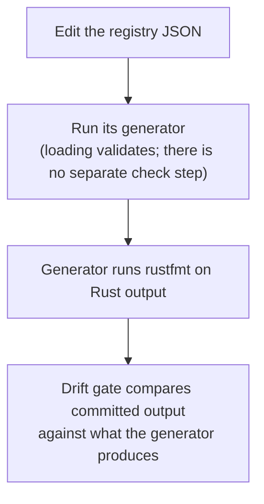

# Spec Workflow

**Status:** Current
**Last updated:** {{git-dates:page}}

How to change `spec/` and leave the repository consistent. For what the fields
MEAN, read [Spec System](../architecture/spec-system.md) first; this page is
the procedure.

Commands below describe the intended workflow. If a command disagrees with
this page, inspect its implementation and the governing contract: either the
documentation or the tool may be wrong. Observed output is not a specification.

## Before and after any spec change

```bash
just spec-status      # what state the spec system is in, derived from the gates
```

Run it before you start, so you know what "unchanged" looks like, and again at
the end. A change that moves the "deferred" or "failing" counts in the
wrong direction is worth a second look.

Before treating deferred examples as implementation work, inspect their live
claim review with `cargo run --manifest-path spec/Cargo.toml --bin spec_status -- --deferred`.
This command exits nonzero and identifies the affected example if a claim is
contradicted or a deferred code is already emitted, using the test gate's admission.
Legal controls and subsumption claims remain regression obligations, not a request
to recreate a diagnostic that no longer applies. Resolve contradicted claims from policy and
source evidence; do not flip registry status merely to reduce the deferred count.

## Adding a construct spec

A construct spec is a VALID fragment plus the tree it must parse to.

**1. Write the file** under the right `spec/constructs/` subdirectory
(`header/`, `main_tier/`, `tiers/`, `utterance/`, `word/`):

````markdown
# my_example

Description of what this example demonstrates.

## Input

```utterance
*CHI:	hello world .
```

## Expected CST

```cst
(utterance
  (main_tier
    ...))
```

## Metadata

- **Level**: utterance
- **Category**: main_tier
````

The fence label (`utterance` here) names a template in `spec/tools/templates/`
that wraps the fragment into a full CHAT file. If no template matches, create
one; the generator fails rather than guessing.

**2. Inspect the real CST, then review the expectation:**

```bash
(cd grammar && tree-sitter parse /path/to/wrapped-example.cha)
```

Parse the complete wrapped document, using the matching template's scaffolding.
Review the relevant subtree against the intended construct before recording its
structure without byte positions or field labels. Do not bless an unexpected
tree simply because the current parser produced it. The `...` above is an
illustrative placeholder, not a complete expected tree.

For fragment specs, the generator currently derives the full-document CST from
its own parse; it does not compare that tree with the authored fragment's
`Expected CST`. Review that correspondence explicitly. Generated test success
alone does not close it; see [Spec System](../architecture/spec-system.md#construct-specs-specconstructs).

**3. Regenerate and verify** (see "Regenerating" below).

## Adding an error spec

An error spec documents a diagnostic rule through examples and claims. Examples
may violate the rule, be legal with respect to that rule, or be rejected by a
reviewed alternative diagnostic. A `legal` claim does not promise that the
entire transcript is valid.

**1. Write the file** in `spec/errors/`, named `E###_<slug>.md`. Everything
declared goes in `+++` TOML frontmatter; the prose goes in the body.

````markdown
+++
code = 'E301'
name = 'Empty speaker code'

[[example]]
source = 'E3xx_main_tier_errors/E301_empty_speaker.cha'
level = 'utterance'
claim = 'violates'
chat = '''
@UTF8
@Begin
@Languages:	eng
@Participants:	CHI Target_Child
@ID:	eng|corpus|CHI|||||Target_Child|||
*:	hello .
@End
'''
+++

## Description

Empty speaker code.
````

A misspelled or unrecognised key is a LOAD ERROR, so you find out from
`just spec-check` rather than from a field that silently did nothing.

**Four things decide whether your spec asserts anything**, and each is easy to
get wrong. They are covered in full in
[Spec System](../architecture/spec-system.md); in short:

- **`claim` is the field that asserts, and it is REQUIRED.** `violates` (the
  spec's code must appear), `legal` (it must not), or `subsumed_by <code(s)>`
  (the targets appear and the spec's code does not). Extra emitted codes still
  pass; the exact per-stage sets are the snapshot's business.
- **There is no `layer` field.** Which stage catches a rule is observed, not
  declared: every example is a fixture whose runner checks both stages, and
  the per-stage record lives in the observation snapshot.
- **`status` and `kind` are NOT yours to declare.** They are facts about the
  CODE, and they live in `spec/codes/error-codes.toml`, one entry per code.
  A spec naming a code that file does not declare does not
  load, and `status = 'not_implemented'` THERE still defers every example of
  that code and `#[ignore]`s its generated tests. Writing either key in a spec
  file is a load error naming the key.
  The separate deferred-spec regression check still verifies explicit `legal`
  and `subsumed_by` claims against the live parser and validator. Deferring
  implementation of a code does not excuse a stale claim about accepted input
  or the alternative diagnostic that rejects it. Planned `violates` examples
  remain deferred; satisfying a subsumption claim does not implement the
  deferred code or change its registry status. There is no default for
  `status`: an invented answer to "is this rule live" is the kind of wrong
  value nothing notices, and a per-file copy of a per-code fact is the kind that
  several files could disagree about.
- **`source`'s stem names the transcript**, which is what rules about the
  file's own name (E531) compare against.

**Write the failing case first.** A new error spec should fail before the rule
exists; that is what proves the fixture actually triggers it.

**A brand-new code is bootstrapped before its consumers compile.** Add the
registry entry, spec and rule, then run `just regen`. Its source-only bootstrap
produces the `ErrorCode` and `DiagnosticKind` sources without linking the model,
so a rule may already reference the new variant. Cargo then rebuilds the runtime
consumers before observing behavior. `just spec-gen` also includes this bootstrap
dependency; `just model-sources-gen` is the narrower recovery command for missing
or broken generated model sources. Neither repairs a bug in the generator itself.

## Regenerating

### Mutation candidates are not golden tests

For source-bound main-tier terminator deletions, use:

```bash
just spec-mutation-candidates corpus/reference/content/terminators-standard.cha
```

This runtime command admits one seed only after diagnostic-free parsing and
alignment-aware validation, including rules about its actual transcript stem.
Warnings also refuse admission. Add `--strict-linkers` to select the optional
cross-utterance rules; admission does not claim validity under unselected rules.
It produces one candidate per present typed main-tier terminator, verifies that
the model's span matches the complete token, and preserves all other bytes.
Missing optional terminators produce no candidate. It never rewrites the model
or guesses a token from line endings.

Output is JSON on stdout, containing the exact seed, transcript identity,
selected linker policy, and each candidate's deleted byte range, removed text,
and resulting CHAT. Every candidate is explicitly unreviewed, with no expected
diagnostic. No output files are created by the command. Seed or span rejection
occurs before candidate output; stdout I/O can still fail partway through a
write. Retain the seed record when saving candidates so provenance does not
depend on an input path continuing to hold the same bytes.

The API lives in `spec-runtime-tools::mutation`, where live parser/model
dependencies belong. `AdmittedSeed` privately owns its model and borrows its
immutable source; candidates can only be constructed from that model's checked
spans. This is AST-source association, not an assertion that the generated CST
API has already migrated every mutation family. Only terminator deletion is
implemented here; the legacy mutators below are not migrated.

`just spec-perturb` produces **unreviewed candidates**, not diagnostic oracles.
Its JSON records have `assessment: "unreviewed"` and no `expected_error` field.
The removed diagnostic table had drifted from canonical rules; a mutation's
name cannot establish which diagnostics a particular input should produce.

The legacy text mutators do not admit a valid seed through the parser/model.
They can affect continuation lines, normalize final newlines, select a speaker
code already declared by a seed, or introduce multiple defects. Do not use
their outputs directly as goldens or treat a syntax-error census as validity.
Before running them, review output-name collisions and the intended input scope.

Candidate output has an explicit planning phase: duplicate destinations
and existing output paths are refused before candidate writes begin. Execution
uses exclusive file creation as well, so a file created after preflight cannot
be overwritten. This protects output, not seed validity. A mid-run I/O failure
may leave earlier newly created candidates; preserve and review them rather
than assuming the batch was atomic or automatically deleting them. The legacy
`--mine` summary path is separate and is not covered by this candidate contract.

For promotion, retain the valid control, describe the precise mutation and its
source relationship, justify a claim from the specification or a recorded
ruling, then add the reviewed example to `spec/errors/` and regenerate through
the normal owner. Review observations separately from expectations. A changed
parser output is evidence to adjudicate, not permission to rewrite the claim.

### Generate owned artifacts

One command, from anywhere in the checkout:

```bash
just spec-gen      # rewrite every generated artifact from the specs
just spec-check    # or ask whether the committed copies are current
```

It first generates model sources without linking the model, then builds the
runtime generator against those sources. Runtime generation starts with the
observation snapshot, since the tree-sitter corpus derives its membership from
it. The runtime writer refuses stale bootstrap inputs rather than rewriting
source code already compiled into its process. The generated artifact
table included in the
[spec-system chapter](../architecture/spec-system.md) is the live list. There is nothing to choose and no path to type:
every destination is a constant in `spec/tools/src/artifacts.rs`, so a
generator cannot be aimed at the wrong tree.

`just spec-check` writes nothing and is exactly what the
`every_generated_artifact_is_current` check runs. Success establishes artifact
currency, not that behavioral tests or the complete publication gate pass.

The published error-reference pages under `docs/errors/` are part of
`spec-gen` like every other artifact, and `spec-check` gates them.

Never hand-edit generated artifacts. A whole-directory owner retains unchanged
files and prunes obsolete ones through `GeneratedDir`; it does not wipe the
directory on every run. Admission requires the `.generated-output-dir` marker
and refuses conflicting human ownership and linked entries. Keep authored
examples outside generated destinations.

## Verifying

```bash
just spec-status                                  # the derived summary
cargo test --manifest-path spec/Cargo.toml --workspace   # every spec-side gate
just test                                         # the main workspace
```

If your change touched the grammar, follow the full
[Grammar Workflow](grammar-workflow.md) as well: a
`grammar.js` edit needs `tree-sitter generate` before any parser behaviour can
be trusted.

## Updating a registry

Two closed vocabularies live under `spec/`, each generating every site that
names it. Neither is edited anywhere but its registry.

```bash
just symbols-gen        # spec/symbols/symbol_registry.json
just form-markers-gen   # spec/form_markers/form_marker_registry.json
```



The generators format their own Rust output deliberately: otherwise `just fmt`
and the generator each rewrite the same bytes and the drift gate fails forever,
with both sides correct.

Each registry's README covers its authorities and the follow-ups its generator
cannot do:
[`spec/symbols/README.md`](https://github.com/TalkBank/chatter/blob/main/spec/symbols/README.md),
[`spec/form_markers/README.md`](https://github.com/TalkBank/chatter/blob/main/spec/form_markers/README.md).

## Common mistakes

- **Editing generated files.** Change the spec or the registry, then regenerate.
- **Choosing a claim merely to match observed output.** `claim` is required,
  but each claim needs a rule or reviewed ruling. If the intended claim fails,
  investigate the implementation or fixture; do not relabel it `legal` or
  `subsumed_by` just to make it pass.
- **Flipping `status` to `implemented` without regenerating.** The fixture
  manifest still carries the old status, so the runner keeps skipping what you
  just enabled.
- **Regenerating reflexively.** Regeneration is for artifacts that genuinely
  changed, not a substitute for deciding what the change needs.
